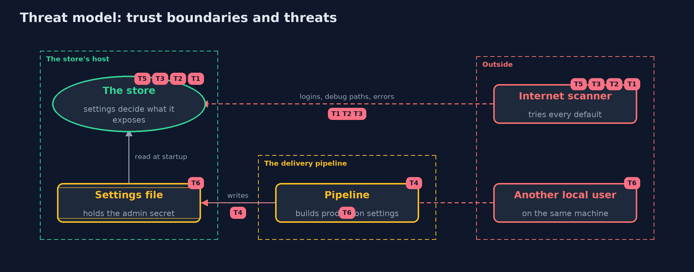

# Threat Model — Security Misconfiguration

A threat model answers four questions: what are we protecting, who or what could harm it, how, and what do we do about it. This one covers this project's own demo system, not a production deployment. Domain: an online store.

## Scope

The settings of an online store: the profile it runs with, its admin secret, its debugging switches, its error pages, its banners and methods, and the file that holds them. It covers
internet scanners, other users on the store's host, and a delivery pipeline that builds production settings. It does not cover the operating system, TLS or the application's code.

## What we protect (assets)

- The admin account and its password.
- The store's configuration and internal details: classes, paths, versions.
- Files in the static folder that were never meant to be public, such as a backup of orders.
- The production settings file.

## Who and what acts on the system

- Automated internet scanners that try every default.
- Another user on the same machine.
- The delivery pipeline and the people who edit settings files.

## Trust boundaries

A trust boundary is a line that data or a request crosses between parts that trust each other differently. Threats cluster where those lines are.

- Internet to the store: every request crosses it.
- Settings file to the other users of the host: file permissions are the guard.
- Development to production: the pipeline that copies and edits settings.

Each dashed box is a trust boundary. A rose tag such as T1 shows where the threat of that number, in the table below, applies.

## Threats, using STRIDE

STRIDE is a checklist of six kinds of threat: **Spoofing** (S), **Tampering** (T), **Repudiation** (R), **Information disclosure** (I), **Denial of service** (D), **Elevation of privilege** (E).

| Id | Kind | Threat | Where it shows up | Control in this project | What is left |
| --- | --- | --- | --- | --- | --- |
| T1 | Spoofing | Someone logs in as admin with the default password | `StoreServer` admin login | The startup gate refuses an empty, short or known default admin password in production | A strong password can still leak: the admin console should also be unreachable from the internet and use a second factor |
| T2 | Information disclosure | A debug page reveals the configuration and its secrets | `/debug/config` | Off in the hardened profile, refused by the gate in production, and checked from outside | Other diagnostic endpoints added later need the same treatment |
| T3 | Information disclosure | A directory listing or a detailed error page reveals files and internals | `/static/`, error pages | No listing; errors show a reference only, with details in the logs | Files that should not be public must not be in the static folder at all |
| T4 | Tampering | Development settings drift into production | `ProfileDrift`, the pipeline | The drift check fails the deployment, and the gate refuses to start | The check knows only the settings in its baseline; new settings are flagged for review, not judged |
| T5 | Information disclosure | Banners and methods tell an attacker what the store runs and echo requests | Server header, TRACE | No product or version in headers; TRACE and unknown methods refused | Products can still be fingerprinted in other ways, so patching matters more than hiding |
| T6 | Information disclosure | Another user on the host reads the settings file and its secret | `ConfigFile` | The settings file is readable by its owner only | Secrets are better injected from a secrets manager than kept in a file at all |

## Assumptions

- The production secret is injected at deployment and is long and random; in the demo it is a fixed demo value that is never printed.
- The store's host is maintained; operating system hardening is out of scope.
- The checker's eight checks are a baseline, not a complete audit.

## Out of scope

- Framework settings such as Spring Boot's actuator: the tools version.
- Operating system and container hardening.
- TLS configuration.

## How the tests check this

- `StoreAndCheckerTest` checks that the shipped store fails all eight checks and the hardened store passes them, and each leak on its own.
- `GateAndDriftTest` checks the startup gate, the drift check, settings parsing, password comparison and file permissions.
- `DemoRunsTest` compares the whole demo with the golden output.

## Where this model goes next

The next project, fail-closed-error-handling, looks at what happens when something goes wrong at run time: errors that leak, and checks that fail open.
