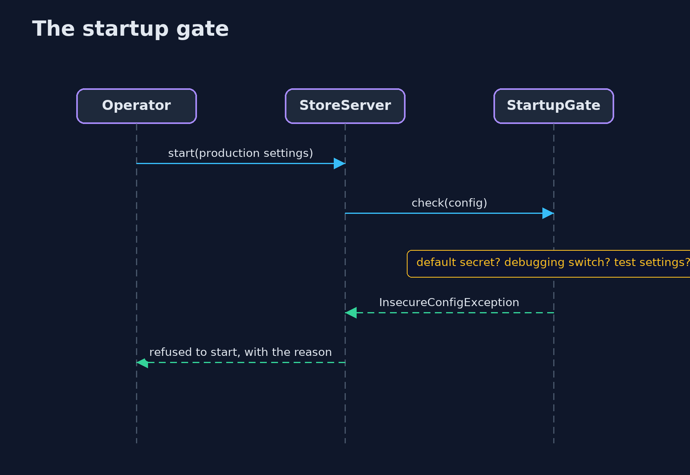
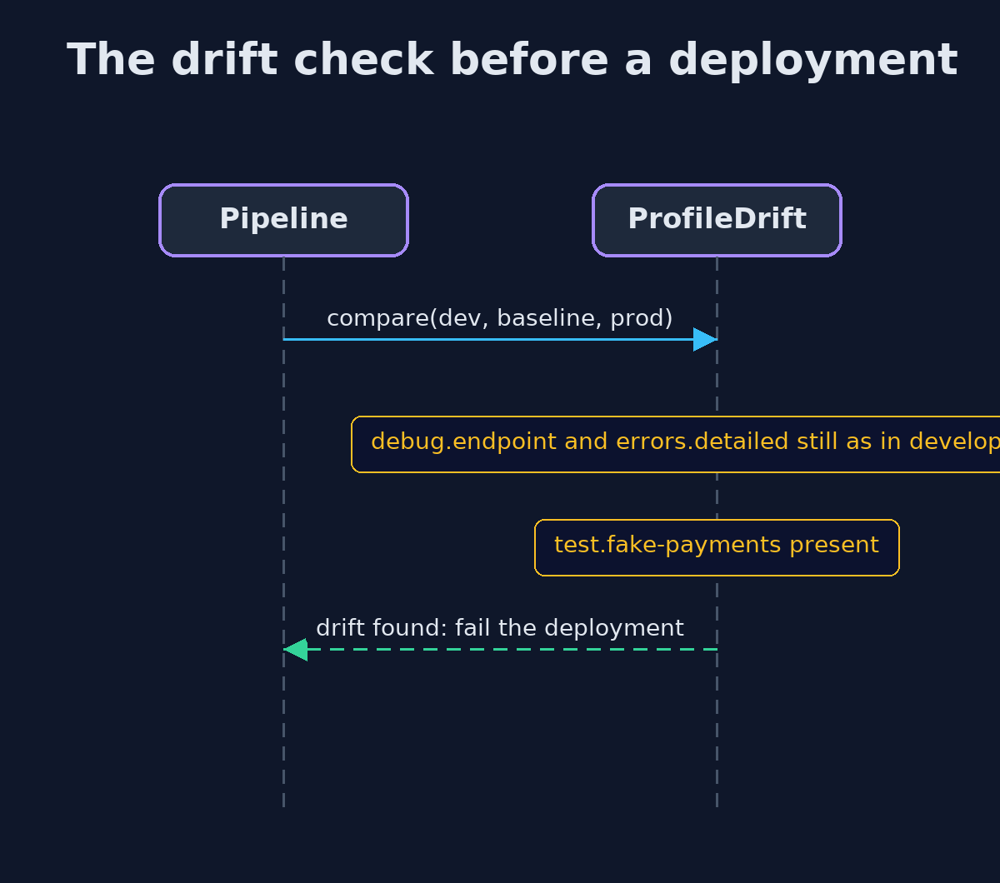

# Security Misconfiguration — UML Sequence Diagrams

## 1. The startup gate

In production, the settings are judged before the port opens.

## 2. The drift check before a deployment

Production is compared with development and with the baseline.

