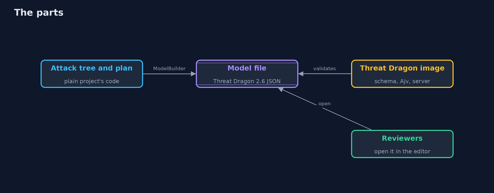
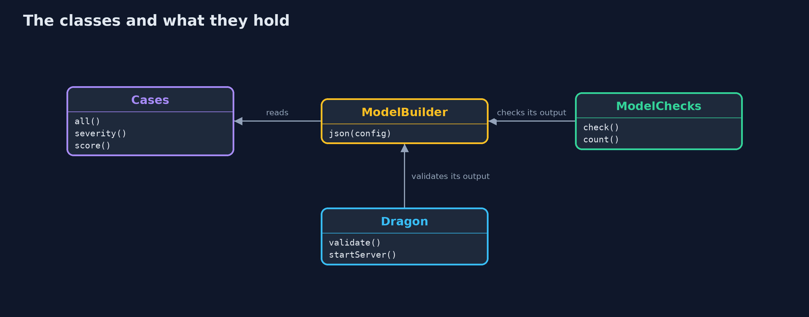

# Attack Trees and Abuse Cases in Threat Dragon

```
src/main/java/com/jk/explore/security/dragonmodel/
├── AbuseCase.java         "As an attacker I want to ..., so that ...": an abuse case written as a check against the bank system
├── Analysis.java          What a tree says about an attacker: the cheapest way to reach the goal (its cost and its steps), and the chance that some way succeeds
├── BankConfig.java        The properties of the bank system that the abuse cases test
├── BankTree.java          The attack tree for "move money out of Ana's account" at the online bank, as it is before any of the defences below
├── Cases.java             For each abuse case: where in the bank's diagram it lands, what kind of threat it is in STRIDE terms, which defences answer it, and what it costs the attacker according to the tree
├── Defence.java           A defence the bank could buy: what it costs, and what it does to the leaves of the tree (a factor for the attacker's cost and one for the chance of success; a probability factor of 0 removes the step)
├── Dragon.java            The real OWASP Threat Dragon image: its own validator for model files, and its own server and editor
├── ModelBuilder.java      The bank's threat model as an OWASP Threat Dragon 2.x file: a diagram of actors, processes, a store, flows and two trust boundaries, and one threat for each abuse case, attached to the element or flow it hits, with a status (Open or Mitigated), a severity from the attack tree, the abuse case as its description and the defence as its mitigation
├── ModelChecks.java       Checks of the model file itself, that the editor's schema does not make: the threats are complete and consistent, and the flags, numbers and links agree with each other
├── Node.java              A node of an attack tree: either a leaf (one step an attacker takes) or a gate (OR: any child will do; AND: every child is needed)
├── Planner.java           Chooses defences by what they do to the tree: at each step, the one that most raises the cheapest attack
├── Sh.java                Runs a program and returns what it printed
└── ThreatDragonDemo.java  The configurations after 0, 1, 2 
```

**A Java program writes the bank's eight abuse cases from the attack tree as an OWASP Threat Dragon 2.6 model (13 cells, 8 threats with a STRIDE type, a severity from the tree's cost and chance, and a status); the editor's own schema and Ajv, taken from the real image, validate it and refuse four ways of breaking it; the plan of the plain project takes the open threats from 8 to 2 in the file, in step with the failing abuse cases; checks the schema cannot make find a mitigated threat with no defence, a stale flag, a lost flow end and a wrong threat count; but the model is flat threats, the tree's AND and OR have no place in it, and nothing in it is a test.**

The plain [attack-trees-and-abuse-cases](../attack-trees-and-abuse-cases) project prices the attacker's steps in a tree, plans defences, and keeps abuse cases as failing tests. This one puts the same bank in **OWASP Threat Dragon 2.6**, the project's own threat-modeling tool, as a model file: a diagram with trust boundaries, actors, processes, a store and flows, and the eight abuse cases as threats. It uses the real `owasp/threat-dragon` image for two things, its **own validator** (the model schema in the editor's bundle and the Ajv the image ships) and its **server**. It needs Docker; the tests are tagged `integration` (the model tests are not): `./gradlew integrationTest`.

What it shows:
- **The tree as a model.** 13 cells (2 trust boundaries, 2 actors, 3 processes, 1 store, 5 flows) and 8 threats, one for each abuse case, placed on the element or flow it hits (sign-in, the text-message code, the web app, the transfer API, the transfer request, the approval console), typed in STRIDE terms, with a severity and a score from the tree's cost and chance (AC5 changing the account number: High, 50 EUR, 90%).
- **Checked by Threat Dragon's validator.** The bank's file is valid; four breakages (no title, a diagram type that is too short, a cell with no id, a shape that is too small) are each refused with the editor's own message, so a generated file is checked before anyone opens it.
- **The plan, in the file.** OWN, CSRF, PASSKEY, CSP: the open threats go 8, 7, 6, 3, 2, in step with the abuse cases failing. The two left are the insider and the library flaw, as in the plain project. Every file is valid.
- **Checks the schema cannot make.** A mitigated threat that names no defence, a stale `hasOpenThreats` flag, a flow that ends at a missing cell and a wrong `threatTop` are each found by a rule of its own.
- **The editor.** The image's server starts with generated keys on a loopback port; it offers only a local session, and its model API answers 401 without signing in. The model is opened in the browser from a file.

**Maps to:** OWASP Top 10 (2025) A06 Insecure Design · NIST SSDF PW.1 · OWASP Threat Dragon model schema 2.x · STRIDE.

## The idea in everyday terms

A floor plan with sticky notes. The tree is the burglar's route written on a long sheet of paper; the model file pins each note to the door, window or corridor it concerns, so that the people who walk the building see the risks where they are.

## The scenario

The online bank and Ana's account. The demo takes the abuse cases of the attack tree, builds the diagram and the threats, validates the file, and applies the plan of defences to it.

## Run

```bash
./gradlew run
```

The demo tells the story in 5 acts, each printing exact numbers that the tests check:

| Act | What it shows |
| --- | --- |
| 1. The tree, as a Threat Dragon model | Thirteen cells and eight threats, one for each abuse case, with a STRIDE type and a severity from the tree's cost and chance. |
| 2. Checked by Threat Dragon's own validator | The image's schema and Ajv accept the bank's file and refuse four ways of breaking it, each with the editor's own message. |
| 3. The plan, step by step, in the file | OWN, CSRF, PASSKEY and CSP take the open threats from 8 to 2, in step with the failing abuse cases, and every file stays valid. |
| 4. Checks the schema cannot make | A mitigated threat with no defence, a stale flag, a lost flow end and a wrong count are each found by a rule of their own. |
| 5. The editor, and the bill | The image's server starts on a loopback port with a local session only; threats are flat, and nothing in the file is a test. |

## Test

```bash
./gradlew test
```

12 tests in `DemoRunsTest`, `DragonTest`, `ModelTest`. The model, its rules and the tree are tested with no Docker. The validator and the server tests run the owasp/threat-dragon image (./gradlew integrationTest).

## What the simulation got right, and what it left out

The model file is written by the program with stable identifiers, so it diffs cleanly. The validator is the real one from the real image, run in a container; the server is the real server, started with generated keys. Ports, container names and keys are never printed; the demo takes about half a minute.

## Technologies and versions

Every version below is pinned in the project's build files and was the latest stable release when the project was built.

| Technology | Version | Used for |
| --- | --- | --- |
| Java | 25 | the language and runtime; a Gradle toolchain finds or downloads the JDK |
| Gradle | 9.8.1 (wrapper) | build and run; nothing to install, the wrapper downloads it |
| tools.jackson.core:jackson-databind | 3.1.5 | library the code uses |
| org.junit.jupiter:junit-jupiter | 6.1.3, set by junit-bom | JUnit 5: the tests (tests only) |
| org.junit.platform:junit-platform-launcher | 6.1.3, set by junit-bom | JUnit platform launcher, which Gradle needs to run the tests (tests only) |
| videokit | repository tool (`tools/videokit`) | the narrated video and animation: Piper `en_US-amy-medium`, speed 0.8, longer pauses (the amy-slow voice) |

## Learning Material

| Document | What it is for |
| --- | --- |
| [Problem statement](docs/problem-statement.md) | the situation and what the project must show |
| [Prerequisites](docs/prerequisites.md) | what you need to know first |
| [Attack Trees and Abuse Cases in Threat Dragon, explained](docs/attack-trees-and-abuse-cases-with-threat-dragon-explained.md) | the acts in prose |
| [Session guide](docs/session.md) | a one-hour lesson with exercises |
| [Animated walkthrough](docs/animation.html) | the acts step by step, narrated |
| [Threat model](docs/threat-model.md) | what is protected, who could harm it, and how, using STRIDE |
| [Spec](docs/spec.md) | what this project must be true of |
| [Expected output](docs/expected-output.txt) | the golden demo output every test and every port checks against |

### The idea in one picture

The tree and the plan make the file; the image checks it; people open it.



### Where each piece sits

The tree side, the model side and the image side.



### How the data moves

A place, a type, a severity and a status.


### Who calls whom, in order


### Video

`video/attack-trees-and-abuse-cases-with-threat-dragon-explained.mp4` (with `.m4a` audio and `.srt` subtitles) is built by `video/build_video.sh`. Rendered media is not committed.

## What it costs

- **A flat model loses the tree:** the AND and OR gates and the arithmetic stay elsewhere.
- **Status is a claim in a file:** only a test says it is true.
- **A file edited by hand and by program can drift:** it needs checks of its own.
- **Layout is data too:** positions and sizes must be sensible for the picture to be useful.
- **The editor needs a login provider** for anything beyond a local session.

## When this is too much

A one-page design with three threats can live as a list in the pull request. Use a model file when the diagram is the point: boundaries, flows and the threats that sit on them, reviewed by several people.

## Where you have already met this

- A threat model JSON file in a repository.
- A diagram with red numbers on the flows.
- A status column with Open, Mitigated and N/A.
- A "Report" button in a threat modeling tool.

## Where this sits

This is the tools version of [attack-trees-and-abuse-cases](../attack-trees-and-abuse-cases), in the [secure-design](..) module, after [threat-modeling-with-pytm](../threat-modeling-with-pytm), which asked the same bank 113 questions.
