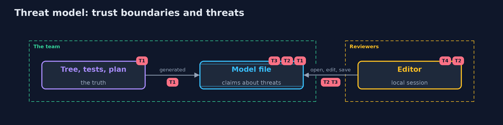

# Threat Model — Attack Trees and Abuse Cases in Threat Dragon

A threat model answers four questions: what are we protecting, who or what could harm it, how, and what do we do about it. This one covers this project's own demo system, not a production deployment. Domain: a bank.

## Scope

The threat model file of the bank as a record of threats and their status, how it is produced, checked and opened. It does not cover the bank's code or the security of the editor beyond how it is started here.

## What we protect (assets)

- The accuracy of the status of each threat.
- The model file as the thing reviewers rely on.

## Who and what acts on the system

- A reviewer who opens the file in the editor.
- A developer who edits it by hand.

## Trust boundaries

A trust boundary is a line that data or a request crosses between parts that trust each other differently. Threats cluster where those lines are.

- The file and the code: a status is only as true as the tests behind it.

Each dashed box is a trust boundary. A rose tag such as T1 shows where the threat of that number, in the table below, applies.

## Threats, using STRIDE

STRIDE is a checklist of six kinds of threat: **Spoofing** (S), **Tampering** (T), **Repudiation** (R), **Information disclosure** (I), **Denial of service** (D), **Elevation of privilege** (E).

| Id | Kind | Threat | Where it shows up | Control in this project | What is left |
| --- | --- | --- | --- | --- | --- |
| T1 | Tampering | A threat is marked Mitigated while the defence is missing | the model file's status | Generate the status from the configuration the abuse cases test | A defence that is configured and not working |
| T2 | Tampering | The file is edited by hand and drifts from the code | the model file | Rules over the file, checked in the build | Edits that satisfy every rule and are still wrong |
| T3 | Repudiation | A change of status has no record of who and why | the file in the repository | Version control and review of the diff | Reviews that approve without reading |
| T4 | Information disclosure | The editor is exposed with a weak login | the editor's server | A local session on loopback only, generated keys | A server exposed beyond the machine |

## Assumptions

- The file is kept in version control and changes are reviewed.
- The abuse cases run in the build.

## Out of scope

- Securing the editor's login providers.
- The bank's own code.

## How the tests check this

- `ModelTest` checks the tree, the severity, the model's fields, its stability, the plan's files and each rule with no Docker.
- `DragonTest` runs the image's validator on every file of the plan and on the broken ones, and starts its server.
- `DemoRunsTest` compares the whole demo with the golden output.

## Where this model goes next

The next module is the advanced track, which is planned.
