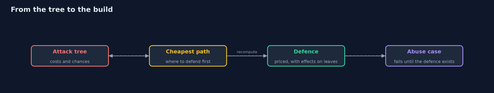
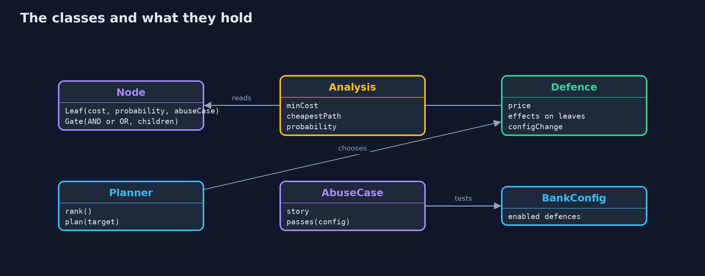

# Attack Trees and Abuse Cases

```
src/main/java/com/jk/explore/security/attacktree/
├── AbuseCase.java       "As an attacker I want to ..., so that ...": an abuse case written as a check against the bank system
├── Analysis.java        What a tree says about an attacker: the cheapest way to reach the goal (its cost and its steps), and the chance that some way succeeds
├── AttackTreeDemo.java  Runs the attack tree story in five numbered acts and prints exact, repeatable results
├── BankConfig.java      The properties of the bank system that the abuse cases test
├── BankTree.java        The attack tree for "move money out of Ana's account" at the online bank, as it is before any of the defences below
├── Defence.java         A defence the bank could buy: what it costs, and what it does to the leaves of the tree (a factor for the attacker's cost and one for the chance of success; a probability factor of 0 removes the step)
├── Node.java            A node of an attack tree: either a leaf (one step an attacker takes) or a gate (OR: any child will do; AND: every child is needed)
└── Planner.java         Chooses defences by what they do to the tree: at each step, the one that most raises the cheapest attack
```

**An attack tree lays out every way an attacker can reach one goal, with a cost and a chance on each step; it shows which defence cuts the cheapest path, why one defence is never enough, and, with abuse cases written as failing tests, turns each step into something the build can check.**

A threat model lists what can go wrong. An **attack tree** answers a sharper question: *by which ways can an attacker reach this one goal, and which is the cheapest?* The goal is the root ("move money out of Ana's account"). Below it are the ways in. An **OR** gate means any child is enough; an **AND** gate means every
child is needed. The leaves are single steps, each with a **cost to the attacker** and a **chance that it works** against the system as it is.

From those numbers the tree computes two things: the **cheapest path** (costs add along AND, the cheapest wins at OR) and the **chance that some path succeeds** (probabilities multiply along AND and combine at OR). In this bank's tree the cheapest path costs 50 EUR: change the account number in the transfer request.
That is a missing ownership check, and no password policy or one-time code would have mattered.

The project then does the thing that makes trees useful in practice:
- **Price the defences** (ownership check, CSRF tokens, breached-password check, app-based one-time codes, passkeys, a strict content security policy, fast patching, dual control) and see what each one does to the tree on its own: no single one fixes it.
- **Cut the cheapest path, then look again.** After the ownership check, the cheapest path moves to leaked-password reuse and CSRF at 100 EUR; after passkeys, to a script injection at 2,000 EUR; after a content security policy, to a software flaw at 6,000 EUR. Each round shows the next weakest door.
- **Write abuse cases as tests.** "As Mallory I transfer from Ana's account by changing the account number" is a check that *fails* on the weak bank and passes when the ownership check exists. Eight abuse cases cover thirteen of the tree's fourteen steps.

**Maps to:** OWASP Top 10 (2025) A06 Insecure Design · OWASP ASVS 5.0, V1 architecture and design requirements · Bruce Schneier, *Attack Trees* (1999) · NIST SSDF PW.1 (design software to meet security requirements) · OWASP Threat Modeling.

## The idea in everyday terms

A burglar's map of a house, drawn from their side: the front door (a strong lock), the back window (latched with a butter knife), the garage (open), the neighbour with a spare key. The cheapest way in is not the front door. Fixing the window moves the cheapest way to the garage; the map is only done when the cheapest way is expensive.

## The scenario

The online bank, one goal and fourteen attacker steps, eight defences with prices, and eight abuse cases that run against a model of the bank's configuration. All numbers are teaching estimates, chosen so that the lesson is visible; a real tree uses the team's own estimates and argues about them.

## Run

```bash
./gradlew run
```

The demo tells the story in 5 acts, each printing exact numbers that the tests check:

| Act | What it shows |
| --- | --- |
| 1. The tree | One goal, 14 attacker steps in four branches: log in as Ana, abuse the transfer call, bribe an employee, or break in through the software. |
| 2. What the tree says about the attacker | The cheapest way in costs 50 EUR (change the account number), and the chance that some way works is 97%. |
| 3. Each defence on its own | The ownership check raises the cheapest path from 50 to 100 EUR for 2,000 EUR; no other defence alone moves it, and the passkey, the most expensive, leaves it at 50. |
| 4. A plan: always cut the cheapest path, then look again | Ownership check (2,000 EUR) → 100 EUR; CSRF tokens (5,000 EUR in all) → still 100 EUR via the leaked-password path; passkeys (45,000 EUR) → 2,000 EUR via a script injection; a strict CSP (55,000 EUR) → 6,000 EUR via the software. |
| 5. Abuse cases as tests | All 8 abuse cases fail on the bank as it is; after the plan 2 still fail (the insider and the unpatched library); 13 of the tree's 14 steps have an executable abuse case. |

## Test

```bash
./gradlew test
```

13 tests in `AttackTreeTest`, `DemoRunsTest`. Everything is fixed data, so the demo prints the same text on every run.

## What the simulation got right, and what it left out

The tree is a small Java data structure; the analysis is exact arithmetic over it. The abuse cases run against a model of the bank's configuration (a set of switched-on defences), not against a running bank: each is a predicate that is false until the defence exists. That is enough to show the loop between the tree, the defence and the test.

## Technologies and versions

Every version below is pinned in the project's build files and was the latest stable release when the project was built.

| Technology | Version | Used for |
| --- | --- | --- |
| Java | 25 | the language and runtime; a Gradle toolchain finds or downloads the JDK |
| Gradle | 9.8.1 (wrapper) | build and run; nothing to install, the wrapper downloads it |
| org.junit.jupiter:junit-jupiter | 6.1.3, set by junit-bom | JUnit 5: the tests (tests only) |
| org.junit.platform:junit-platform-launcher | 6.1.3, set by junit-bom | JUnit platform launcher, which Gradle needs to run the tests (tests only) |
| videokit | repository tool (`tools/videokit`) | the narrated video and animation: Piper `en_US-amy-medium`, speed 0.8, longer pauses (the amy-slow voice) |

## Learning Material

| Document | What it is for |
| --- | --- |
| [Problem statement](docs/problem-statement.md) | the situation and what the project must show |
| [Prerequisites](docs/prerequisites.md) | what you need to know first |
| [Attack Trees and Abuse Cases, explained](docs/attack-trees-and-abuse-cases-explained.md) | the acts in prose |
| [Session guide](docs/session.md) | a one-hour lesson with exercises |
| [Animated walkthrough](docs/animation.html) | the acts step by step, narrated |
| [Threat model](docs/threat-model.md) | what is protected, who could harm it, and how, using STRIDE |
| [Spec](docs/spec.md) | what this project must be true of |
| [Expected output](docs/expected-output.txt) | the golden demo output every test and every port checks against |

### The idea in one picture

The tree finds the weak point, the plan buys a defence, the abuse case proves it, and then the tree is recomputed.



### Where each piece sits

A tree is leaves and gates; an analysis reads it; a defence rewrites its leaves.



### How the data moves

Each round exposes the next weakest door.


### Who calls whom, in order


### Video

`video/attack-trees-and-abuse-cases-explained.mp4` (with `.m4a` audio and `.srt` subtitles) is built by `video/build_video.sh`. Rendered media is not committed.

## What it costs

- **The numbers are guesses,** and a tree is only as good as the argument about them. Their value is that they make the argument explicit; check them against incidents and red-team results.
- **Independence is assumed.** The same weakness (a reused password) can feed several branches, which a tree with shared leaves would show; the probabilities here are a first approximation.
- **Trees grow fast.** Keep one tree per goal and prune branches that no attacker in your threat model would take.
- **Greedy plans are not optimal.** Choosing the defence that most raises the cheapest path is easy to explain; with budgets and overlaps a search can find a cheaper set.
- **Abuse cases test the design, not the attacker.** A passing abuse case shows that this abuse is refused, not that no abuse exists.

## When this is too much

For a small system a checklist and a conversation are enough; reach for a tree when the goal is valuable, the paths are many and you need to decide where to spend. Do not draw trees for goals nobody would attack.

## Where you have already met this

- Attack trees in threat modeling books and in the automotive and safety-critical industries.
- Misuse cases and evil user stories in agile security practice.
- "As an attacker I want to..." stories in a backlog.
- OWASP SAMM threat assessment and the STRIDE method.

## Where this sits

This project is in [secure-design](..) and follows [threat-modeling](../threat-modeling) (what can go wrong) and [security-requirements-with-asvs](../security-requirements-with-asvs) (what the system must do about it). Its steps point at projects in this track: access control, CSRF, passkeys, XSS, dependency updates.
