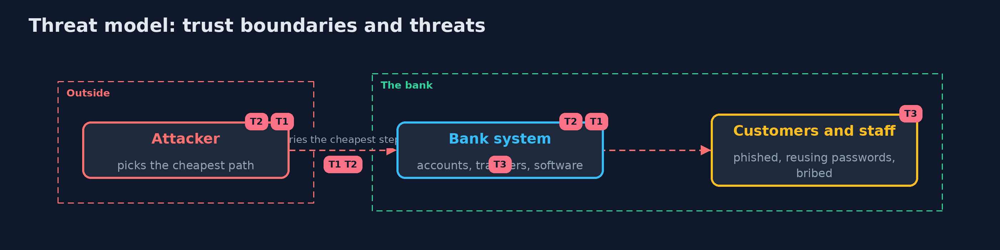

# Threat Model — Attack Trees and Abuse Cases

A threat model answers four questions: what are we protecting, who or what could harm it, how, and what do we do about it. This one covers this project's own demo system, not a production deployment. Domain: an online bank.

## Scope

The analysis of how an attacker could move money out of a customer's account, and the choice of defences. It covers the structure of the tree, its numbers and the plan.
It does not cover the quality of the estimates, or attackers whose goals are different (denial of service, data theft).

## What we protect (assets)

- Customers' balances.
- The bank's budget and attention.

## Who and what acts on the system

- A rational attacker who takes the cheapest path.
- The team that estimates the numbers and plans the defences.

## Trust boundaries

A trust boundary is a line that data or a request crosses between parts that trust each other differently. Threats cluster where those lines are.

- The tree to reality: the numbers are estimates.

Each dashed box is a trust boundary. A rose tag such as T1 shows where the threat of that number, in the table below, applies.

## Threats, using STRIDE

STRIDE is a checklist of six kinds of threat: **Spoofing** (S), **Tampering** (T), **Repudiation** (R), **Information disclosure** (I), **Denial of service** (D), **Elevation of privilege** (E).

| Id | Kind | Threat | Where it shows up | Control in this project | What is left |
| --- | --- | --- | --- | --- | --- |
| T1 | Tampering | A request is changed to touch another customer's account, or forged from another site | Tree leaves B1, B2a, B2b | Ownership check on every transfer; form tokens and SameSite cookies | Other endpoints that miss the same check; abuse cases for each |
| T2 | Spoofing | A password or session is stolen, guessed or reused | Tree leaves A1a to A4b | Passkeys, breached-password checks, strict CSP and HttpOnly cookies | Social engineering of the recovery process |
| T3 | Elevation of privilege | An employee is bribed, or an unpatched library is exploited | Tree leaves C, D1, D2 | Dual control for operations; patching within a week; segmentation | The most expensive steps remain, and are the next to price |

## Assumptions

- Steps are independent, and the attacker is cost-driven.
- A defence has the effect stated for it.

## Out of scope

- Detection and response: detecting-attacks and incident-response.
- Attackers with unlimited budgets.

## How the tests check this

- `AttackTreeTest` checks the gate arithmetic and blocked branches, the baseline numbers, each branch, the effect of defences, the ranking, the exact plan and its costs, and the abuse cases against the weak and the fully defended bank.
- `DemoRunsTest` compares the whole demo with the golden output.

## Where this model goes next

The next project in this module is the threat-modeling-with-pytm version, which draws the same model with a tool; the plan continues in the advanced track with secure architecture patterns.
