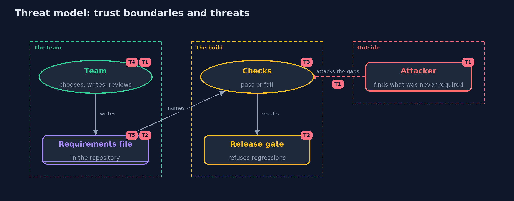

# Threat Model — Security Requirements with OWASP ASVS

A threat model answers four questions: what are we protecting, who or what could harm it, how, and what do we do about it. This one covers this project's own demo system, not a production deployment. Domain: an online store.

## Scope

The requirements practice itself: the chosen level, the requirements file in the repository, the checks, the coverage report and the release gate. It does not cover the store's own threats, which the checks are about.

## What we protect (assets)

- The requirements file, which says what the store promises.
- The checks and the gate, which stand between a regression and a release.
- The coverage report, which partners and auditors rely on.

## Who and what acts on the system

- The team, who choose the level and write and review the requirements.
- A partner or auditor, who reads the report.
- An attacker, who finds what was never required.

## Trust boundaries

A trust boundary is a line that data or a request crosses between parts that trust each other differently. Threats cluster where those lines are.

- The standard to the team's file: paraphrases can drift from what the standard means.
- The report to its readers: a green report can be read as more than it says.

Each dashed box is a trust boundary. A rose tag such as T1 shows where the threat of that number, in the table below, applies.

## Threats, using STRIDE

STRIDE is a checklist of six kinds of threat: **Spoofing** (S), **Tampering** (T), **Repudiation** (R), **Information disclosure** (I), **Denial of service** (D), **Elevation of privilege** (E).

| Id | Kind | Threat | Where it shows up | Control in this project | What is left |
| --- | --- | --- | --- | --- | --- |
| T1 | Information disclosure | A threat that no requirement covers goes unchecked, because the standard was treated as the whole list | `Catalogue` | The threat model comes first, and its mitigations are added as requirements | Threats nobody has thought of are still not covered |
| T2 | Tampering | A requirement is weakened or deleted from the file so that a failing check no longer blocks the release | `RequirementsFile`, the release gate | The file lives in the repository and changes to it are reviewed like code | A reviewer who approves without reading still lets it through |
| T3 | Spoofing | A check passes for the wrong reason, so a requirement looks met when it is not | `Checks` | Every check has a test that makes it fail, such as the fast-hash and debug builds | A check can only be as good as the question it asks |
| T4 | Repudiation | Nobody can say why the level was chosen, so it is lowered under deadline pressure | `LevelChooser` | The level is chosen by a model that records its reasons | The model is a simplification; the team still owns the decision |
| T5 | Information disclosure | The mapping ages when the standard is revised, and requirements point at chapters that have moved | `Requirement.edition` | Every requirement records its edition, and old editions are flagged for review | A paraphrase can still drift from what the standard means |

## Assumptions

- The checks run in the build, and a failing check blocks a release.
- Manual requirements are reviewed by someone who knows the system.
- In the demo, the store, the requirements and the profiles are illustrative.

## Out of scope

- The store's threats: the threat-modeling project.
- Certification and formal audit.

## How the tests check this

- `LevelAndRequirementsTest` checks the level model, unique ids, known checks, and the requirements file and its refusals.
- `ChecksAndAssessmentTest` checks every check on the store, the regression, the counts at each level and the chapter report.
- `DemoRunsTest` compares the whole demo with the golden output.

## Where this model goes next

The next project, attack-trees-and-abuse-cases, takes one threat and breaks it into the attacker's steps, to find which defence cuts the cheapest path.
