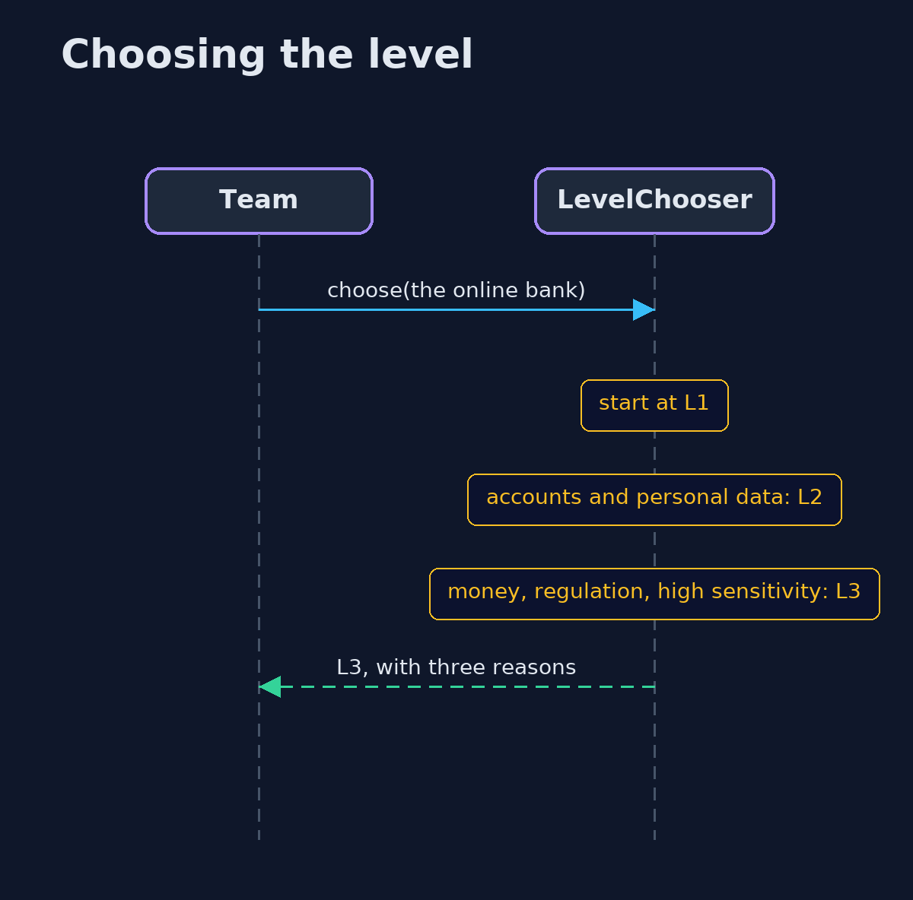
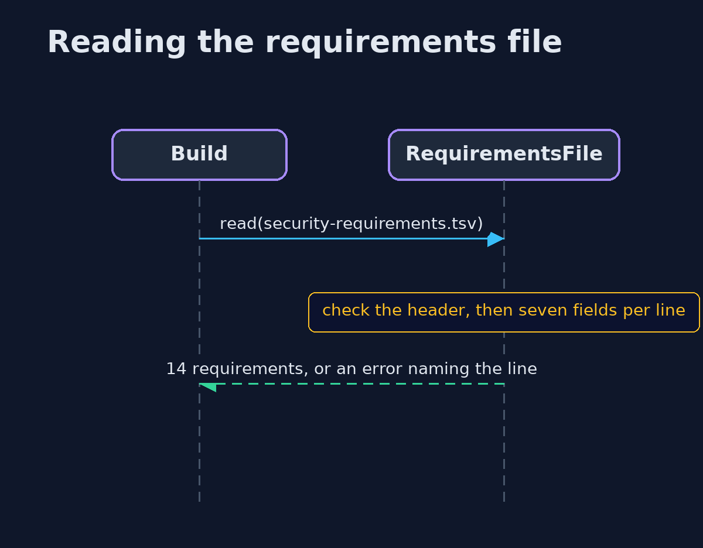

# Security Requirements with OWASP ASVS — UML Sequence Diagrams

## 1. Choosing the level

Each rule can only raise the level, and each raise leaves a reason.

## 2. Reading the requirements file

A broken file is refused with its line number, instead of being half read.

