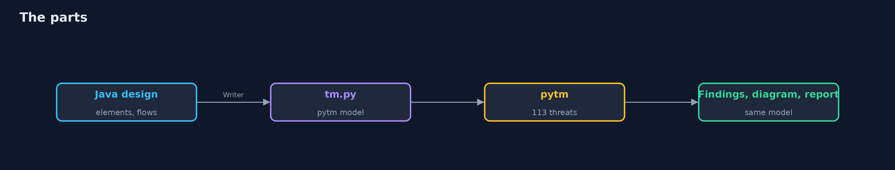
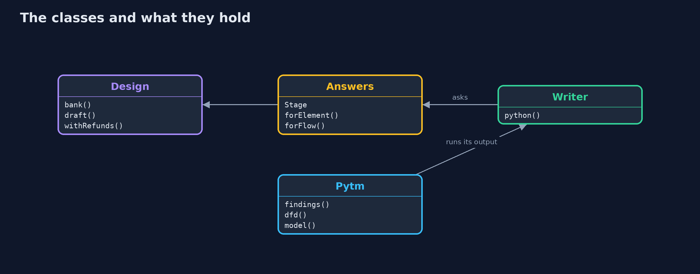
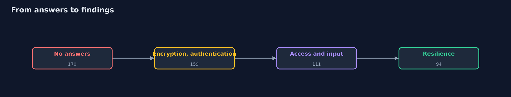
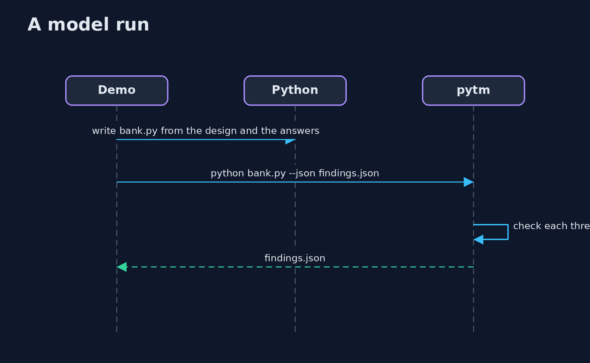

# Threat Modeling with pytm

```
src/main/java/com/jk/explore/security/pytmmodel/
├── Answers.java   What the team says about each element and flow: pytm asks about encryption, authentication, access control, validation and resilience, and its rules produce a finding for each threat of its library whose condition the answers do not rule out
├── Design.java    The online bank of the plain threat-modeling project, as plain data: who talks to whom, across which boundary, and whether each flow is encrypted, authenticated and authorized
├── Pytm.java      The real pytm 1.4, installed with pip into a virtual environment under build/ the first time, and run on a model file
├── PytmDemo.java  
└── Writer.java    Writes the Python file that pytm reads: the design as pytm objects, plus the answers of a stage
```

**A program writes the bank's data-flow design as a Python model for pytm 1.4, which checks 113 threats from its library against every element and flow: with no answers it finds 170, and four stages of answers (encryption, authentication, access control and input handling, resilience) bring it to 94; the same model draws the diagram with Graphviz and fills a report template; but the findings are a function of the answers, pytm accepts a draft that skips a boundary, holds no decisions, and catches a design change only if the model is changed.**

The plain [threat-modeling](../threat-modeling) project writes a data-flow model of an online bank, runs STRIDE rules over it and keeps a register of decisions. This one gives the same bank to a real tool, **pytm 1.4**, "pythonic threat modeling": a Java program writes the design as a Python model, pytm checks the 113 threats of its library against every element and flow, and the findings, a diagram and a report come out of the same model. It needs `python3` with `pip` (pytm is installed into a virtual environment under `build/` the first time, which needs a network) and Graphviz (`brew install graphviz`); the tests are tagged `integration`: `./gradlew integrationTest`.

What it shows:
- **The bank, written for pytm.** 7 elements, 8 flows and 4 boundaries, 66 lines of Python. A draft with a card vault and a flow from the app that skips a boundary is **accepted without a complaint** (the plain model check reported 2 problems): pytm judges the answers about each element, not the shape of the picture.
- **What pytm finds when nothing is said.** 170 findings from 73 different threats (16 Very High, 59 High, 85 Medium), starting from the worst case; the plain STRIDE rules gave 20 candidates.
- **Every answer changes the findings.** Declaring encryption: 167. Authentication: 159. Access control, least privilege and input handling: 111. Hardening, limits and logging: **94**. An answer that is not true makes a finding disappear.
- **A diagram and a report.** `--dfd` and Graphviz draw 7 nodes, 8 arrows and 4 trust boundaries; `--report` fills a template of our own with the 94 findings.
- **The bill.** A refund flow over plain http takes 94 findings to 99; findings about XML appear in a bank that parses none; pytm keeps no owner, no decision and no review date.

**Maps to:** OWASP Top 10 (2025) A06 Insecure Design · NIST SSDF PW.1 (design software to meet security requirements) · CAPEC (the source of pytm's threats) · STRIDE.

## The idea in everyday terms

A building inspector with a very long checklist who starts by assuming every door is unlocked. Each lock you can honestly show them crosses items off, and a lock you claim but do not have only hides the item.

## The scenario

The online bank of the plain threat-modeling project. The demo describes it once, in Java, and asks pytm what could go wrong at each stage of what the team can honestly say about it.

## Run

```bash
./gradlew run
```

The demo tells the story in 5 acts, each printing exact numbers that the tests check:

| Act | What it shows |
| --- | --- |
| 1. The bank, written for pytm | A Java design of 7 elements, 8 flows and 4 boundaries becomes 66 lines of pytm Python; a draft that skips a boundary is accepted. |
| 2. What pytm finds when nothing is said | 170 findings from 73 threats, starting from the worst case. |
| 3. Every answer changes the findings | Four stages of honest answers take 170 findings down to 94. |
| 4. A diagram and a report | The same model draws 7 nodes, 8 arrows and 4 boundaries and fills a report of 94 findings. |
| 5. The bill | A design change is caught only if the model is changed, generic findings need a person, and pytm keeps no decisions. |

## Test

```bash
./gradlew test
```

12 tests in `DemoRunsTest`, `PytmTest`, `WriterTest`. The design and the generated Python are tested with no tool. The rest run pytm and Graphviz (./gradlew integrationTest); the first run installs pytm with pip and needs a network.

## What the simulation got right, and what it left out

pytm is the real library, installed with pip into a virtual environment; Graphviz is the real dot. The model is written by the program from a Java description of the bank. Findings are sorted before they are printed, so the output is the same on every run.

## Technologies and versions

Every version below is pinned in the project's build files and was the latest stable release when the project was built.

| Technology | Version | Used for |
| --- | --- | --- |
| Java | 25 | the language and runtime; a Gradle toolchain finds or downloads the JDK |
| Gradle | 9.8.1 (wrapper) | build and run; nothing to install, the wrapper downloads it |
| tools.jackson.core:jackson-databind | 3.1.5 | library the code uses |
| org.junit.jupiter:junit-jupiter | 6.1.3, set by junit-bom | JUnit 5: the tests (tests only) |
| org.junit.platform:junit-platform-launcher | 6.1.3, set by junit-bom | JUnit platform launcher, which Gradle needs to run the tests (tests only) |
| videokit | repository tool (`tools/videokit`) | the narrated video and animation: Piper `en_US-amy-medium`, speed 0.8, longer pauses (the amy-slow voice) |

## Learning Material

| Document | What it is for |
| --- | --- |
| [Problem statement](docs/problem-statement.md) | the situation and what the project must show |
| [Prerequisites](docs/prerequisites.md) | what you need to know first |
| [Threat Modeling with pytm, explained](docs/threat-modeling-with-pytm-explained.md) | the acts in prose |
| [Session guide](docs/session.md) | a one-hour lesson with exercises |
| [Animated walkthrough](docs/animation.html) | the acts step by step, narrated |
| [Threat model](docs/threat-model.md) | what is protected, who could harm it, and how, using STRIDE |
| [Spec](docs/spec.md) | what this project must be true of |
| [Expected output](docs/expected-output.txt) | the golden demo output every test and every port checks against |

### The idea in one picture

One design, one model, three outputs.



### Where each piece sits

A design, answers, a writer and a runner.



### How the data moves

Each stage adds answers and removes findings.



### Who calls whom, in order




### Video

`video/threat-modeling-with-pytm-explained.mp4` (with `.m4a` audio and `.srt` subtitles) is built by `video/build_video.sh`. Rendered media is not committed.

## What it costs

- **The answers are claims,** and a false one hides a finding.
- **A generic library of threats gives candidates,** many of which do not apply.
- **The model is a second copy of the design** unless it is generated from the first.
- **pytm has no place for decisions,** owners and review dates.
- **It needs Python and Graphviz,** one more toolchain.

## When this is too much

A small internal tool with one user and no sensitive data does not need a tool. Use one when a design has several parties and boundaries, or when the model must be rerun at every change.

## Where you have already met this

- A `tm.py` file in a repository.
- A data-flow diagram in a design document.
- A STRIDE spreadsheet.
- A list of findings sorted by severity that nobody has read.

## Where this sits

This is the tools version of [threat-modeling](../threat-modeling), in the [secure-design](..) module. The next project turns the same bank into attack trees and abuse cases: [attack-trees-and-abuse-cases-with-threat-dragon](../attack-trees-and-abuse-cases-with-threat-dragon).
