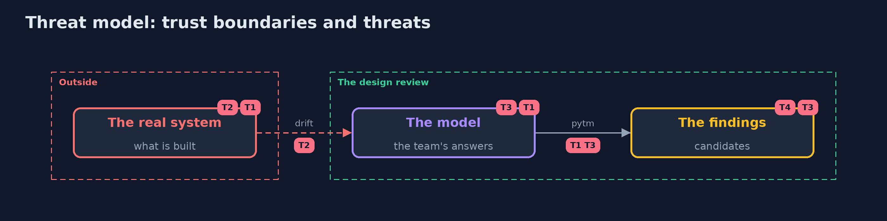

# Threat Model — Threat Modeling with pytm

A threat model answers four questions: what are we protecting, who or what could harm it, how, and what do we do about it. This one covers this project's own demo system, not a production deployment. Domain: a bank.

## Scope

The threat model of the bank as a pytm model, and the use of the tool: its answers, its findings, its outputs. It does not cover the bank's code.

## What we protect (assets)

- The design decisions that the model records.
- The accuracy of the answers.

## Who and what acts on the system

- The team that answers the questions.
- A reviewer who reads the findings.

## Trust boundaries

A trust boundary is a line that data or a request crosses between parts that trust each other differently. Threats cluster where those lines are.

- The model and the system: the model is only as true as its answers.

Each dashed box is a trust boundary. A rose tag such as T1 shows where the threat of that number, in the table below, applies.

## Threats, using STRIDE

STRIDE is a checklist of six kinds of threat: **Spoofing** (S), **Tampering** (T), **Repudiation** (R), **Information disclosure** (I), **Denial of service** (D), **Elevation of privilege** (E).

| Id | Kind | Threat | Where it shows up | Control in this project | What is left |
| --- | --- | --- | --- | --- | --- |
| T1 | Repudiation | An untrue answer hides a finding | the model's answers | Each answer has an owner and a test | Answers nobody tests |
| T2 | Tampering | The system changes and the model does not | the design | Generate the model from one description, and rerun on every change | Changes made outside the description |
| T3 | Information disclosure | Hundreds of generic findings bury the ones that matter | the findings | Start from the worst case and earn findings away; rank by severity | Findings nobody reads |
| T4 | Repudiation | A finding is accepted without a decision on record | after the tool | A register with owner, decision and review day | Decisions that expire unnoticed |

## Assumptions

- The Java design is kept in step with the system.
- Findings are reviewed by people.

## Out of scope

- The bank's code.
- Risk acceptance.

## How the tests check this

- `WriterTest` checks the design and the Python it generates with no tool.
- `PytmTest` runs the real pytm and Graphviz for the library, the counts at each stage, the draft, the refund flow, the diagram and the report.
- `DemoRunsTest` compares the whole demo with the golden output.

## Where this model goes next

The next project in this module, attack-trees-and-abuse-cases-with-threat-dragon, puts the bank's threats and defences in OWASP Threat Dragon.
