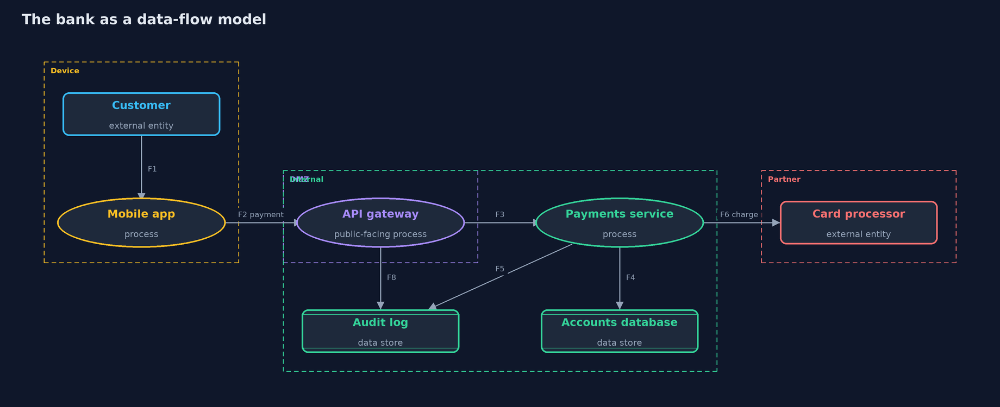
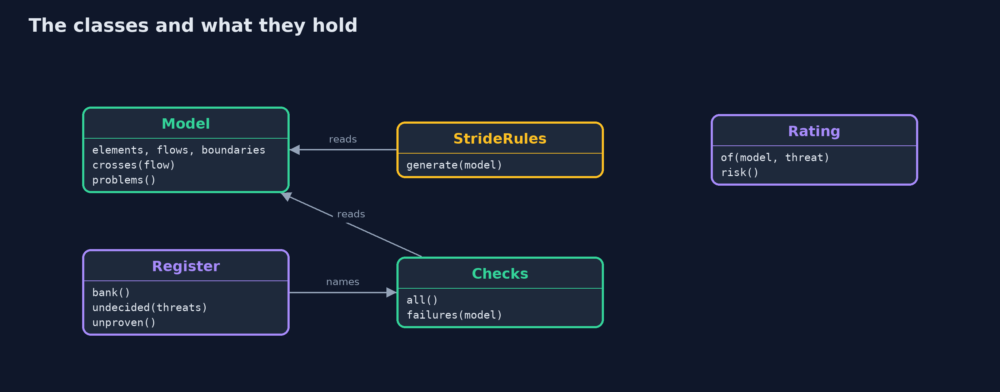
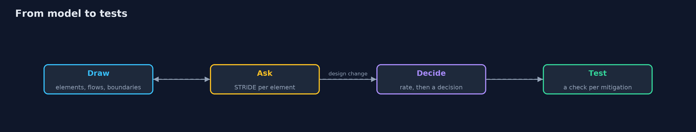

# Threat Modeling with STRIDE

```
src/main/java/com/jk/explore/security/threatmodel/
├── BankModel.java        The online bank used throughout the demo: a mobile app, an API gateway, a payments service, two stores and a card processor
├── Boundary.java         A trust boundary: the line between two zones where what is trusted on one side cannot be trusted on the other
├── Checks.java           Mitigations as executable checks over the model
├── Decision.java         What the team decided to do about one threat
├── Element.java          One box in the data-flow diagram: who or what it is, which zone it sits in, who owns it, and which controls it has
├── Flow.java             One arrow in the data-flow diagram: what moves from where to where, and how it is protected on the way
├── Kind.java             The three kinds of element in a data-flow diagram
├── Model.java            A data-flow model of a system: elements in zones, the flows between them, and the trust boundaries between zones
├── Rating.java           Likelihood and impact on a scale of one to five, and risk as their product
├── Register.java         The bank's threat register: one decision for each threat key the team has looked at
├── Stride.java           The six STRIDE categories, each the opposite of a property the system should have
├── StrideRules.java      STRIDE per element: simple rules that turn the model into a list of candidate threats
├── Threat.java           A candidate threat found by a rule: a STRIDE category against one element or flow
└── ThreatModelDemo.java  Runs the online bank story in five numbered acts and prints exact, repeatable results
```

**A threat model is a small, checked picture of the system: STRIDE rules turn every element and boundary into questions, people rate and decide each threat, and every mitigation becomes a test, so a design change that breaks one fails before release instead of after a breach.**

**Insecure design** (OWASP Top 10 2025, A06) is the flaw that no amount of careful coding fixes: the system was built without anyone asking how it could be attacked.
**Threat modeling** is that question, asked on purpose and early. It has four parts, known as the **Four Question Framework**: what is being built, what can go wrong, what is being done about it, and was it done well enough.

This project answers them in code. The bank becomes a **data-flow model**: external entities, processes, data stores, the flows between them, and **trust boundaries** where what is trusted on one side cannot be trusted on the other.
**STRIDE** rules (spoofing, tampering, repudiation, information disclosure, denial of service, elevation of privilege) turn every element and every boundary crossing into candidate threats. People **rate** each one, likelihood times impact, and **decide**: mitigate, accept with an owner and a review date, transfer, or avoid.
Every mitigation names an **executable check** over the model, so when the design changes, the checks run again and a missing control fails a test before release.

It maps to OWASP Top 10 2025 A06 Insecure Design, NIST SSDF practice PW.1 (design software to meet security requirements and mitigate risks), the Threat Modeling Manifesto, and the ASVS 5.0 chapter on secure architecture and design.

## The idea in everyday terms

Think of an architect walking through a building plan with a security consultant before a single wall is built. The plan shows the doors, the corridors and the vault. At each door the consultant asks the same six questions: who could pretend to be someone else here, what could be changed, who could deny having passed, what could be seen, what could be blocked, and who could end up with keys they should not have. Some doors get locks, some risks are written down and accepted, some are insured, and one corridor is simply removed from the plan.
And when the client later adds a side entrance, the walk-through happens again.

## The scenario

An online bank has a mobile app, an API gateway, a payments service, an accounts database, an audit log, and a third-party card processor. The demo draws it as a data-flow model, checks the picture, generates STRIDE threats, rates and decides them, turns the mitigations into checks, and then adds a refund feature to see what the model catches.

## Run

```bash
./gradlew run
```

The demo tells the story in 5 acts, each printing exact numbers that the tests check:

| Act | What it shows |
| --- | --- |
| 1. The system as a data-flow model | The bank is 2 external entities, 3 processes, 2 data stores, 8 flows and 3 trust boundaries with no problems; an earlier draft has 2: a flow that skips a boundary and a store with no owner. |
| 2. STRIDE per element | Rules turn the model into 20 candidate threats: spoofing 4, tampering 5, repudiation 4, information disclosure 2, denial of service 1, elevation of privilege 4. |
| 3. Rating and deciding | The highest risks score 5 x 5 = 25 at the internet boundary; the 20 threats are decided as mitigate 17, accept 1, transfer 1 and avoid 1, with none undecided. |
| 4. Mitigations as tests | 8 checks, one for every mitigation, pass on the bank as built; adding an unencrypted refund flow fails the TLS check and brings 2 undecided threats, and the old draft fails 3 checks. |
| 5. The bill, and the habit | 7 elements, 8 flows and 20 threats stay small enough to keep current; one accepted risk is already past its review day; the four questions are asked on every design change. |

## Test

```bash
./gradlew test
```

17 tests in `ChecksTest`, `DemoRunsTest`, `ModelTest`, `StrideTest`. The model, the STRIDE rules, the ratings, the register and the checks are all deterministic Java, so the golden output is the same on every run and needs only a JDK.

## What the simulation got right, and what it left out

The bank is a model in code, not a running system, so every result is exact. The likelihood and impact scales are simple and stated in the code, as a team would agree them. The STRIDE rules are a starting point that finds candidates; they are not a complete catalogue of threats.

## Technologies and versions

Every version below is pinned in the project's build files and was the latest stable release when the project was built.

| Technology | Version | Used for |
| --- | --- | --- |
| Java | 25 | the language and runtime; a Gradle toolchain finds or downloads the JDK |
| Gradle | 9.8.1 (wrapper) | build and run; nothing to install, the wrapper downloads it |
| org.junit.jupiter:junit-jupiter | 6.1.3, set by junit-bom | JUnit 5: the tests (tests only) |
| org.junit.platform:junit-platform-launcher | 6.1.3, set by junit-bom | JUnit platform launcher, which Gradle needs to run the tests (tests only) |
| videokit | repository tool (`tools/videokit`) | the narrated video and animation: Piper `en_US-amy-medium`, speed 0.8, longer pauses (the amy-slow voice) |

## Learning Material

| Document | What it is for |
| --- | --- |
| [Problem statement](docs/problem-statement.md) | the situation and what the project must show |
| [Prerequisites](docs/prerequisites.md) | what you need to know first |
| [Threat Modeling with STRIDE, explained](docs/threat-modeling-explained.md) | the acts in prose |
| [Session guide](docs/session.md) | a one-hour lesson with exercises |
| [Animated walkthrough](docs/animation.html) | the acts step by step, narrated |
| [Threat model](docs/threat-model.md) | what is protected, who could harm it, and how, using STRIDE |
| [Spec](docs/spec.md) | what this project must be true of |
| [Expected output](docs/expected-output.txt) | the golden demo output every test and every port checks against |

### The idea in one picture

Four zones and three trust boundaries; every arrow that crosses a boundary is where threats gather.



### Where each piece sits

The model is data; rules, register and checks read it.



### How the data moves

Each step feeds the next, and a design change starts the loop again.



### Who calls whom, in order


### Video

`video/threat-modeling-explained.mp4` (with `.m4a` audio and `.srt` subtitles) is built by `video/build_video.sh`. Rendered media is not committed.

## What it costs

- **A model is only as good as its last update.** A design change that nobody puts into the model leaves its threats unexamined, which is why the checks run on every change.
- **Rules find candidates, people decide.** STRIDE rules make sure no question is forgotten, but likelihood, impact and the right control still need judgement and someone who knows the system.
- **Accepted risks expire.** An accepted risk needs an owner and a review date, and the demo finds one that is already past it.
- **Bigger is not better.** A model that nobody can read in one sitting stops being updated. Keep it to the parts that matter, and split large systems into several small models.

## When this is too much

A one-page script needs no formal threat model, though the four questions still help. Anything that moves money, holds personal data or crosses a trust boundary deserves one, kept small and updated with the design. Formal tools and full diagrams pay off when several teams share a system.

## Where you have already met this

- Design reviews and architecture decision records that ask "what could go wrong?"
- Data-flow diagrams in security reviews, with dashed trust boundaries.
- Tools such as OWASP Threat Dragon, pytm and the Microsoft Threat Modeling Tool.
- Risk registers with owners and review dates.

## Where this sits

This project is the first in [secure-design](..). It uses the trust boundaries and threats that every earlier project's own threat model already showed, and turns them into a method. The `-with-pytm` version writes the same model with a widely used open-source tool.
