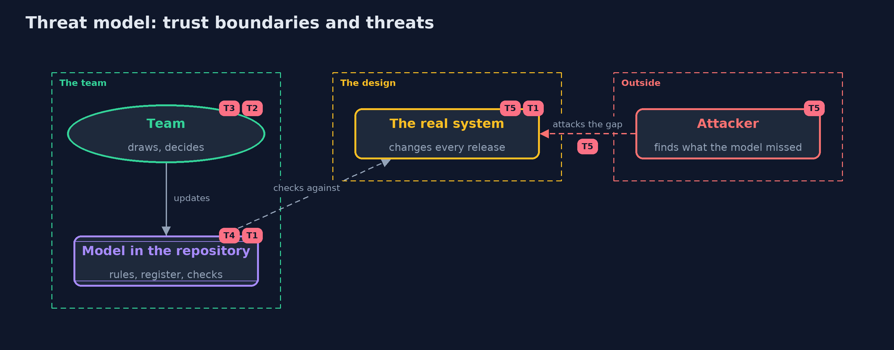

# Threat Model — Threat Modeling with STRIDE

A threat model answers four questions: what are we protecting, who or what could harm it, how, and what do we do about it. This one covers this project's own demo system, not a production deployment. Domain: an online bank.

## Scope

The threat modeling practice itself: the model kept in the repository, the rules, the register and the checks, and how they stay true as the real system changes. It does not cover the bank's own threats, which are the subject of the demo.

## What we protect (assets)

- The model and register, which the team relies on to know what is covered.
- The checks, which stand between a design change and a release.
- The accepted risks and their review dates.

## Who and what acts on the system

- The team, who draw, decide and update.
- An attacker, who finds what the model missed.

## Trust boundaries

A trust boundary is a line that data or a request crosses between parts that trust each other differently. Threats cluster where those lines are.

- The model to the real system: the model is only true while it matches the design.
- The rules to the team's judgement: rules find candidates, people decide.

Each dashed box is a trust boundary. A rose tag such as T1 shows where the threat of that number, in the table below, applies.

## Threats, using STRIDE

STRIDE is a checklist of six kinds of threat: **Spoofing** (S), **Tampering** (T), **Repudiation** (R), **Information disclosure** (I), **Denial of service** (D), **Elevation of privilege** (E).

| Id | Kind | Threat | Where it shows up | Control in this project | What is left |
| --- | --- | --- | --- | --- | --- |
| T1 | Tampering | The model drifts from the real system, so its threats and checks describe something that no longer exists | `Model`, `BankModel` | The model lives in the repository and its checks run in the build | A change made outside the model, such as a manual firewall rule, is still invisible to it |
| T2 | Information disclosure | A threat is missed because no rule asks the right question | `StrideRules` | Rules cover every element and boundary crossing, and the team reviews the list | STRIDE finds common candidates only; logic and abuse cases need the next project |
| T3 | Repudiation | A risk is accepted and forgotten | `Register` | Every accepted risk has an owner and a review day, and the demo reports one past its date | An owner who leaves the team leaves the risk without one, unless ownership moves with the role |
| T4 | Tampering | A mitigation is claimed but never verified | `Register.unproven` | Every mitigation must name a check that exists | A check proves only what the model says, not what the running system does |
| T5 | Elevation of privilege | An attacker exploits a design gap the model never showed | the real system | Review the model on every design change, and test the running system too | No model is complete; penetration tests and monitoring remain necessary |

## Assumptions

- The team updates the model in the same change as the design.
- The checks run in the build, so a failing check blocks a release.
- In the demo, the bank, the scales and the decisions are illustrative.

## Out of scope

- Quantitative risk methods: the advanced track.
- Tool-specific diagrams: the -with-pytm version.

## How the tests check this

- `ModelTest` checks completeness, crossings and boundaries, and the draft's problems.
- `StrideTest` checks the generated threats, their order, and the ratings.
- `ChecksTest` checks that every threat is decided and every mitigation proven, and that a design change fails the right check.
- `DemoRunsTest` compares the whole demo with the golden output.

## Where this model goes next

The next project, attack-trees-and-abuse-cases, takes one threat and breaks it into the attacker's steps, to find which defence cuts the cheapest path.
