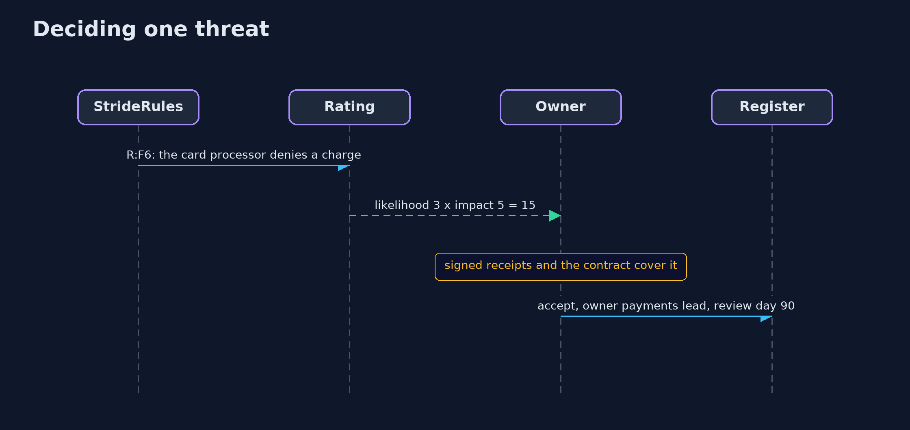
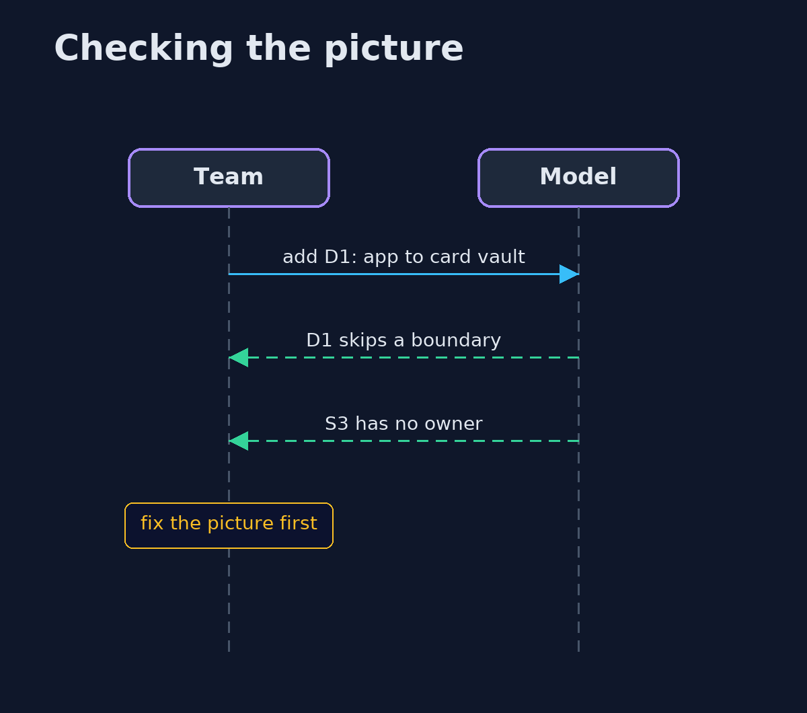

# Threat Modeling with STRIDE — UML Sequence Diagrams

## 1. Deciding one threat

The rule proposes, the rating ranks, a person decides.

## 2. Checking the picture

A flow that skips a boundary is reported before any threat is generated.

