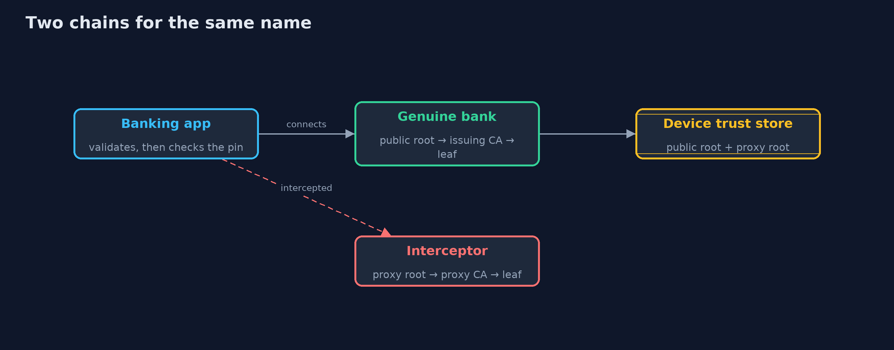
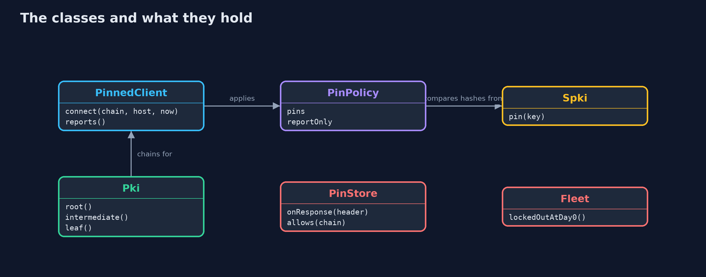
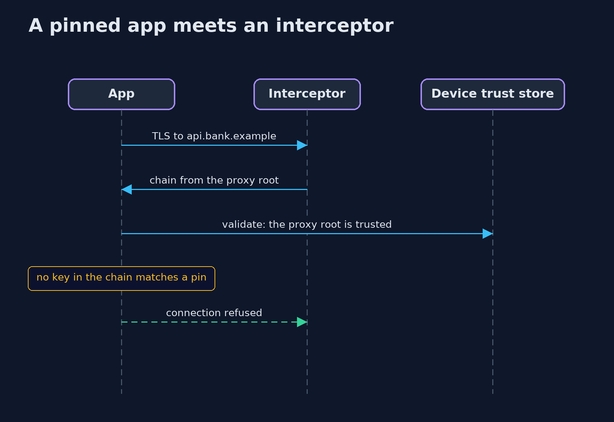

# Certificate Pinning and What It Costs

```
src/main/java/com/jk/explore/security/pinning/
├── Der.java           The few ASN.1 DER encodings an X.509 certificate and a revocation list need
├── Fleet.java         The installed apps of a bank, and how many of them still carry an old pin when the server changes its key
├── Outcome.java       What the client did with a server's chain
├── PinPolicy.java     The pins an app ships with: at least one key in the chain must match one of them
├── PinStore.java      Dynamic pinning as browsers once did it (HPKP): the <em>server</em> tells the browser which keys to pin and for how long, in a response header, and the browser remembers it
├── PinnedClient.java  A mobile-style client
├── PinningDemo.java   Runs the pinning story in five numbered acts and prints exact, repeatable results
├── Pki.java           Just enough certificate making to build chains for the demo: a root, an intermediate and a leaf, as real X.509 DER read back by the JDK
└── Spki.java          The pin of a key: the SHA-256 hash of its SubjectPublicKeyInfo, in Base64 (the form used by HPKP, OkHttp and Android's network security configuration)
```

**Pinning a server's public key stops interception by a certificate authority the device trusts but the app's author did not expect, and it also locks every app out the day the server changes keys unless backup pins, a sensible choice of key and a way to update were planned; that cost is why browsers dropped server-set pins.**

A device trusts dozens of **certificate authorities**, and a company proxy, a debugging tool or malware can add one more. Any of them can sign a valid certificate for your bank's name, so ordinary TLS validation passes for an interceptor. **Certificate pinning** narrows trust: the app ships
with the hash of a **public key** (the SPKI hash) and refuses a server whose chain contains no pinned key, however valid the chain looks.

It is powerful and it has a price, which is what this project measures:
- **The pin stops an interceptor** whose root the device trusts, and a pin cannot make a bad chain good, because validation still runs first.
- **Changing the server's key breaks every app** that pinned the old one. With 10,000 installs, all 10,000 fail at once, and 1,500 stay locked out a week later because they have not updated.
- **Pinning choices soften the price:** pin an issuing CA's key (changes rarely), or the leaf plus a **backup pin** for a key that is generated, kept offline and not yet in use. A **report-only** mode shows what would break before it does.
- **Pins set by the server** (the old `Public-Key-Pins` header, HPKP) let anyone who controls one response, or a site that loses its own keys, lock visitors out for up to a year. Browsers removed the feature for that reason.

**Maps to:** OWASP Top 10 (2025) A04 Cryptographic Failures · CWE-295 · CWE-296 · OWASP MASVS-NETWORK · RFC 7469 (HPKP, now historic) · RFC 8470 and Certificate Transparency as the modern alternatives.

## The idea in everyday terms

Instead of letting any notary in the country vouch for your bank, you carry a photo of the one banker you know. A forger with a perfectly genuine notary stamp is turned away. But if the bank changes its banker, everyone who carries the old photo
walks away from the real bank too, until they get a new photo.

## The scenario

A mobile banking app talks to api.bank.example. The demo builds real certificate chains (a public root, an issuing CA, the bank's leaf, and a second chain from a root that a company proxy installed on the device) and runs a client with different pin policies against them, plus a fleet calculation and a model of header-set pins.

## Run

```bash
./gradlew run
```

The demo tells the story in 5 acts, each printing exact numbers that the tests check:

| Act | What it shows |
| --- | --- |
| 1. An app that trusts the device | Without pins, the app accepts the genuine server and also an interceptor whose root the device trusts. |
| 2. An app that pins the server's key | With the leaf key pinned, the interceptor is refused by the pin; on a clean device the interceptor fails ordinary validation anyway. |
| 3. The server renews with a new key | The app pinned to the old leaf key refuses the renewed certificate; of 10,000 installs, all 10,000 fail on day 0 and 1,500 are still locked out after a week. |
| 4. Pins chosen so that rotation does not break the app | Pinning the issuing CA survives the renewal and still refuses the interceptor; a leaf pin plus a backup pin survives a switch to the backup key; report-only mode accepts and records a mismatch. |
| 5. Why browsers stopped letting servers set pins | One response with a pin header for the meddler's keys blocks the genuine site for every returning visitor for up to a year; a site that loses its pinned keys locks itself out the same way. |

## Test

```bash
./gradlew test
```

11 tests in `DemoRunsTest`, `PinningTest`. Keys are random and never printed, and the clock is fixed, so the demo prints the same text on every run.

## What the simulation got right, and what it left out

The chains are real X.509 certificates built in the project and validated with the JDK's PKIX code. The pins are real SPKI SHA-256 hashes in Base64, as in HPKP and OkHttp. The fleet and the header store are small models. Keys are random and never printed; the clock is fixed.

## Technologies and versions

Every version below is pinned in the project's build files and was the latest stable release when the project was built.

| Technology | Version | Used for |
| --- | --- | --- |
| Java | 25 | the language and runtime; a Gradle toolchain finds or downloads the JDK |
| Gradle | 9.8.1 (wrapper) | build and run; nothing to install, the wrapper downloads it |
| org.junit.jupiter:junit-jupiter | 6.1.3, set by junit-bom | JUnit 5: the tests (tests only) |
| org.junit.platform:junit-platform-launcher | 6.1.3, set by junit-bom | JUnit platform launcher, which Gradle needs to run the tests (tests only) |
| videokit | repository tool (`tools/videokit`) | the narrated video and animation: Piper `en_US-amy-medium`, speed 0.8, longer pauses (the amy-slow voice) |

## Learning Material

| Document | What it is for |
| --- | --- |
| [Problem statement](docs/problem-statement.md) | the situation and what the project must show |
| [Prerequisites](docs/prerequisites.md) | what you need to know first |
| [Certificate Pinning and What It Costs, explained](docs/certificate-pinning-explained.md) | the acts in prose |
| [Session guide](docs/session.md) | a one-hour lesson with exercises |
| [Animated walkthrough](docs/animation.html) | the acts step by step, narrated |
| [Threat model](docs/threat-model.md) | what is protected, who could harm it, and how, using STRIDE |
| [Spec](docs/spec.md) | what this project must be true of |
| [Expected output](docs/expected-output.txt) | the golden demo output every test and every port checks against |

### The idea in one picture

Both chains validate against the device's trust store; only one contains the pinned key.



### Where each piece sits

The client validates with the device roots, then applies the pin policy.



### How the data moves

The pin is checked after ordinary validation, never instead of it.


### Who calls whom, in order




### Video

`video/certificate-pinning-explained.mp4` (with `.m4a` audio and `.srt` subtitles) is built by `video/build_video.sh`. Rendered media is not committed.

## What it costs

- **Rotation becomes a project.** Every key change needs an app release that went out before the change, with enough time for users to update.
- **Backup pins need a key that exists.** Generate it ahead of time and keep it offline, or the backup pin protects nothing.
- **Pinning the issuing CA trusts everything that CA signs,** which is weaker than pinning the leaf but survives renewals.
- **Users cannot work around a pin,** which is the point against interception and the pain when you are wrong. Ship a way to update, and consider a signed remote switch to turn enforcement off in an emergency.
- **Testing with interception tools needs the pin disabled in debug builds,** and that switch must not exist in release builds.

## When this is too much

For most apps, ordinary validation plus Certificate Transparency monitoring, CAA records and short-lived certificates is enough, and costs far less when something changes. Pin when the threat is real (banking, health, high-value targets), when you control the app's update path,
and when your team has tested a rotation. Do not pin for a website in a browser: use the modern controls.

## Where you have already met this

- `CertificatePinner` in OkHttp and the `<pin-set>` in Android's network security configuration.
- `NSPinnedDomains` in iOS.
- "SSL pinning bypass" in mobile penetration-testing guides.
- The 2017–2018 removal of HPKP from Chrome and Firefox.

## Where this sits

This project is in [tls-in-practice](..) and follows [inspecting-tls-traffic](../inspecting-tls-traffic): a pin is also what stops an interception proxy from inspecting your own app's traffic. It uses the chains of [local-certificate-authority](../local-certificate-authority) (with a small copy of the encoder, so each project stands alone).
