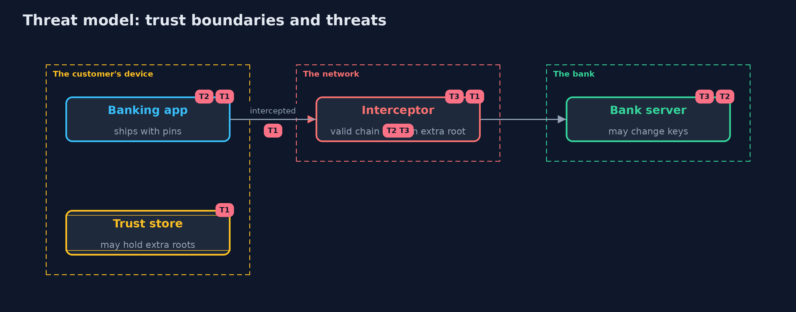

# Threat Model — Certificate Pinning and What It Costs

A threat model answers four questions: what are we protecting, who or what could harm it, how, and what do we do about it. This one covers this project's own demo system, not a production deployment. Domain: a mobile banking app.

## Scope

A mobile app's TLS connection to its own API, with pins shipped in the app. It covers interception by roots on the device and the cost of changing keys.
It does not cover a compromised device (which can disable pinning), or a compromised bank server.

## What we protect (assets)

- The confidentiality of the app's traffic.
- The app's availability to customers.

## Who and what acts on the system

- The customer.
- A proxy, tool or malware with a root on the customer's device.
- The bank's operations team, who renew and rotate keys.

## Trust boundaries

A trust boundary is a line that data or a request crosses between parts that trust each other differently. Threats cluster where those lines are.

- The app to the network: the chain it receives is untrusted until validated and pinned.
- The device's trust store: it is not under the app author's control.

Each dashed box is a trust boundary. A rose tag such as T1 shows where the threat of that number, in the table below, applies.

## Threats, using STRIDE

STRIDE is a checklist of six kinds of threat: **Spoofing** (S), **Tampering** (T), **Repudiation** (R), **Information disclosure** (I), **Denial of service** (D), **Elevation of privilege** (E).

| Id | Kind | Threat | Where it shows up | Control in this project | What is left |
| --- | --- | --- | --- | --- | --- |
| T1 | Information disclosure | An interceptor with a root the device trusts reads the app's traffic | `PinnedClient` without a pin | An SPKI pin checked after validation | An attacker with full control of the device can remove the pin |
| T2 | Denial of service | A key change locks every app that pinned the old key out | `PinPolicy`, `Fleet` | Pin the issuing CA or a backup key made in advance; report-only mode; release before rotating | Users who do not update before the change |
| T3 | Denial of service | Header-set pins from a meddler or a lost key block the real site for up to a year | `PinStore` | Do not accept server-set pins; use Certificate Transparency, CAA and short-lived certificates | Old clients that still implement HPKP |

## Assumptions

- The app binary is genuine and its pins are intact.
- An attacker on the device with full control can remove the pins; pinning is not protection against that.

## Out of scope

- Pinning bypass tools and jailbroken devices.
- Certificate Transparency and CAA.

## How the tests check this

- `PinningTest` checks the pin format, validation before pinning, interception with and without pins, renewal with a new key, backup pins, report-only mode, the fleet numbers and the header-set pin store.
- `DemoRunsTest` compares the whole demo with the golden output.

## Where this model goes next

The next module, secure-coding, goes back to the code itself, with secrets that leak through errors and logs.
