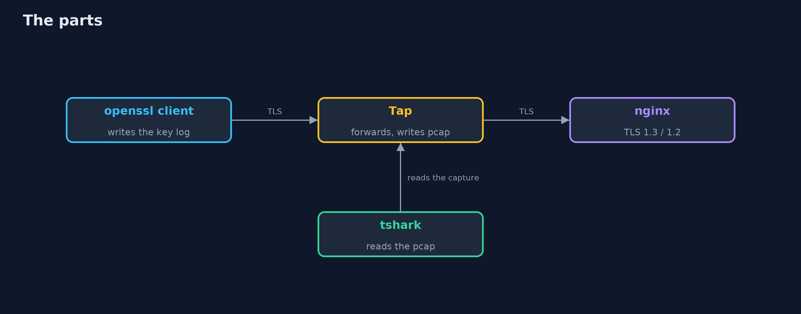
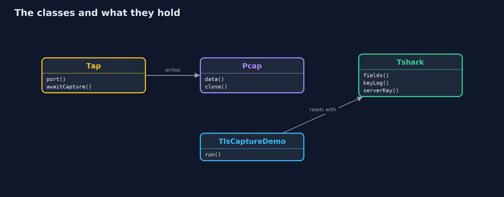
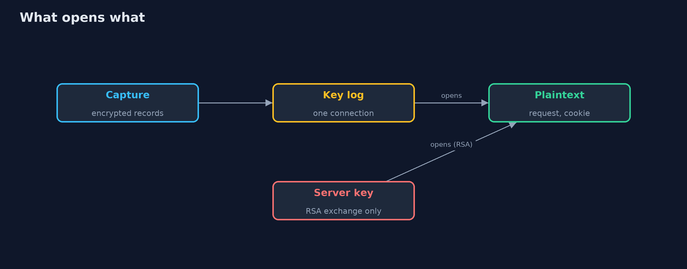
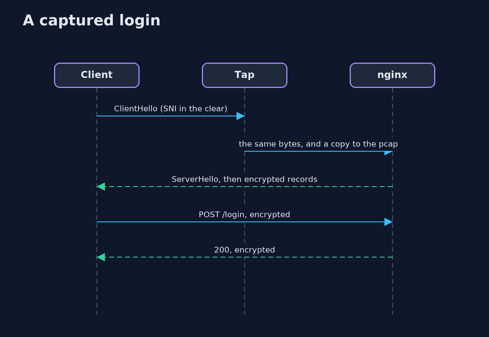

# Inspecting TLS Traffic with Wireshark

```
src/main/java/com/jk/explore/security/tlscapture/
├── Client.java          The openssl command as a TLS client; with a key log file it writes the secrets of the connection, as a browser does when SSLKEYLOGFILE is set
├── LegacyServer.java    A server that uses RSA key exchange (TLS 1.2), so no forward secrecy: the client encrypts the session secret with the server's public key
├── LocalCa.java         A root made with the step command, and the certificates it signs, good and bad
├── Nginx.java           A real nginx with a login page, on a loopback port
├── Pcap.java            Writes a capture file (pcap, raw IPv4 packets) of one TCP connection between two loopback ports, from the bytes a tap saw
├── Procs.java           Small helpers for running programs
├── Tap.java             A tap between a client and a server on loopback: it forwards every byte and writes a capture file of what went through
├── TlsCaptureDemo.java  One login through a tap, which writes {@code pcap}; the client writes its secrets to {@code keys} when that is not null
└── Tshark.java          The tshark command reading a capture file, with or without the secrets of the connection
```

**A capture of a real TLS 1.3 login shows the server name, the cipher the server chose and encrypted records, and nothing of the password; tshark with the key log the client wrote opens that connection (and its encrypted certificate) and no other, a log with only the client's lines opens only requests, and a leaked server key opens a recording made with RSA key exchange but not one made with ephemeral keys.**

The plain [inspecting-tls-traffic](../inspecting-tls-traffic) project decrypts a recorded TLS 1.3 session in Java with HKDF. This one uses the real tools: **nginx**, the **openssl** client with `-keylogfile`, and **tshark** (`brew install nginx step wireshark`). Nothing is captured from a network card, which needs rights a test should not ask for: a small **tap** in Java sits between the client and the server on loopback, forwards every byte and writes a capture file (pcap) of what went through, which is all that a machine on the path would see. The tests are tagged `integration` (the capture-file test is not): `./gradlew integrationTest`.

What it shows:
- **What the wire shows.** The Client Hello names the shop in the clear, the Server Hello picks `TLS_AES_256_GCM_SHA384`, the rest is encrypted records: no certificate, no HTTP, no password.
- **A key log.** `openssl s_client -keylogfile` writes five lines (the client random and a secret each), the same format a browser writes when `SSLKEYLOGFILE` is set. It holds no private key.
- **The same capture with the key log.** tshark shows `POST /login`, the form fields, the cookie, and the encrypted certificate.
- **One connection only.** A second login is closed to the first login's key log; one file with both logs opens both; a log with only the client's lines opens the requests and not the responses.
- **The server's own key.** A TLS 1.2 certificate is visible in the clear. With the server's private key, a recording made with ECDHE stays closed and a recording made with RSA key exchange opens, password and all.

**Maps to:** OWASP Top 10 (2025) A04 Cryptographic Failures · CWE-312 (cleartext storage of sensitive information), CWE-532 · RFC 8446 (TLS 1.3) · the NSS key log format.

## The idea in everyday terms

Sealed envelopes carried past a watcher. The watcher sees the address on the outside, the times and the sizes. A note from the sender with that one envelope's key opens that envelope and no other; the post office's master key opens old envelopes only if they were sealed the old way.

## The scenario

An online store's shopper logs in over TLS 1.3. The demo plays a person with a capture file and the tools to read it, and shows what they can and cannot learn.

## Run

```bash
./gradlew run
```

The demo tells the story in 5 acts, each printing exact numbers that the tests check:

| Act | What it shows |
| --- | --- |
| 1. What the wire shows | The capture shows the server name, the chosen cipher and encrypted records; the certificate, the request and the password are not there. |
| 2. A key log: the secrets of one connection | The client writes five lines, each tied to one connection by its client random, and no private key. |
| 3. The same capture, read with the key log | tshark with the key log shows the request, the form fields, the cookie and the certificate. |
| 4. A key log opens its own connection and no other | A second login is closed to the first key log; one file with both opens both; a log with only the client's lines opens only requests. |
| 5. The server's own key is a different matter | A TLS 1.2 certificate is in the clear; a leaked server key opens an RSA key exchange recording and not an ECDHE one. |

## Test

```bash
./gradlew test
```

11 tests in `DemoRunsTest`, `PcapTest`, `TlsCaptureTest`. The capture-file writer is tested with no program. The other tests need nginx, openssl, step and tshark (./gradlew integrationTest).

## What the simulation got right, and what it left out

nginx, openssl and tshark are the real programs; the tap writes a real pcap file. Secrets, ports and packet counts are never printed; the demo takes about half a minute.

## Technologies and versions

Every version below is pinned in the project's build files and was the latest stable release when the project was built.

| Technology | Version | Used for |
| --- | --- | --- |
| Java | 25 | the language and runtime; a Gradle toolchain finds or downloads the JDK |
| Gradle | 9.8.1 (wrapper) | build and run; nothing to install, the wrapper downloads it |
| org.junit.jupiter:junit-jupiter | 6.1.3, set by junit-bom | JUnit 5: the tests (tests only) |
| org.junit.platform:junit-platform-launcher | 6.1.3, set by junit-bom | JUnit platform launcher, which Gradle needs to run the tests (tests only) |
| videokit | repository tool (`tools/videokit`) | the narrated video and animation: Piper `en_US-amy-medium`, speed 0.8, longer pauses (the amy-slow voice) |

## Learning Material

| Document | What it is for |
| --- | --- |
| [Problem statement](docs/problem-statement.md) | the situation and what the project must show |
| [Prerequisites](docs/prerequisites.md) | what you need to know first |
| [Inspecting TLS Traffic with Wireshark, explained](docs/inspecting-tls-traffic-with-wireshark-explained.md) | the acts in prose |
| [Session guide](docs/session.md) | a one-hour lesson with exercises |
| [Animated walkthrough](docs/animation.html) | the acts step by step, narrated |
| [Threat model](docs/threat-model.md) | what is protected, who could harm it, and how, using STRIDE |
| [Spec](docs/spec.md) | what this project must be true of |
| [Expected output](docs/expected-output.txt) | the golden demo output every test and every port checks against |

### The idea in one picture

A tap between the client and the server writes the capture; tshark reads it.



### Where each piece sits

The tap and the capture writer, the servers, and the reader.



### How the data moves

A key log opens a connection; the server key opens an RSA exchange.



### Who calls whom, in order




### Video

`video/inspecting-tls-traffic-with-wireshark-explained.mp4` (with `.m4a` audio and `.srt` subtitles) is built by `video/build_video.sh`. Rendered media is not committed.

## What it costs

- **A key log is as good as the password it protects,** so where it is written and when it is deleted matter.
- **Names, times and sizes stay visible** even with TLS 1.3.
- **A capture on a real network needs rights** that are rightly hard to get.
- **Debugging with decryption tempts a team to leave logging on.**

## When this is too much

If you can read the application's own logs, you rarely need to decrypt the wire. Decrypt traffic when the bug is between the machines: a proxy, a handshake, a header added on the way.

## Where you have already met this

- An environment variable `SSLKEYLOGFILE` in a developer's shell.
- A Wireshark screen full of `Application Data`.
- A `.pcap` attached to a bug report.
- Someone saying "just turn off TLS in test".

## Where this sits

This is the tools version of [inspecting-tls-traffic](../inspecting-tls-traffic), in the [tls-in-practice](..) module. The certificates come from the kind of authority built in [local-certificate-authority-with-step-ca](../local-certificate-authority-with-step-ca).
