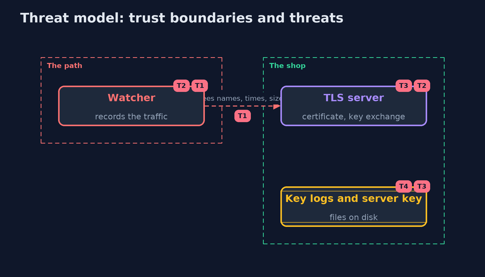

# Threat Model — Inspecting TLS Traffic with Wireshark

A threat model answers four questions: what are we protecting, who or what could harm it, how, and what do we do about it. This one covers this project's own demo system, not a production deployment. Domain: an online store.

## Scope

Recorded TLS traffic of the shop's login, the key logs and server keys that could open it, and the choices that decide what they open. It does not cover capturing on a real network.

## What we protect (assets)

- The shoppers' passwords and sessions.
- The server's private key and any key logs.

## Who and what acts on the system

- A watcher on the path who records traffic.
- A developer who debugs with a key log.
- A thief who later obtains a key.

## Trust boundaries

A trust boundary is a line that data or a request crosses between parts that trust each other differently. Threats cluster where those lines are.

- The network: everything on it is recorded.
- The files where secrets are written.

Each dashed box is a trust boundary. A rose tag such as T1 shows where the threat of that number, in the table below, applies.

## Threats, using STRIDE

STRIDE is a checklist of six kinds of threat: **Spoofing** (S), **Tampering** (T), **Repudiation** (R), **Information disclosure** (I), **Denial of service** (D), **Elevation of privilege** (E).

| Id | Kind | Threat | Where it shows up | Control in this project | What is left |
| --- | --- | --- | --- | --- | --- |
| T1 | Information disclosure | A watcher learns who talks to whom, when and how much | the network | Encrypted Client Hello, padding, fewer names | Times and sizes |
| T2 | Information disclosure | A recording is opened later with a stolen server key | key exchange | Ephemeral key exchange (ECDHE) only | None for sessions that used it |
| T3 | Information disclosure | A key log opens a connection | the client's key log file | No SSLKEYLOGFILE in production, short-lived files, restricted access | Developer machines |
| T4 | Elevation of privilege | Keys are read from a server's disk | the server's files | File permissions, hardware keys | Anyone with the server's rights |

## Assumptions

- Key logs are written only on development machines.
- Servers use ephemeral key exchange.

## Out of scope

- Breaking the cipher itself.
- Traffic analysis beyond sizes and times.

## How the tests check this

- `PcapTest` reads back the capture file the tap writes, byte by byte.
- `TlsCaptureTest` runs nginx, the openssl client, a tap and tshark for what the capture shows, the key log, one connection only and the server key.
- `DemoRunsTest` compares the whole demo with the golden output.

## Where this model goes next

The next project in this module is certificate-pinning, then the secure-coding module.
