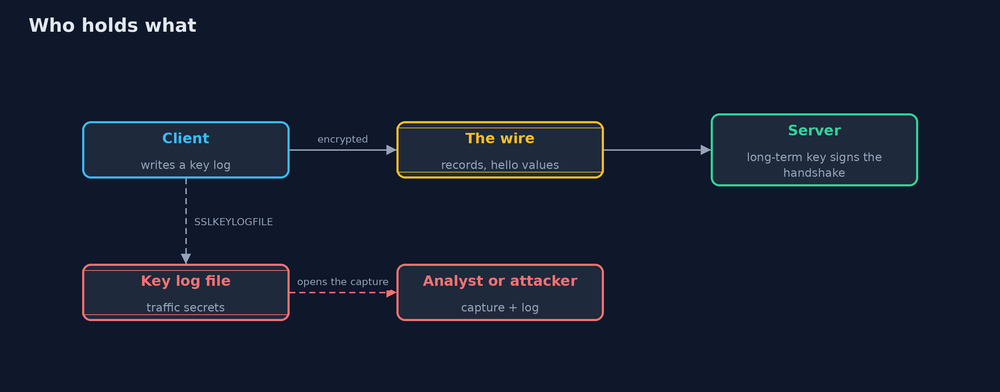
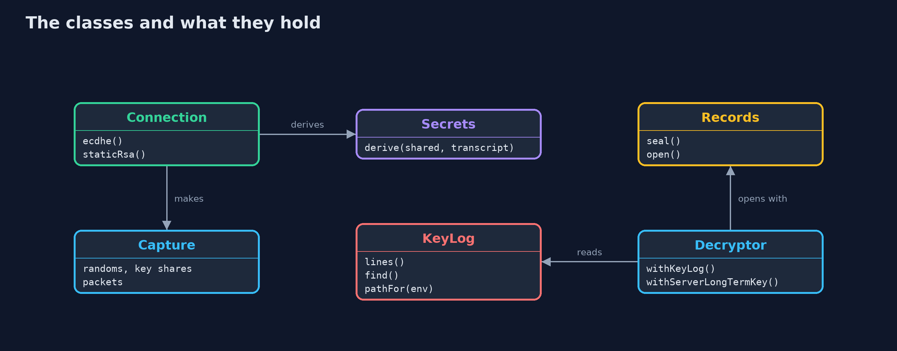
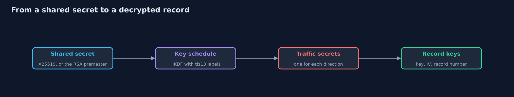
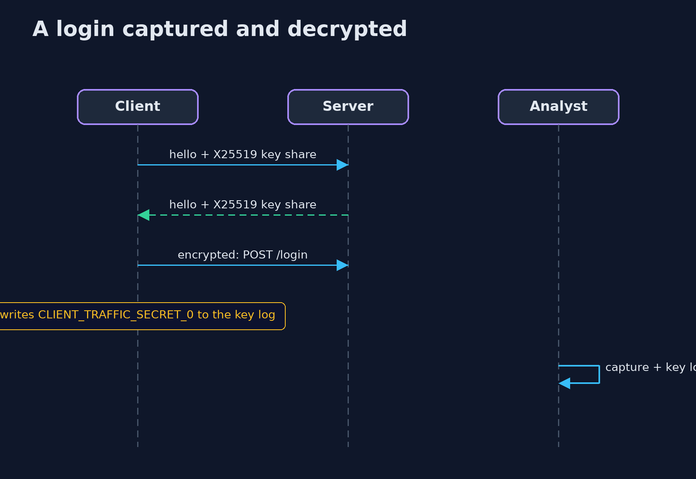

# Inspecting TLS Traffic with a Key Log

```
src/main/java/com/jk/explore/security/tlslog/
├── Capture.java         What a network observer (or a packet capture file) holds for one connection: the hello values that are sent in the clear, and the encrypted records
├── Connection.java      Makes one connection between a client and a server, in the two ways TLS has made keys: an ephemeral Diffie-Hellman exchange (X25519, as in TLS 1.3), or a secret chosen by the client and encrypted under the server's long-term RSA key (static RSA key exchange, removed in TLS 1.3)
├── Decryptor.java       What an analyst can do with a capture, depending on what they hold
├── Hex.java             Lower-case hexadecimal, the way key log files and packet tools print bytes
├── Hkdf.java            HKDF (RFC 5869) with HMAC-SHA-256, and the two TLS 1.3 helpers built on it (RFC 8446, section 7.1)
├── KeyLog.java          The NSS key log format that browsers, curl and Java agents write when {@code SSLKEYLOGFILE} is set and that Wireshark reads: {@code LABEL <client random in hex> <secret in hex>}
├── LabelledRandom.java  A repeatable byte stream from a label (SHA-256 in counter mode)
├── Packet.java          One thing seen on the wire: who sent it, and the bytes
├── Records.java         TLS 1.3 record protection: AES-128-GCM, a nonce made from the IV and the record number, and the record header as additional data
├── Secrets.java         The two application traffic secrets of a connection, one for each direction
└── TlsLogDemo.java      Runs the capture-and-key-log story in five numbered acts and prints exact, repeatable results
```

**An encrypted capture is unreadable without keys, but a key log file (SSLKEYLOGFILE) holds the traffic secrets of the connections it lists and nothing else, so it is a debugging tool that must never run in production; and forward secrecy is why a leaked server key does not open recorded ephemeral sessions.**

When a developer needs to see what an HTTPS client really sent, a packet capture alone shows only encrypted records. The standard answer is a **key log**: browsers, curl and many libraries write the connection's traffic secrets to the file named by the
`SSLKEYLOGFILE` environment variable, and tools such as Wireshark read it to decrypt the capture. It is a very useful tool and a dangerous file: it is a recording key for every connection it lists.

This project builds the whole thing in plain Java so that nothing is a black box: a **TLS 1.3 style key schedule** (HKDF-SHA-256 with the real `tls13 ` labels, X25519 key exchange), **AES-128-GCM records** with the real nonce and header rules, a **capture** of what a network observer sees, the **NSS key log format**, and a
**decryptor** that works on a capture with different things in hand: nothing, a key log, or the server's long-term private key.

What it shows, in order:
- A capture without keys: lengths and the hello values in the clear, but no plaintext.
- The key log lines, and a client that refuses to write them in production.
- The capture decrypted with the log: a login request with its password.
- A log opens only the connections whose lines it holds, and one direction at a time.
- **Forward secrecy:** a leaked long-term server key opens recorded *static RSA* sessions, and nothing from ephemeral key exchange.

**Maps to:** OWASP Top 10 (2025) A04 Cryptographic Failures · CWE-312 · CWE-532 · RFC 8446 (TLS 1.3), RFC 5869 (HKDF), RFC 8448 (example traces) · the NSS key log format.

## The idea in everyday terms

A recorded phone call is noise until somebody has the key to the scrambler. A key log is a note with that key for specific calls: it lets an engineer listen to the call they are debugging, and it lets anyone who finds the note listen to the same calls.
A phone company that uses a fresh scrambler key for each call, and throws it away, cannot be forced to decode last year's recordings even if its master key is stolen.

## The scenario

A customer logs in to a shop over an encrypted connection, and a developer captures the traffic. The demo creates connections with repeatable keys, captures what the wire shows, and plays three roles: an observer with no keys, a developer with the key log,
and an attacker who later steals the server's long-term key.

## Run

```bash
./gradlew run
```

The demo tells the story in 5 acts, each printing exact numbers that the tests check:

| Act | What it shows |
| --- | --- |
| 1. What the wire shows | An observer sees the hello values and two encrypted records of 70 and 52 bytes; the plaintext, including the word password, is nowhere, and without keys nothing can be decrypted. |
| 2. Writing a key log | The key log variable is ignored when unset, honoured in development and refused in production; each connection gets a client line and a server line named by the client random. |
| 3. Reading the capture with the key log | With the log the capture reads POST /login with user=ana&password=hunter2, and the reply with the session. |
| 4. A key log opens its own connections and no others | Session one's log reads nothing of session two; session two reads with its own lines; with only the client line of session one, only the client's records open. |
| 5. Why the server's own key is a different matter | A server key that leaks a year later decrypts a recorded static-RSA connection completely and an ephemeral one not at all. |

## Test

```bash
./gradlew test
```

12 tests in `DemoRunsTest`, `TlsLogTest`. Keys come from a labelled generator and the RSA key is never printed, so the demo prints the same text on every run.

## What the simulation got right, and what it left out

The key exchange (X25519, RSA-OAEP), HKDF, AES-GCM and the key log format are real and standard; the handshake messages are reduced to the values the key schedule needs (random values, key shares and a hash of the hellos), and certificates are left out because the lesson is about keys.
Keys come from a labelled generator so that the bytes, and the demo's output, are the same on every run. That generator must never be used for real keys.

## Technologies and versions

Every version below is pinned in the project's build files and was the latest stable release when the project was built.

| Technology | Version | Used for |
| --- | --- | --- |
| Java | 25 | the language and runtime; a Gradle toolchain finds or downloads the JDK |
| Gradle | 9.8.1 (wrapper) | build and run; nothing to install, the wrapper downloads it |
| org.junit.jupiter:junit-jupiter | 6.1.3, set by junit-bom | JUnit 5: the tests (tests only) |
| org.junit.platform:junit-platform-launcher | 6.1.3, set by junit-bom | JUnit platform launcher, which Gradle needs to run the tests (tests only) |

## Learning Material

| Document | What it is for |
| --- | --- |
| [Problem statement](docs/problem-statement.md) | the situation and what the project must show |
| [Prerequisites](docs/prerequisites.md) | what you need to know first |
| [Inspecting TLS Traffic with a Key Log, explained](docs/inspecting-tls-traffic-explained.md) | the acts in prose |
| [Session guide](docs/session.md) | a one-hour lesson with exercises |
| [Animated walkthrough](docs/animation.html) | the acts step by step |
| [Threat model](docs/threat-model.md) | what is protected, who could harm it, and how, using STRIDE |
| [Spec](docs/spec.md) | what this project must be true of |
| [Expected output](docs/expected-output.txt) | the golden demo output every test and every port checks against |

### The idea in one picture

The observer sees records; the endpoints hold the secrets; the key log is a copy of the secrets.



### Where each piece sits

A connection makes secrets and a capture; the decryptor works from the capture and a key source.



### How the data moves

Anyone who holds a traffic secret can run the last two steps.



### Who calls whom, in order




## What it costs

- **A key log is a plaintext secret.** Anyone who can read the file and the capture can read the sessions; protect it like a password file and delete it after use.
- **Debugging in production is tempting and wrong.** Make the setting impossible there, as the demo's check does, and monitor for the variable.
- **Forward secrecy needs ephemeral key exchange,** which every TLS 1.3 connection has; older configurations that still offer static RSA give it up.
- **Decrypting traffic you may not read is a privacy matter** as well as a technical one: inspect only your own test traffic.
- **Key logs are per connection,** so long captures need many lines, and a log that is missing a line for a resumed or renegotiated session gives an incomplete picture.

## When this is too much

If you only need to know what a library sent, log at the application layer (the request object) in a test, and leave TLS alone. A proxy you control and your own test CA is another way to see your client's traffic without writing secrets to disk.

## Where you have already met this

- Wireshark's "Pre-Master-Secret log filename" setting.
- `SSLKEYLOGFILE=/tmp/keys.log` before starting a browser or `curl`.
- Java's `-Djavax.net.debug=ssl` output, which prints handshake detail (and in some versions secrets).
- The advice to turn off static RSA cipher suites.

## Where this sits

This project is in [tls-in-practice](..) and follows [tls-misconfigurations](../tls-misconfigurations), which flags suites without forward secrecy. It builds on the beginner
[tls-handshake](../../../beginner/transport-security/tls-handshake) project, and on the hashing and key-exchange ideas in the beginner cryptography track.
