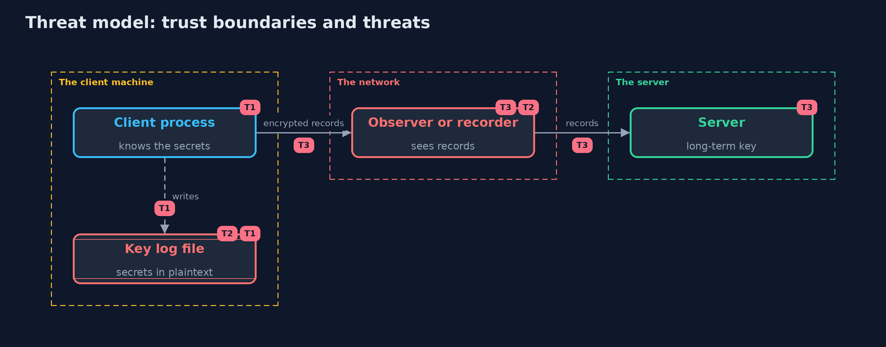

# Threat Model — Inspecting TLS Traffic with a Key Log

A threat model answers four questions: what are we protecting, who or what could harm it, how, and what do we do about it. This one covers this project's own demo system, not a production deployment. Domain: an online shop's login.

## Scope

Encrypted connections between a client and a server, a capture of them, and the key material that can open them: a key log and the server's long-term key.
It does not cover the application's own data protection, or metadata such as sizes and timing.

## What we protect (assets)

- The contents of login requests and replies, including passwords and sessions.
- The traffic secrets of live and recorded connections.
- The server's long-term private key.

## Who and what acts on the system

- A developer debugging their own client.
- A network observer who records traffic.
- An attacker who later obtains a key log or the server's private key.

## Trust boundaries

A trust boundary is a line that data or a request crosses between parts that trust each other differently. Threats cluster where those lines are.

- The client process to the file system: a key log is a copy of the secrets outside the process.
- The network: everything on it can be recorded.

Each dashed box is a trust boundary. A rose tag such as T1 shows where the threat of that number, in the table below, applies.

## Threats, using STRIDE

STRIDE is a checklist of six kinds of threat: **Spoofing** (S), **Tampering** (T), **Repudiation** (R), **Information disclosure** (I), **Denial of service** (D), **Elevation of privilege** (E).

| Id | Kind | Threat | Where it shows up | Control in this project | What is left |
| --- | --- | --- | --- | --- | --- |
| T1 | Information disclosure | A key log file is read by someone other than the developer | `KeyLog`, the file | Development only (the variable is refused in production), restricted file permissions, delete after use | Developers' laptops are not production but hold real credentials too |
| T2 | Information disclosure | A capture and a key log together reveal passwords and sessions | `Decryptor.withKeyLog` | Keep the two apart, use test accounts, and rotate any credential seen in a log | Anything seen in a capture is exposed to everyone who saw it |
| T3 | Information disclosure | A recorded connection is decrypted after the server's long-term key leaks | `Decryptor.withServerLongTermKey` | Ephemeral key exchange only (forward secrecy) | Static RSA suites that remain enabled for old clients |

## Assumptions

- The cryptography (X25519, HKDF, AES-GCM, RSA-OAEP) is sound.
- Recordings are kept for a long time.

## Out of scope

- Traffic analysis from sizes and timing.
- Attacks on the client machine that read secrets from memory.

## How the tests check this

- `TlsLogTest` checks HKDF against the RFC test vector, record sealing and its failures, wire contents, key schedule determinism, key log scope and format, the static RSA and ephemeral cases, the production check and the encodings.
- `DemoRunsTest` compares the whole demo with the golden output and checks that it is repeatable.

## Where this model goes next

The next project, certificate-pinning, covers the opposite control: a client that accepts only a known key, which also stops this kind of inspection by a proxy.
