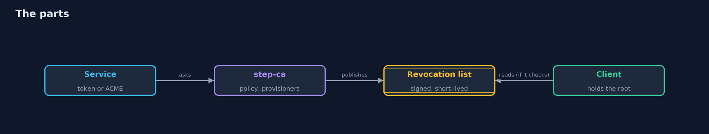
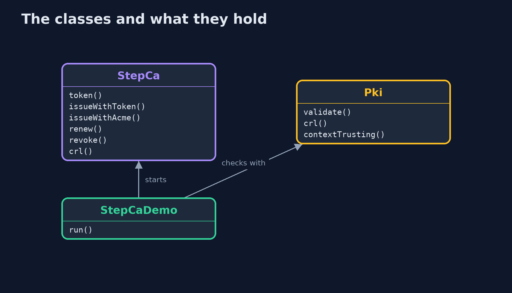

# A Local Certificate Authority with step-ca

```
src/main/java/com/jk/explore/security/stepca/
├── Pki.java         What a client does with a certificate: build the path to the root it trusts, and check revocation if it was written to
├── StepCa.java      A real step-ca in a folder of its own, and the real step command as its client
└── StepCaDemo.java  A real step-ca: what it issues to whom, how a service gets and renews a certificate, and what revocation does and does not do
```

**A real step-ca issues day-long certificates to services that ask with a one-time token or through ACME, only for the names its policy allows; a service renews with its own certificate and key, a stolen key is revoked at the CA and listed in a signed revocation list, but a client that never checks the list still accepts the certificate, and everything rests on the machine and the password that hold the issuing key.**

The plain [local-certificate-authority](../local-certificate-authority) project writes a small certificate authority in Java and ends with "in practice this is automated with ACME, as the -with-step-ca version shows". This one runs the real thing: **step-ca** and the **step** command (`brew install step`) with a JWK token provisioner and an ACME provisioner, a name policy, and a revocation list. Nothing is installed globally: every run starts a CA in a temporary folder on a free loopback port and stops it at the end. ACME validates a name by calling it back on **port 80**, so that port must be free. The tests are tagged `integration`: `./gradlew integrationTest`.

What it shows:
- **An authority that runs.** A root and an issuing authority that may not create authorities; the CA's own https certificate is trusted only by a client that was given the root; the root key is an encrypted file.
- **A certificate with a token.** A one-time token for `www.shop.localhost` gives a certificate that lasts **24 hours**; the token works once and only for its name; 2000 hours is refused; `pay.example` is refused by the **policy** (allow `localhost` and `*.shop.localhost`).
- **A certificate with ACME.** The service asks through the ACME provisioner and the CA calls its name back on port 80; the same policy applies.
- **Renewal.** `step ca renew` gives a new serial number and the same key; `step ca rekey` gives a new key; another certificate's key cannot renew.
- **Revocation, and the bill.** A revoked certificate cannot be renewed and appears in the CA's signed list. A client that checks refuses it; a client that never checks accepts it; a client that wants to check and has no list refuses. The issuing key is online and the root key is on disk.

**Maps to:** OWASP Top 10 (2025) A04 Cryptographic Failures · CWE-295 (improper certificate validation), CWE-298 · RFC 8555 (ACME), RFC 5280 (certificates and CRLs).

## The idea in everyday terms

A town office that issues day passes. You show a slip signed by your department, or you answer the phone at your own desk, and you get a pass for a day; the office will not issue a pass for a name outside the town; and a list of cancelled passes is only useful at the doors that read it.

## The scenario

An online store runs its services on names under shop.localhost and wants certificates for them without buying any. The demo plays the CA and the teams that ask it for certificates.

## Run

```bash
./gradlew run
```

The demo tells the story in 5 acts, each printing exact numbers that the tests check:

| Act | What it shows |
| --- | --- |
| 1. A certificate authority that runs | A root, an issuing authority, an https endpoint that only a client with the root can trust, and a root key in an encrypted file. |
| 2. A certificate for a service, with a token | A one-time token gives a day-long certificate for its own name; reuse, another name, a long lifetime and a name outside the policy are refused. |
| 3. A certificate for a service, with ACME | The service asks through the ACME provisioner, the CA calls its name back on port 80, and the same policy applies. |
| 4. Renewing before it ends | Renewal with the certificate and its key gives a new serial number; rekeying gives a new key; another key cannot renew. |
| 5. Revocation, and the bill | A revoked certificate cannot be renewed and appears in a signed list; only a client that checks refuses it, and the whole thing rests on one machine and one password. |

## Test

```bash
./gradlew test
```

11 tests in `DemoRunsTest`, `StepCaTest`. The tests start one CA for the whole class and stop it (./gradlew integrationTest). They need the step command and step-ca (brew install step) and a free port 80.

## What the simulation got right, and what it left out

step-ca and step are the real programs. The CA runs in a temporary folder on a free loopback port; the ACME challenge is answered on port 80 by the step command itself. Serial numbers, keys, ports and folders are never printed; the demo takes about half a minute.

## Technologies and versions

Every version below is pinned in the project's build files and was the latest stable release when the project was built.

| Technology | Version | Used for |
| --- | --- | --- |
| Java | 25 | the language and runtime; a Gradle toolchain finds or downloads the JDK |
| Gradle | 9.8.1 (wrapper) | build and run; nothing to install, the wrapper downloads it |
| tools.jackson.core:jackson-databind | 3.1.5 | library the code uses |
| org.junit.jupiter:junit-jupiter | 6.1.3, set by junit-bom | JUnit 5: the tests (tests only) |
| org.junit.platform:junit-platform-launcher | 6.1.3, set by junit-bom | JUnit platform launcher, which Gradle needs to run the tests (tests only) |
| videokit | repository tool (`tools/videokit`) | the narrated video and animation: Piper `en_US-amy-medium`, speed 0.8, longer pauses (the amy-slow voice) |

## Learning Material

| Document | What it is for |
| --- | --- |
| [Problem statement](docs/problem-statement.md) | the situation and what the project must show |
| [Prerequisites](docs/prerequisites.md) | what you need to know first |
| [A Local Certificate Authority with step-ca, explained](docs/local-certificate-authority-with-step-ca-explained.md) | the acts in prose |
| [Session guide](docs/session.md) | a one-hour lesson with exercises |
| [Animated walkthrough](docs/animation.html) | the acts step by step, narrated |
| [Threat model](docs/threat-model.md) | what is protected, who could harm it, and how, using STRIDE |
| [Spec](docs/spec.md) | what this project must be true of |
| [Expected output](docs/expected-output.txt) | the golden demo output every test and every port checks against |

### The idea in one picture

Services ask the CA; clients trust the root and may read the list.



### Where each piece sits

StepCa runs the CA and the step command; Pki is the client's side.



### How the data moves

A proof, a policy, a short life.


### Who calls whom, in order


### Video

`video/local-certificate-authority-with-step-ca-explained.mp4` (with `.m4a` audio and `.srt` subtitles) is built by `video/build_video.sh`. Rendered media is not committed.

## What it costs

- **The CA is a high-value server:** its password and its machine are what the trust rests on.
- **Every service needs a renewal job,** and a job that stops is an outage in a day.
- **Revocation reaches only the clients that check,** and a list must be fresh.
- **ACME proves control of a name, not who should have it:** the policy and the tokens decide that.
- **Every client needs the root,** installed from a source that cannot be changed on the way.

## When this is too much

For a single service with one certificate a year, a certificate from a public authority is simpler. A local authority pays off when there are many services, short lifetimes, and names that no public authority will certify.

## Where you have already met this

- `step ca certificate` or `step ca renew` in a script.
- `acme` as a provisioner name in a CA's configuration.
- A `root_ca.crt` copied into a trust store.
- A job that restarts a service after it renews a certificate.

## Where this sits

This is the tools version of [local-certificate-authority](../local-certificate-authority), in the [tls-in-practice](..) module. The next one, [tls-servers-in-practice-with-nginx-and-caddy](../tls-servers-in-practice-with-nginx-and-caddy), puts these certificates in front of the store.
