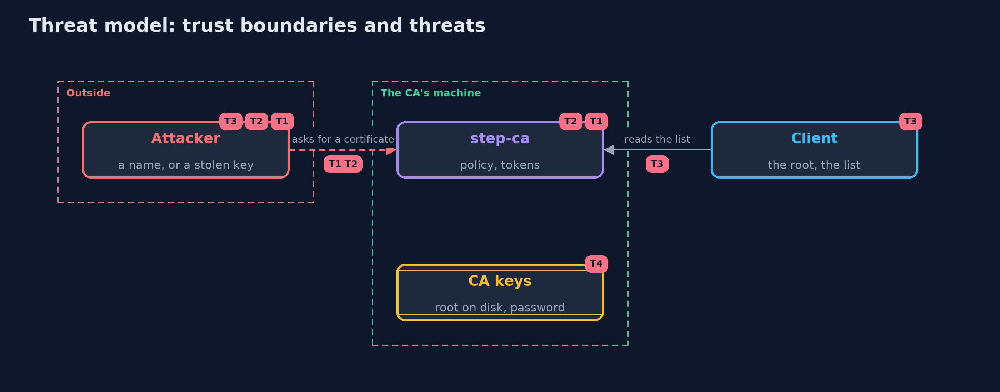

# Threat Model — A Local Certificate Authority with step-ca

A threat model answers four questions: what are we protecting, who or what could harm it, how, and what do we do about it. This one covers this project's own demo system, not a production deployment. Domain: an online store.

## Scope

A step-ca with a token and an ACME provisioner issuing day-long certificates for the store's internal names, and the clients that validate them. It covers who may obtain a certificate, renewal, and revocation. It does not cover hardware-backed keys or the network between services.

## What we protect (assets)

- The CA's issuing key and password.
- The certificates and keys of the store's services.

## Who and what acts on the system

- Teams that run services.
- An attacker who can reach the CA's address.
- An attacker who steals a service's key.

## Trust boundaries

A trust boundary is a line that data or a request crosses between parts that trust each other differently. Threats cluster where those lines are.

- The CA's machine and folder: whoever reads it can issue.
- The client's trust store: the root.

Each dashed box is a trust boundary. A rose tag such as T1 shows where the threat of that number, in the table below, applies.

## Threats, using STRIDE

STRIDE is a checklist of six kinds of threat: **Spoofing** (S), **Tampering** (T), **Repudiation** (R), **Information disclosure** (I), **Denial of service** (D), **Elevation of privilege** (E).

| Id | Kind | Threat | Where it shows up | Control in this project | What is left |
| --- | --- | --- | --- | --- | --- |
| T1 | Spoofing | Someone obtains a certificate for a name that is not theirs | the CA's provisioners | One-time tokens for one name, a name policy, ACME challenges | Whoever controls the name's address can pass the challenge |
| T2 | Elevation of privilege | A long-lived certificate is requested | the CA | A maximum lifetime of a day | A stolen key works until it ends |
| T3 | Repudiation | A revoked certificate is still accepted | clients | A signed, fresh list, and clients that fail closed without one | Clients that never check |
| T4 | Information disclosure | The CA's keys are read from its machine | the CA's folder | An encrypted root key, a password kept elsewhere | The issuing key is online |

## Assumptions

- Clients receive the root from a source that cannot be changed on the way.
- The CA's password is not stored with its key.

## Out of scope

- Compromise of the root key on offline media.
- Device attestation.

## How the tests check this

- `StepCaTest` starts a real step-ca and uses the step command for tokens, ACME, policy, lifetime, renewal, rekeying, revocation and the list, and checks them with the JDK.
- `DemoRunsTest` compares the whole demo with the golden output.

## Where this model goes next

The next project in this module, tls-servers-in-practice-with-nginx-and-caddy, serves the store with certificates from this CA.
