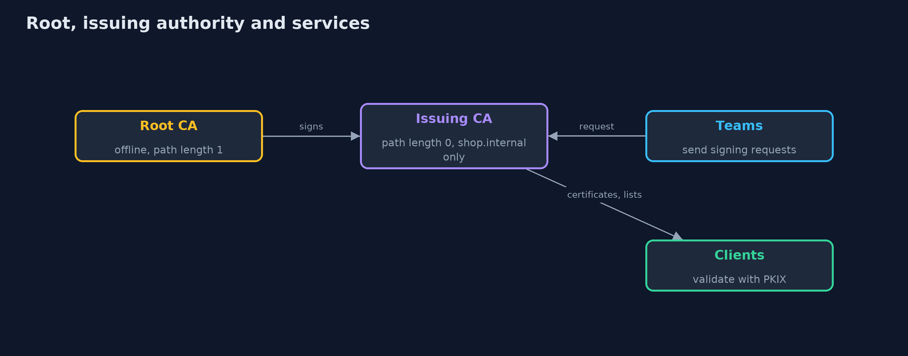
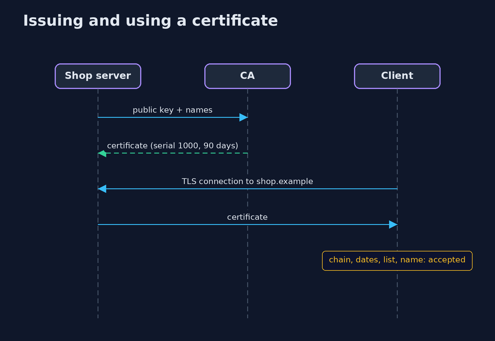

# A Local Certificate Authority

```
src/main/java/com/jk/explore/security/localca/
├── CertificateAuthority.java  The store's internal certificate authority
├── Csr.java                   Certificate signing requests (PKCS#10)
├── Inventory.java             A list of every certificate the store runs, with the ones that need attention flagged
├── Issued.java                A certificate together with its subject's key pair
├── Keys.java                  EC P-256 key pairs
├── LocalCaDemo.java           Runs the online store's internal certificate authority in five numbered acts and prints exact, repeatable results
├── Profile.java               What a certificate of one kind may be used for and how long it may live
├── RefusedException.java      The certificate authority refused a request, with the reason it gives back to the requester
├── ShortLived.java            A service that keeps a 24-hour certificate and renews it on its own, with a new key each time, once two thirds of its life has passed
└── Validator.java             What every client of the store's services does: validate the chain with the JDK's PKIX implementation against the one internal root, at a chosen time, optionally requiring a current revocation list from every issuer in the chain
```

**A small certificate authority shows what issuing really involves: the authority applies the policy itself, proves the requester holds the key, limits its own reach with name constraints, and then faces the hard part, taking a certificate back, where short-lived certificates beat revocation lists.**

A **certificate** is a signed statement that a public key belongs to a name. A **certificate authority** (CA) is whoever signs those statements, and every client that trusts the CA believes them. The store's internal services (`www`, `payments`, `orders`, `cart`) need certificates for
their own names, so the store runs its own CA. This project builds one with real X.509 certificates and revocation lists, and checks them with the JDK's own validator.

What the project measures:
- **The issuer applies the policy, not the requester.** Every request must prove the sender holds the private key, name at least one service inside `shop.internal`, come from a team allowed that name, and stay inside the lifetime of its profile.
- **The CA limits itself.** The offline root signs one issuing authority with path length zero and a name constraint, so even a stolen or buggy issuer cannot make a valid certificate for `pay.example`: clients refuse it.
- **Revocation is only as good as the list the client has.** A revoked certificate is refused by a client that checks a current list, accepted by one that never checks, and refused by a strict client when the list is out of date.
- **Short-lived certificates avoid the problem.** A 24-hour certificate renewed at two thirds of its life with a new key needs no list; if the renewal job stops, the certificate just runs out.
- **The root key is the bill.** It signs rarely and stays offline; the audit log records every decision.

**Maps to:** OWASP Top 10 (2025) A04 Cryptographic Failures · CWE-295 · CWE-299 · RFC 5280 (X.509 and CRLs) · RFC 2986 (PKCS #10 requests) · RFC 8555 (ACME) as the automation.

## The idea in everyday terms

A passport office. The office does not take your word for who you are, it checks that you hold the photo, limits itself to its own country's names, and stamps an expiry date. If a passport is lost, the office can publish a list of cancelled numbers, but only border guards who read the
latest list will notice. A passport that simply expires tomorrow needs no list at all.

## The scenario

An online store's internal services call each other over TLS. The demo runs a root CA, an issuing CA, four teams that request certificates, a validator built on the JDK's PKIX code, revocation lists, a renewing service and an inventory, all on a fixed clock.

## Run

```bash
./gradlew run
```

The demo tells the story in 5 acts, each printing exact numbers that the tests check:

| Act | What it shows |
| --- | --- |
| 1. Running a certificate authority | An offline root signs an issuing authority limited to shop.internal; the issuer applies a policy, and a name constraint still holds when the policy is skipped. |
| 2. Issuing from a signing request | The request carries only the public key and proves possession; a forged request, a name that belongs to another team and a mixed request are all refused. |
| 3. Revocation: taking a certificate back | A revoked certificate is refused by a client that checks a current list, accepted by one that never checks, and refused by a strict client when the list is out of date. |
| 4. Short-lived certificates instead of revocation | A 24-hour certificate renews at two thirds of its life with a new key: 4 renewals in 72 hours and no failed check, and a stopped job simply expires; the inventory flags what needs attention. |
| 5. The bill | The root key signed 3 times and stays offline; revoking the issuing authority with the root's list refuses every certificate below it; the audit log holds 18 decisions, 6 of them refusals. |

## Test

```bash
./gradlew test
```

16 tests in `DemoRunsTest`, `LocalCaTest`. Keys are random and never printed, and the clock is fixed, so the demo prints the same text on every run.

## What the simulation got right, and what it left out

The certificates and revocation lists are real DER, built with Bouncy Castle and validated by the JDK's own PKIX implementation. The teams, the clock and the renewal job are small models. Keys are random and never printed, so the demo prints the same text on every run.

## Technologies and versions

Every version below is pinned in the project's build files and was the latest stable release when the project was built.

| Technology | Version | Used for |
| --- | --- | --- |
| Java | 25 | the language and runtime; a Gradle toolchain finds or downloads the JDK |
| Gradle | 9.8.1 (wrapper) | build and run; nothing to install, the wrapper downloads it |
| org.bouncycastle:bcprov-jdk18on | 1.86 | Bouncy Castle: algorithms and providers the JDK lacks |
| org.bouncycastle:bcpkix-jdk18on | 1.86 | Bouncy Castle PKIX: PEM, X.509 certificates and CMS |
| org.junit.jupiter:junit-jupiter | 6.1.3, set by junit-bom | JUnit 5: the tests (tests only) |
| org.junit.platform:junit-platform-launcher | 6.1.3, set by junit-bom | JUnit platform launcher, which Gradle needs to run the tests (tests only) |
| videokit | repository tool (`tools/videokit`) | the narrated video and animation: Piper `en_US-amy-medium`, speed 0.8, longer pauses (the amy-slow voice) |

## Learning Material

| Document | What it is for |
| --- | --- |
| [Problem statement](docs/problem-statement.md) | the situation and what the project must show |
| [Prerequisites](docs/prerequisites.md) | what you need to know first |
| [A Local Certificate Authority, explained](docs/local-certificate-authority-explained.md) | the acts in prose |
| [Session guide](docs/session.md) | a one-hour lesson with exercises |
| [Animated walkthrough](docs/animation.html) | the acts step by step, narrated |
| [Threat model](docs/threat-model.md) | what is protected, who could harm it, and how, using STRIDE |
| [Spec](docs/spec.md) | what this project must be true of |
| [Expected output](docs/expected-output.txt) | the golden demo output every test and every port checks against |

### The idea in one picture

The root signs once and stays offline; the issuing authority signs for the services.



### Where each piece sits

The authority issues through one method and the validator checks what it made.


### How the data moves

A request is refused at the first failing check.


### Who calls whom, in order




### Video

`video/local-certificate-authority-explained.mp4` (with `.m4a` audio and `.srt` subtitles) is built by `video/build_video.sh`. Rendered media is not committed.

## What it costs

- **The root key must stay offline.** It signs three times in the whole demo; a stolen root key means every client has to be changed.
- **Revocation needs publishing and checking.** The authority must publish lists on time and every client must fetch and enforce them, or the list does nothing.
- **Short-lived certificates need automation.** Every service needs a request, a renewal job and a deployment step, which is what ACME does.
- **Name constraints are only as good as the clients.** A client that ignores them accepts the stray certificate, so test the clients you use.
- **An authority is a high-value target.** Keep an audit log of every issue and refusal, and guard the issuing key more than any single service key.

## When this is too much

For a handful of services, a managed or ACME-based internal CA (such as step-ca, covered by the `-with-step-ca` version) is better than hand-built code, and public certificates are better still where a public name is available. Build an authority by hand to understand it, not to run it.

## Where you have already met this

- `openssl ca` and `openssl req` for signing requests.
- `keytool -genkeypair` and `-gencert`.
- The Subject Alternative Name list in a browser's certificate viewer.
- "CRL" and "OCSP" in a certificate's details, and the 90-day certificates of Let's Encrypt.

## Where this sits

This project opens the [tls-in-practice](..) module. The [certificate-pinning](../certificate-pinning) and [tls-misconfigurations](../tls-misconfigurations) projects use certificates like the ones built here, each with a small copy of the code so every project stands alone.
