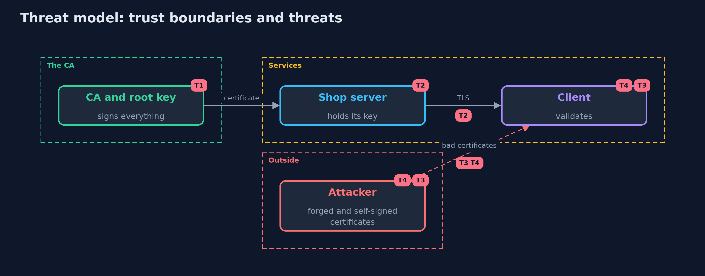

# Threat Model — A Local Certificate Authority

A threat model answers four questions: what are we protecting, who or what could harm it, how, and what do we do about it. This one covers this project's own demo system, not a production deployment. Domain: a shop's private certificate authority.

## Scope

A private certificate authority and the clients that trust its root. It covers issuing, validation, renewal and revocation of server certificates.
It does not cover the physical security of the root key, OCSP, or certificate transparency.

## What we protect (assets)

- The root private key.
- The trust that clients place in the root.
- The servers' private keys.

## Who and what acts on the system

- The operator running the CA.
- A client validating a server.
- An attacker with a self-made certificate, a stolen server key, or a leaf key.

## Trust boundaries

A trust boundary is a line that data or a request crosses between parts that trust each other differently. Threats cluster where those lines are.

- CA to servers: certificates go out, keys never do.
- Server to client: a certificate is untrusted until validated.

Each dashed box is a trust boundary. A rose tag such as T1 shows where the threat of that number, in the table below, applies.

## Threats, using STRIDE

STRIDE is a checklist of six kinds of threat: **Spoofing** (S), **Tampering** (T), **Repudiation** (R), **Information disclosure** (I), **Denial of service** (D), **Elevation of privilege** (E).

| Id | Kind | Threat | Where it shows up | Control in this project | What is left |
| --- | --- | --- | --- | --- | --- |
| T1 | Elevation of privilege | The CA key signs a certificate for a name the requester does not control | `LocalCa.issue` | Issue only after the requester proves control of the name; offline root, name constraints | The demo CA signs whatever it is asked: a real one needs an approval step |
| T2 | Information disclosure | A server's private key is stolen and used to impersonate it | Shop server | Short-lived certificates, revocation, new key at renewal | Exposure until expiry or until clients have the new list |
| T3 | Spoofing | A forged, self-signed, other-authority or leaf-signed certificate is accepted | `Verifier.check` | Chain to the trusted root, signature, basic constraints, usage and name checks through the PKIX validator | A client that skips validation |
| T4 | Repudiation | A revoked certificate stays trusted because the client has no current list | `Verifier.check` revocation | Hard fail on a missing or stale list; short lifetimes | Hard fail turns a list outage into a connection outage |

## Assumptions

- The root key is not compromised, and clients have the genuine root certificate.
- Clients have a reasonably correct clock.

## Out of scope

- A stolen root key: the whole system must be rebuilt.
- Public CAs and certificate transparency.

## How the tests check this

- `CaTest` checks the DER encodings, what the JDK reads back, names, dates, issuers, forged signatures, CA flags, revocation with current, stale and missing lists, and renewal.
- `DemoRunsTest` compares the whole demo with the golden output.

## Where this model goes next

The next project, tls-misconfigurations, checks the TLS servers that use these certificates for weak settings.
