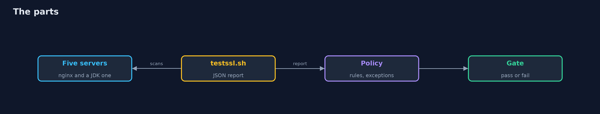
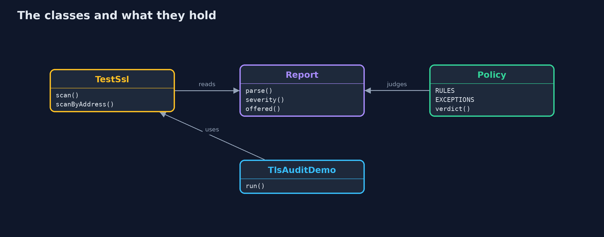
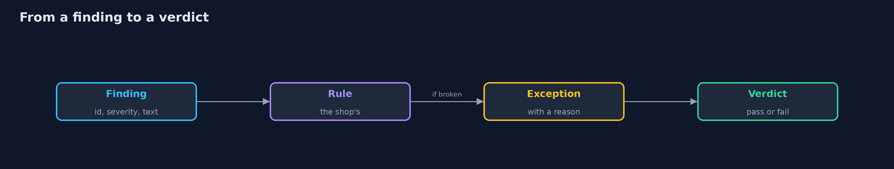
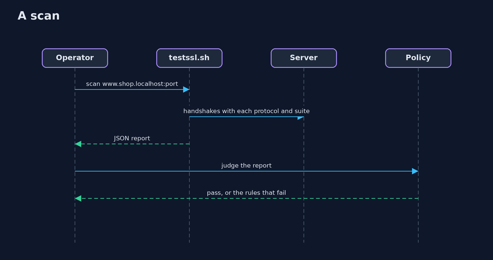

# TLS Misconfigurations with testssl.sh

```
src/main/java/com/jk/explore/security/tlsaudit/
├── LegacyServer.java  A server that speaks what old clients speak: TLS 1.0 and 1.1 next to 1.2, and only RSA key exchange, so no forward secrecy
├── LocalCa.java       A root made with the step command, and the certificates it signs, good and bad
├── Nginx.java         A real nginx on a loopback port, with a TLS configuration written for each case
├── Policy.java        The shop's own rules for a TLS server, written over what testssl.sh reports, and the exceptions that have a reason and a name
├── Procs.java         Small helpers for running programs
├── Report.java        What testssl.sh wrote in its JSON file: one finding per check, each with the severity testssl gives it
├── TestSsl.java       The real testssl.sh, pointed at one server on a loopback port with the name a browser would use
├── TlsAuditDemo.java  The five scans the acts read
└── WorkedOut.java     A teaching class: redoes by hand three checks that testssl.sh only reports, so the demo can show how each one is made
```

**testssl.sh reads a server the way a client does and reports protocols, cipher suites, the certificate and the headers with its own severities; a TLS gate is the shop's own list of rules written over that report, with exceptions that carry a reason, because a copied configuration breaks rules no browser shows, an old protocol is only LOW to the tool and forbidden by the rule, and a scan by address reports a false name problem.**

The plain [tls-misconfigurations](../tls-misconfigurations) project reads a server's TLS settings in Java and grades them. This one runs the real scanner, **testssl.sh** (`brew install testssl`), against five real local servers started by the demo, reads its JSON file, and writes the shop's own **policy** over it. It also needs `nginx` and the `step` command (`brew install nginx step`). Nothing is installed globally and no Docker is needed; `./gradlew test` needs none of them: it prints the whole demo from six JSON files that testssl.sh wrote in one real run (`src/test/resources/scans`); the tests that start servers and scan them are tagged `integration`: `./gradlew integrationTest`.

What it shows:
- **A server that follows the guidance.** TLS 1.2 and 1.3, strong suites with forward secrecy, a certificate that chains to the lab's root, HSTS for two years. testssl itself calls one finding HIGH: no CRL or OCSP URI. The shop's policy has an **exception** for it, with a reason.
- **A configuration copied from the first search result.** Same certificate, same protocols; it breaks four rules no browser shows: obsolete suites, no HSTS, no security headers, a version in the `Server` header.
- **A server that speaks what old clients speak.** Written with the JDK (which refuses to unless told): TLS 1.0 and 1.1, only RSA key exchange. testssl calls the old protocols **LOW**; the shop's rule refuses them.
- **Certificates clients will refuse.** An expired one and one for another name.
- **The bill.** A scan by address reports a name problem that is not real; a scan is a snapshot; an exception without a reason is a switch someone will turn off.

**Maps to:** OWASP Top 10 (2025) A02 Security Misconfiguration and A04 Cryptographic Failures · CWE-326 (inadequate encryption strength), CWE-327, CWE-295 · NIST SP 800-52 · Mozilla's server-side TLS guidelines.

## The idea in everyday terms

A building inspector with a long checklist. The inspector writes what is there and how worried the code book is about it; the owner decides which items are a condition of opening the shop, and writes down, with a reason, the few that are waived.

## The scenario

An online store runs several services behind TLS and wants to know, before a customer's browser does, which of them are wrong and why. The demo plays the store's operator with a scanner.

## Run

```bash
./gradlew run
```

The demo tells the story in 5 acts, each printing exact numbers that the tests check:

| Act | What it shows |
| --- | --- |
| 1. A server that follows the guidance | nginx with TLS 1.2 and 1.3, six ECDHE suites, HSTS and four security headers: testssl.sh calls one finding HIGH (no CRL or OCSP URI), the shop's eleven rules break only revocation, which has a written exception, so the gate passes. |
| 2. A configuration copied from the first search result | The same certificate and protocols without ssl_ciphers, headers or server_tokens off: testssl.sh still calls only cert_revocation HIGH, but four of the shop's rules break, none of them visible in a browser. |
| 3. A server that still speaks what old clients speak | A JDK server told to offer TLS 1.0, 1.1 and 1.2 with RSA key exchange only: testssl.sh rates the old protocols LOW and the missing forward secrecy MEDIUM, so a gate on HIGH or CRITICAL sees the same list for all three servers; the shop's rules fail it on six. |
| 4. Certificates that clients will refuse | A certificate that lived 48 hours and ended before the scan is CRITICAL for its chain and its expiry; one for pay.shop.localhost served as www.shop.localhost is HIGH because the name is not listed. The gate fails each on its own rule. |
| 5. The bill | The guided server scanned by its address instead of its name fails the name rule: 127.0.0.1 is not in the certificate, a false alarm. A scan sees the handshake and the page at / at one moment, so it is run by name, after every change and on a schedule. |

## Test

```bash
./gradlew test
```

21 tests in `DemoRunsTest`, `PolicyTest`, `RecordedScansTest`, `TlsAuditTest`. The policy tests and the recorded-scan tests (the whole demo printed from six saved testssl.sh JSON files) need nothing. The live scan tests start the servers once for the whole class and need nginx, step and testssl.sh (./gradlew integrationTest).

## What the simulation got right, and what it left out

The servers are real: four nginx instances and one written with the JDK, on free loopback ports, with certificates from a root made with the step command. testssl.sh runs as a program and its JSON file is read back. Ports, dates and counts that change are never printed; the demo takes about a minute.

## Technologies and versions

Every version below is pinned in the project's build files and was the latest stable release when the project was built.

| Technology | Version | Used for |
| --- | --- | --- |
| Java | 25 | the language and runtime; a Gradle toolchain finds or downloads the JDK |
| Gradle | 9.8.1 (wrapper) | build and run; nothing to install, the wrapper downloads it |
| tools.jackson.core:jackson-databind | 3.1.5 | library the code uses |
| org.junit.jupiter:junit-jupiter | 6.1.3, set by junit-bom | JUnit 5: the tests (tests only) |
| org.junit.platform:junit-platform-launcher | 6.1.3, set by junit-bom | JUnit platform launcher, which Gradle needs to run the tests (tests only) |
| videokit | repository tool (`tools/videokit`) | the narrated video and animation: Piper `en_US-amy-medium`, speed 0.8, longer pauses (the amy-slow voice) |

## Learning Material

| Document | What it is for |
| --- | --- |
| [Problem statement](docs/problem-statement.md) | the situation and what the project must show |
| [Prerequisites](docs/prerequisites.md) | what you need to know first |
| [TLS Misconfigurations with testssl.sh, explained](docs/tls-misconfigurations-with-testssl-explained.md) | the acts in prose |
| [Session guide](docs/session.md) | a one-hour lesson with exercises |
| [Animated walkthrough](docs/animation.html) | the acts step by step, narrated |
| [Threat model](docs/threat-model.md) | what is protected, who could harm it, and how, using STRIDE |
| [Spec](docs/spec.md) | what this project must be true of |
| [Expected output](docs/expected-output.txt) | the golden demo output every test and every port checks against |

### The idea in one picture

Servers on one side, the scanner and the shop's policy on the other.



### Where each piece sits

A scanner, a report and a policy.



### How the data moves

The tool's severity is only one input.



### Who calls whom, in order




### Video

`video/tls-misconfigurations-with-testssl-explained.mp4` (with `.m4a` audio and `.srt` subtitles) is built by `video/build_video.sh`. Rendered media is not committed.

## What it costs

- **A scan takes about fifteen seconds per server,** and many more with the vulnerability checks.
- **The tool's severities are its own:** the shop's rules decide what blocks a release.
- **Every exception needs a reason** and a person who reads it again.
- **A scan is a snapshot** of one moment and one path.
- **A false alarm costs trust in the gate** as much as a missed finding costs safety.

## When this is too much

A single static site on a managed host, with the host's own defaults, gains little from a policy of its own. The gate pays off when the shop runs several servers, changes them often, or must show its auditors what it checks.

## Where you have already met this

- A report from an online SSL test tool, with a letter grade.
- `ssl_protocols` and `ssl_ciphers` lines copied from a blog post.
- A scanner step in a pipeline that fails on severity HIGH.
- A certificate that expired on a Sunday.

## Where this sits

This is the tools version of [tls-misconfigurations](../tls-misconfigurations), in the [tls-in-practice](..) module. The servers it scans are the kind configured in [tls-servers-in-practice-with-nginx-and-caddy](../tls-servers-in-practice-with-nginx-and-caddy).
