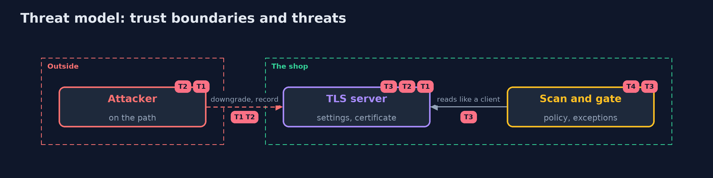

# Threat Model — TLS Misconfigurations with testssl.sh

A threat model answers four questions: what are we protecting, who or what could harm it, how, and what do we do about it. This one covers this project's own demo system, not a production deployment. Domain: an online store.

## Scope

The TLS settings and certificates of the shop's servers, as a client sees them, and the scan and the gate that check them. It does not cover the applications behind the servers.

## What we protect (assets)

- The shoppers' traffic.
- The shop's certificates and keys.

## Who and what acts on the system

- An attacker who can record or alter traffic.
- An operator who copies a configuration.

## Trust boundaries

A trust boundary is a line that data or a request crosses between parts that trust each other differently. Threats cluster where those lines are.

- The network between the browser and the server.
- The policy file: what the shop decides to require.

Each dashed box is a trust boundary. A rose tag such as T1 shows where the threat of that number, in the table below, applies.

## Threats, using STRIDE

STRIDE is a checklist of six kinds of threat: **Spoofing** (S), **Tampering** (T), **Repudiation** (R), **Information disclosure** (I), **Denial of service** (D), **Elevation of privilege** (E).

| Id | Kind | Threat | Where it shows up | Control in this project | What is left |
| --- | --- | --- | --- | --- | --- |
| T1 | Tampering | A downgrade to an old protocol or weak suite | the server's protocol and suite lists | A rule that refuses old protocols and obsolete suites | Clients that cannot speak anything better |
| T2 | Information disclosure | Recorded traffic is opened later with a stolen key | key exchange | A rule that requires forward secrecy | Sessions before the change |
| T3 | Spoofing | A certificate that is expired or for another name | the certificate | Rules for the chain, the name and the expiry, scanned on a schedule | The days between scans |
| T4 | Repudiation | An exception that nobody can explain | the policy | Every exception names the rule and a reason | Reasons that are never read again |

## Assumptions

- The scan runs from where clients can reach the server, by name.
- The policy is reviewed like code.

## Out of scope

- Vulnerabilities in the server programs.
- The applications behind TLS.

## How the tests check this

- `PolicyTest` checks the report reader, the rules, the exception and the nginx configurations with no server.
- `TlsAuditTest` starts five servers and the real testssl.sh and checks the protocols, the certificates, the copied configuration and the false alarm.
- `DemoRunsTest` compares the whole demo with the golden output.

## Where this model goes next

The next project in this module, inspecting-tls-traffic-with-wireshark, looks at the traffic itself.
