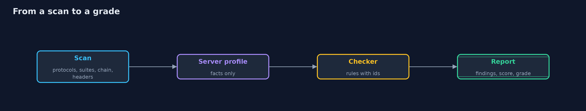
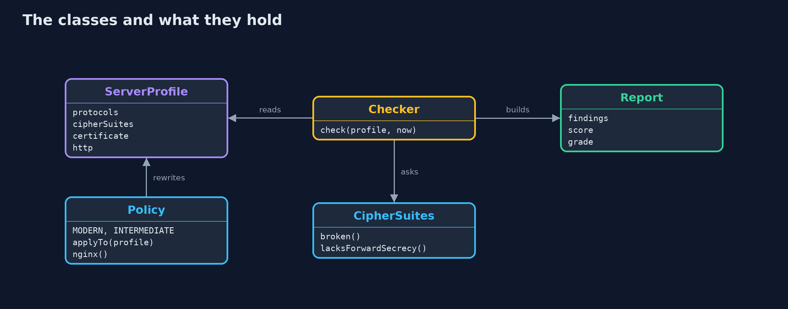
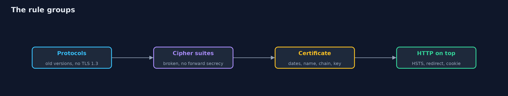
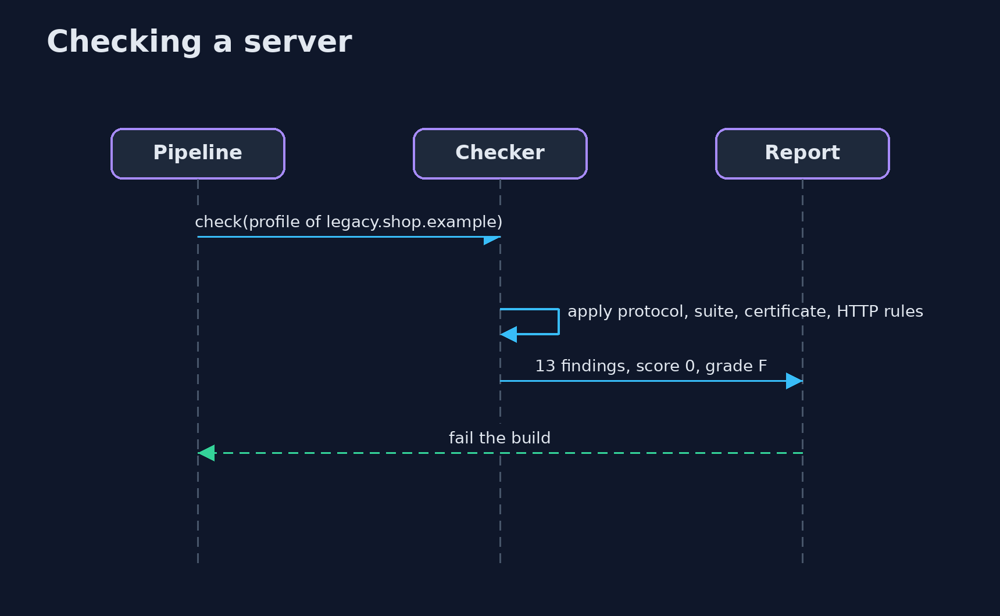

# Finding TLS Misconfigurations

```
src/main/java/com/jk/explore/security/tlscheck/
├── CertFacts.java      What a scan learns about a server's certificate chain, in the terms a checker needs
├── Checker.java        Turns a server profile into findings and a grade
├── CipherSuites.java   Classifies a cipher suite by its IANA name
├── Finding.java        One thing the checker found, with a stable rule id that a build can allow-list or fail on
├── HttpFacts.java      What the HTTPS site says about itself on top of TLS
├── Policy.java         A target configuration, after the Mozilla "modern" and "intermediate" profiles, that a server can be moved to and a config file generated from
├── Profiles.java       Four fixed servers for the demo: a good one, a legacy one, one with a broken certificate, and one that only forgot its HTTP settings
├── Report.java         The findings for one server, worst first, and a grade from A to F
├── ServerProfile.java  Everything a scan of one server found
├── Severity.java       How bad a finding is, and how many points it costs
└── TlsCheckDemo.java   Runs the four-server scan in four numbered acts and prints exact, repeatable results
```

**Most TLS failures are settings, not algorithms: old protocols, weak or non-forward-secret suites, an expired or incomplete certificate chain, a missing name, no HSTS; a checker with stable rule ids and a grade finds them all, and a policy fixes the ones a configuration can fix.**

A server that "has HTTPS" can still be badly set up. Old protocol versions (SSL 3, TLS 1.0 and 1.1), cipher suites that are broken (RC4, 3DES, export grades, NULL, anonymous) or that give no **forward secrecy**, a certificate that expired last week, one for the wrong name,
a chain missing its **intermediate certificate**, a weak key or a SHA-1 signature, no **HSTS**, a session cookie without `Secure`: each is a setting somebody chose or forgot to choose.

This project writes the checker that finds them. It takes a *profile* of a server (what a scan learned), applies rules with stable ids and severities, and produces a **report**: findings worst first, a score and a grade A to F. Then it moves a legacy server to a
**policy** (after Mozilla's "intermediate" profile) and generates the matching nginx settings.

The rules, grouped:
- **Protocols:** SSL 3, TLS 1.0, TLS 1.1 enabled; no TLS 1.2 or 1.3 at all; no TLS 1.3.
- **Cipher suites:** broken suites, suites without forward secrecy, CBC suites, a server that lets the client choose.
- **Certificate:** expired, not yet valid, expiring within 14 days, wrong name (wildcards cover one label), self-signed or untrusted, incomplete chain, weak key, weak signature.
- **HTTP on top:** HSTS missing, short or without subdomains; no redirect from HTTP; session cookie without `Secure`.
- **Protocol features:** TLS compression, insecure renegotiation.

**Maps to:** OWASP Top 10 (2025) A02 Security Misconfiguration and A04 Cryptographic Failures · CWE-326 · CWE-327 · CWE-295 · OWASP ASVS 5.0, the communications security requirements · Mozilla server-side TLS guidelines.

## The idea in everyday terms

Think of a building inspector with a checklist: door locks, fire exits, the age of the wiring, the date on the extinguisher. Each item has a name, a severity and a fix, and the report ends in a grade. The inspector does not break in; they read what is there.

## The scenario

An online shop runs four servers: one that follows the guidance, a legacy one, one whose certificate is broken, and one whose owner forgot the HTTP settings. The profiles are fixed data, shaped like the results of a real scan, so every run gives the same report.

## Run

```bash
./gradlew run
```

The demo tells the story in 4 acts, each printing exact numbers that the tests check:

| Act | What it shows |
| --- | --- |
| 1. A server that follows the guidance | TLS 1.2 and 1.3 with forward-secret AEAD suites, a valid complete certificate and HSTS: grade A, no findings. |
| 2. A legacy server | 13 findings, grade F: old protocols, RC4 and 3DES, no forward secrecy, a 1024-bit SHA-1 certificate, compression, no secure renegotiation, no redirect and a one-day HSTS. |
| 3. A certificate that clients will refuse, and a forgotten HTTP setup | pay.shop.example has an expired certificate for the wrong name with no intermediate (F); blog.shop.example is modern but has an incomplete chain, an expiry in 10 days and no HSTS, redirect or Secure cookie (D). |
| 4. Moving the legacy server to a policy | The intermediate policy removes 9 of the 13 findings and generates the nginx settings; weak-key, weak-signature, no-https-redirect and short-hsts must be fixed by hand. |

## Test

```bash
./gradlew test
```

11 tests in `DemoRunsTest`, `TlsCheckTest`. Everything is fixed data and a fixed date, so the demo prints the same text on every run.

## What the simulation got right, and what it left out

The servers are described by fixed profiles, so the project is about the rules and the report, not about network scanning. The rules follow the Mozilla server-side TLS guidance and the usual scanner checks; the cipher classification works on IANA suite names.

## Technologies and versions

Every version below is pinned in the project's build files and was the latest stable release when the project was built.

| Technology | Version | Used for |
| --- | --- | --- |
| Java | 25 | the language and runtime; a Gradle toolchain finds or downloads the JDK |
| Gradle | 9.8.1 (wrapper) | build and run; nothing to install, the wrapper downloads it |
| org.junit.jupiter:junit-jupiter | 6.1.3, set by junit-bom | JUnit 5: the tests (tests only) |
| org.junit.platform:junit-platform-launcher | 6.1.3, set by junit-bom | JUnit platform launcher, which Gradle needs to run the tests (tests only) |
| videokit | repository tool (`tools/videokit`) | the narrated video and animation: Piper `en_US-amy-medium`, speed 0.8, longer pauses (the amy-slow voice) |

## Learning Material

| Document | What it is for |
| --- | --- |
| [Problem statement](docs/problem-statement.md) | the situation and what the project must show |
| [Prerequisites](docs/prerequisites.md) | what you need to know first |
| [Finding TLS Misconfigurations, explained](docs/tls-misconfigurations-explained.md) | the acts in prose |
| [Session guide](docs/session.md) | a one-hour lesson with exercises |
| [Animated walkthrough](docs/animation.html) | the acts step by step, narrated |
| [Threat model](docs/threat-model.md) | what is protected, who could harm it, and how, using STRIDE |
| [Spec](docs/spec.md) | what this project must be true of |
| [Expected output](docs/expected-output.txt) | the golden demo output every test and every port checks against |

### The idea in one picture

The checker does not touch the server; it reads a profile.



### Where each piece sits

A profile goes in, a report comes out; a policy rewrites the profile.



### How the data moves

A critical finding in any group gives grade F.



### Who calls whom, in order




### Video

`video/tls-misconfigurations-explained.mp4` (with `.m4a` audio and `.srt` subtitles) is built by `video/build_video.sh`. Rendered media is not committed.

## What it costs

- **Old clients break.** Turning off TLS 1.0, 1.1 and 3DES is right for the public web, and wrong for a factory device that cannot be updated: write down who they are.
- **Grades are blunt.** A single rule can matter more or less in your setting, which is why findings have ids a team can accept with a reason.
- **A scan is a snapshot.** Certificates expire and settings drift; run the checker on a schedule and in the pipeline.
- **Real scans are slower and messier than this model:** they try every protocol and suite, and servers behave differently by client.
- **HSTS is hard to undo.** A long max-age on a site that later loses HTTPS locks visitors out; start short and raise it.

## When this is too much

If you terminate TLS at a managed load balancer or CDN, use its vetted policy and check it with this kind of tool, rather than hand-picking suites. Do not hand-tune cipher lists from memory: start from a published profile.

## Where you have already met this

- A grade A+ to F from SSL Labs.
- `ssl_protocols`, `ssl_ciphers` and `Strict-Transport-Security` in nginx and Apache configurations.
- Browser errors: NET::ERR_CERT_DATE_INVALID, ERR_CERT_COMMON_NAME_INVALID and "incomplete chain".
- `testssl.sh` and `nmap --script ssl-enum-ciphers`.

## Where this sits

This project is in [tls-in-practice](..). It checks the servers that use certificates like those issued in [local-certificate-authority](../local-certificate-authority), and prepares the testssl version
(tls-misconfigurations-with-testssl). The handshake itself is in the beginner [tls-handshake](../../../beginner/transport-security/tls-handshake) project.
