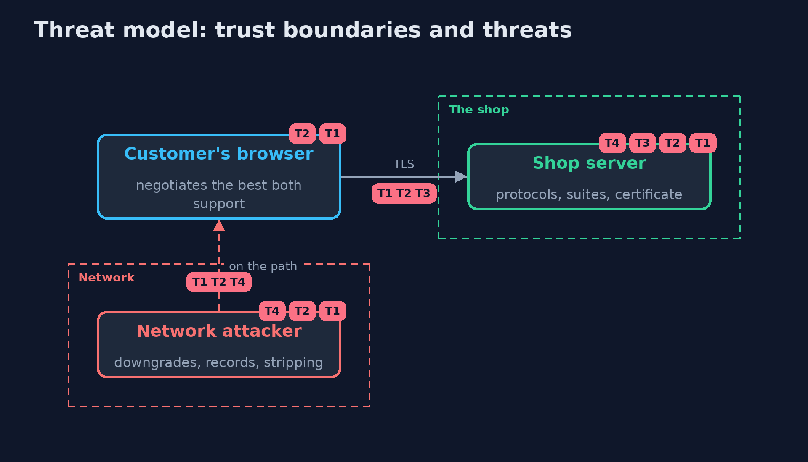

# Threat Model — Finding TLS Misconfigurations

A threat model answers four questions: what are we protecting, who or what could harm it, how, and what do we do about it. This one covers this project's own demo system, not a production deployment. Domain: an online shop's servers.

## Scope

The TLS and HTTPS configuration of a shop's servers. It covers protocols, suites, certificates and HSTS-related settings as seen by a client.
It does not cover application bugs, the TLS library's own vulnerabilities, or the certificate authority's operation.

## What we protect (assets)

- The confidentiality and integrity of customers' traffic.
- The identity of the shop's servers.

## Who and what acts on the system

- A customer's browser.
- A network attacker who can read and change traffic, or record it for later.
- The operator who sets up the server.

## Trust boundaries

A trust boundary is a line that data or a request crosses between parts that trust each other differently. Threats cluster where those lines are.

- Client to server across an untrusted network.

Each dashed box is a trust boundary. A rose tag such as T1 shows where the threat of that number, in the table below, applies.

## Threats, using STRIDE

STRIDE is a checklist of six kinds of threat: **Spoofing** (S), **Tampering** (T), **Repudiation** (R), **Information disclosure** (I), **Denial of service** (D), **Elevation of privilege** (E).

| Id | Kind | Threat | Where it shows up | Control in this project | What is left |
| --- | --- | --- | --- | --- | --- |
| T1 | Tampering | A downgrade to an old protocol or a broken suite lets the attacker read or change traffic | `Checker` protocol and cipher rules | Offer TLS 1.2 and 1.3 only, with AEAD suites, server preference | Clients that need old protocols are cut off by design |
| T2 | Information disclosure | Recorded traffic is decrypted later after the server key leaks | suites without forward secrecy | ECDHE or TLS 1.3 only | Session tickets kept too long can weaken forward secrecy |
| T3 | Spoofing | Clients reject or misjudge the certificate: expired, wrong name, incomplete chain, weak key | `Checker` certificate rules | Monitoring, full chain, modern keys and signatures, renewal automation | Expiry between scans |
| T4 | Tampering | A first plain HTTP request is intercepted and the connection never reaches HTTPS | `Checker` HTTP rules | Redirect, HSTS with subdomains and preload where suitable, Secure cookies | The very first visit before HSTS is known |

## Assumptions

- The profile is an accurate result of a scan.
- The clients the shop must support all handle the policy's protocols and suites.

## Out of scope

- Library vulnerabilities, which need patching.
- Issuance and revocation: local-certificate-authority.

## How the tests check this

- `TlsCheckTest` checks every rule on both sides of its boundary, wildcard matching, the cipher classification, the grading rules, the worst-first order and the policy.
- `DemoRunsTest` compares the whole demo with the golden output.

## Where this model goes next

The next project, inspecting-tls-traffic, shows what a key log file gives away about an encrypted connection.
