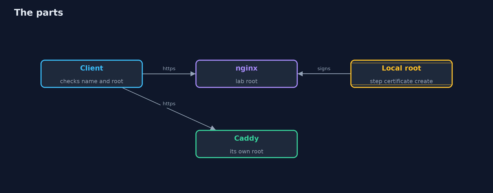
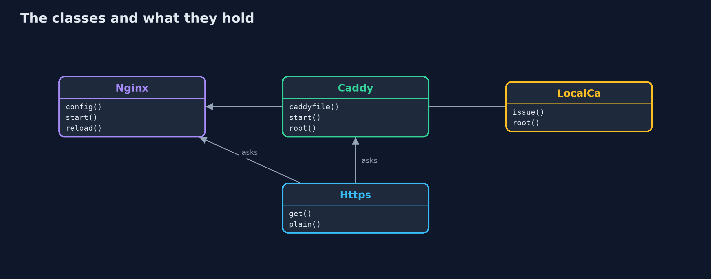

# TLS Servers in Practice with nginx and Caddy

```
src/main/java/com/jk/explore/security/tlsservers/
├── Caddy.java           A real Caddy on loopback ports, with its own local certificate authority, run in a folder of its own
├── Https.java           A small HTTPS client over a socket: the address is 127.0.0.1, the name is whatever the test says, so names under .localhost need no resolver
├── LocalCa.java         A root made with the step command, and certificates it signs directly; nginx has no CA of its own
├── Nginx.java           A real nginx on loopback ports, with a configuration written for each case, run in a folder of its own
├── Procs.java           Small helpers for running programs
└── TlsServersDemo.java  
```

**A real nginx serves the shop with a certificate from a local root and needs a line for each choice (protocol versions, hiding the version, HSTS, a reload after each new certificate), where a location's own add_header silently replaces the server's HSTS; a real Caddy makes its own local authority and 12-hour certificates, redirects and renews by itself; and neither staples an OCSP answer when the certificate names no responder.**

This project puts the same small shop behind two real servers, **nginx** and **Caddy** (`brew install nginx caddy`), both started by the demo on loopback ports, and reads the result with a small HTTPS client written with the JDK. For nginx, the certificate comes from a local root made with the `step` command. Caddy makes its own. Nothing is installed globally and no Docker is needed; the tests are tagged `integration`: `./gradlew integrationTest`.

What it shows:
- **nginx with a certificate from a local authority.** A client that trusts the lab's root gets `200` over TLS 1.3; a client with only its default roots refuses; a name the certificate does not carry is refused; http is sent on with a `301`; the `Server` header gives the exact version until `server_tokens off`.
- **Protocol versions.** The default accepts a client that offers only TLS 1.2; `ssl_protocols TLSv1.3` refuses it.
- **HSTS, and a trap.** The header is absent by default and sent over https only; a `location` with its own `add_header` **replaces** the server's, and the page loses HSTS until the line is repeated.
- **Caddy.** The Caddyfile names only the site; Caddy made a root, an intermediate and **12-hour** certificates and renews them; it redirects with `308`, says only `Caddy`, accepts TLS 1.2 by default and sends HSTS only when told.
- **The bill.** OCSP stapling needs a responder named in the certificate; a new certificate is served by nginx only after a reload.

**Maps to:** OWASP Top 10 (2025) A02 Security Misconfiguration and A04 Cryptographic Failures · CWE-319 (cleartext transmission), CWE-326 · RFC 6797 (HSTS), RFC 6066 (OCSP stapling).

## The idea in everyday terms

Two shops with locks on their doors. One lock is fitted by hand, bolt by bolt, and each bolt is yours to remember; the other comes with a locksmith who changes the key every morning but chooses the lock for you.

## The scenario

An online store wants its pages served only over https, with certificates from its own authority. The demo starts both servers, asks them what a client sees, and changes one line at a time.

## Run

```bash
./gradlew run
```

The demo tells the story in 5 acts, each printing exact numbers that the tests check:

| Act | What it shows |
| --- | --- |
| 1. nginx with a certificate from the local authority | A client with the lab's root gets the page over TLS 1.3; the default roots, a wrong name and plain http each get their own answer. |
| 2. Which protocol versions it speaks | The default accepts a client that offers only TLS 1.2; one line makes the server refuse it. |
| 3. HSTS, and the add_header trap | The header is absent by default and sent over https only; a location's own add_header replaces the server's, and the page loses HSTS. |
| 4. Caddy makes its own certificates | A Caddyfile that names only the site gives a local authority, 12-hour certificates, a redirect and automatic renewal. |
| 5. The bill | Stapling needs a responder; nginx serves the old certificate until it is reloaded; every client needs the right root. |

## Test

```bash
./gradlew test
```

11 tests in `DemoRunsTest`, `TlsServersTest`. The tests start one nginx and one Caddy for the whole class (./gradlew integrationTest). They need nginx, caddy and the step command.

## What the simulation got right, and what it left out

nginx and Caddy are the real programs, in temporary folders, on free loopback ports. Names under .localhost need no resolver because the client connects to 127.0.0.1 and sends the name as the server name. Ports, serial numbers and dates are never printed; the demo takes about half a minute.

## Technologies and versions

Every version below is pinned in the project's build files and was the latest stable release when the project was built.

| Technology | Version | Used for |
| --- | --- | --- |
| Java | 25 | the language and runtime; a Gradle toolchain finds or downloads the JDK |
| Gradle | 9.8.1 (wrapper) | build and run; nothing to install, the wrapper downloads it |
| org.junit.jupiter:junit-jupiter | 6.1.3, set by junit-bom | JUnit 5: the tests (tests only) |
| org.junit.platform:junit-platform-launcher | 6.1.3, set by junit-bom | JUnit platform launcher, which Gradle needs to run the tests (tests only) |
| videokit | repository tool (`tools/videokit`) | the narrated video and animation: Piper `en_US-amy-medium`, speed 0.8, longer pauses (the amy-slow voice) |

## Learning Material

| Document | What it is for |
| --- | --- |
| [Problem statement](docs/problem-statement.md) | the situation and what the project must show |
| [Prerequisites](docs/prerequisites.md) | what you need to know first |
| [TLS Servers in Practice with nginx and Caddy, explained](docs/tls-servers-in-practice-with-nginx-and-caddy-explained.md) | the acts in prose |
| [Session guide](docs/session.md) | a one-hour lesson with exercises |
| [Animated walkthrough](docs/animation.html) | the acts step by step, narrated |
| [Threat model](docs/threat-model.md) | what is protected, who could harm it, and how, using STRIDE |
| [Spec](docs/spec.md) | what this project must be true of |
| [Expected output](docs/expected-output.txt) | the golden demo output every test and every port checks against |

### The idea in one picture

One client, two servers, two authorities.



### Where each piece sits

Two server wrappers, a root, and a client.



### How the data moves

Version, root, name, then the headers.


### Who calls whom, in order


### Video

`video/tls-servers-in-practice-with-nginx-and-caddy-explained.mp4` (with `.m4a` audio and `.srt` subtitles) is built by `video/build_video.sh`. Rendered media is not committed.

## What it costs

- **nginx has no defaults you can forget:** every protocol, header and certificate is a line, and a line in the wrong block does nothing or undoes another.
- **A new certificate needs a reload,** so a renewal job must end with one.
- **Caddy decides for you,** which is safe until you need something it does not do.
- **HSTS is a promise to browsers** that is hard to take back.
- **Stapling and revocation need a responder** that local authorities often do not run.

## When this is too much

A site that only serves static pages from a managed host gets https from the host. Do this when you run the server yourself, or when the certificate comes from your own authority.

## Where you have already met this

- `ssl_certificate` and `ssl_protocols` in an nginx configuration.
- A Caddyfile that is only a domain name and a `reverse_proxy` line.
- `add_header Strict-Transport-Security` copied from a blog post.
- A cron job that runs `nginx -s reload` after a renewal.

## Where this sits

This is a tools project of the [tls-in-practice](..) module without a plain twin. The authority behind it is the subject of [local-certificate-authority-with-step-ca](../local-certificate-authority-with-step-ca); the checks of the result are in [tls-misconfigurations](../tls-misconfigurations) and its testssl version.
