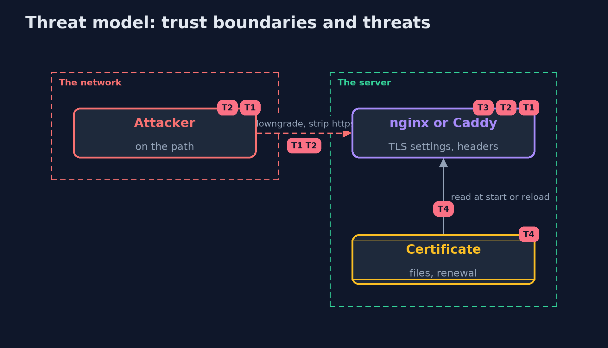

# Threat Model — TLS Servers in Practice with nginx and Caddy

A threat model answers four questions: what are we protecting, who or what could harm it, how, and what do we do about it. This one covers this project's own demo system, not a production deployment. Domain: an online store.

## Scope

An nginx and a Caddy serving the shop over https, with the certificates they use. It covers protocol versions, redirects, HSTS, information in headers, stapling and renewal. It does not cover the application behind them.

## What we protect (assets)

- The shoppers' sessions and pages.
- The servers' private keys.

## Who and what acts on the system

- A shopper's browser.
- A network attacker who can downgrade or strip https.
- The operator who edits the configuration.

## Trust boundaries

A trust boundary is a line that data or a request crosses between parts that trust each other differently. Threats cluster where those lines are.

- The network between the browser and the server.
- The files the server reads its certificate from.

Each dashed box is a trust boundary. A rose tag such as T1 shows where the threat of that number, in the table below, applies.

## Threats, using STRIDE

STRIDE is a checklist of six kinds of threat: **Spoofing** (S), **Tampering** (T), **Repudiation** (R), **Information disclosure** (I), **Denial of service** (D), **Elevation of privilege** (E).

| Id | Kind | Threat | Where it shows up | Control in this project | What is left |
| --- | --- | --- | --- | --- | --- |
| T1 | Tampering | A downgrade to an old protocol version | the server's protocol list | ssl_protocols with TLS 1.2 and 1.3, or 1.3 only | Clients that cannot speak 1.3 |
| T2 | Tampering | A first visit over plain http is stripped | redirects and HSTS | Redirect to https and send HSTS on every page | The very first visit, before the header is seen |
| T3 | Information disclosure | The server announces its exact version | the Server header | server_tokens off | Other ways to fingerprint a server |
| T4 | Denial of service | An expired certificate because a renewal never reloaded | the certificate files | A renewal job that ends with a reload, or a server that renews itself | A job that fails quietly |

## Assumptions

- Clients have the root of the authority that signed.
- The operator's configuration is reviewed like code.

## Out of scope

- Vulnerabilities in the web servers themselves.
- The application's own authentication.

## How the tests check this

- `TlsServersTest` starts a real nginx and Caddy and checks, as a client, the certificate and name, redirects, version, protocols, HSTS, the add_header trap, stapling, the reload and Caddy's authority.
- `DemoRunsTest` compares the whole demo with the golden output.

## Where this model goes next

The next project in this module, tls-misconfigurations-with-testssl, checks servers like these with testssl.sh.
