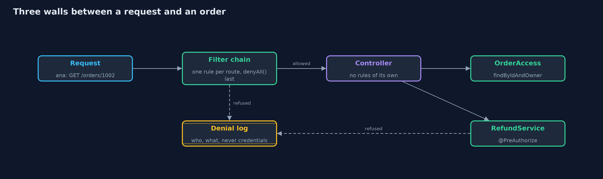
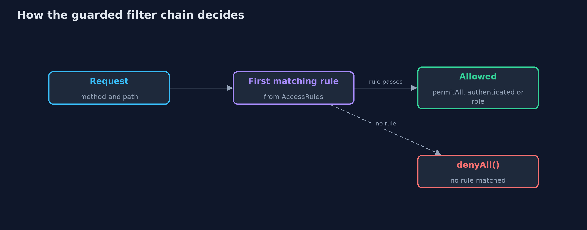
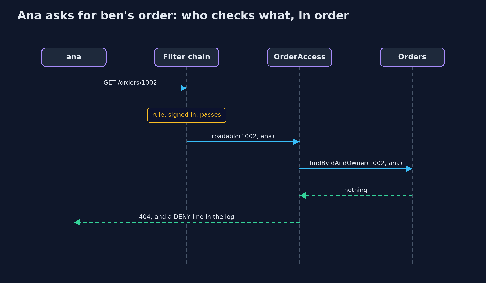

# Broken Access Control with Spring Security

```
src/main/java/com/jk/explore/security/accesscontrolspring/
├── AccessControlSpringDemo.java  Runs the online store story in five numbered acts against real Spring Boot servers on the loopback interface
├── AccessRules.java              Every route rule of the guarded store in one list, by method and path
├── Catalogue.java                The store's people and orders: the same story as the plain project
├── DenialLog.java                Every refusal, as one line: who asked and for what
├── ExportController.java         A route a developer adds later and forgets to give a rule
├── GuardedController.java        The guarded store's routes
├── GuardedSecurity.java          The guarded store's filter chain: one rule per route from {@link AccessRules}, and everything else refused
├── NaiveController.java          The naive store's routes: orders looked up by id alone, the refund service bypassed, and one handler, cancelling an order, written carefully
├── NaiveSecurity.java            The naive store's filter chain, with three common mistakes: a sign-in rule where an ownership rule is needed, a pattern that covers {@code /admin/users} but not {@code /admin/users/ben}, and {@code anyRequest().permitAll()} at the end "until it is locked down"
├── Order.java                    An order in the store
├── OrderAccess.java              Who may see or change which order, in one place
├── Orders.java                   The orders, held in memory
├── Pages.java                    What the store's page shows each person: the admin links are hidden from everyone else, which is presentation, not protection
├── RefundService.java            Refunds
├── RouteInventory.java           Lists every route the store's controllers really serve, read from Spring MVC's own handler mapping, and reports each one that has no entry in {@link AccessRules}
├── Shop.java                     The online store
└── Wire.java                     A tiny HTTP client for the demo: one request, signed in with the demo password or not signed in at all
```

**Spring Security enforces every rule it is given and nothing else: a sign-in rule where an ownership rule was needed, a pattern that misses a sub-path, and a permitAll() at the end let seven of nine attacks through. Deny by default, the owner in the query, method security, a denial log and a route inventory test close all nine.**

The plain version of this lesson built access control by hand. Real Java services usually get it from **Spring Security**, which is very good at enforcing rules,
and enforces exactly the rules it is given. This project starts a real **Spring Boot 4** store twice. The first time it has three common configuration
mistakes, and seven of the plain project's nine attacks still succeed. The second time it is fixed with the framework's own tools:

- **deny by default** in `authorizeHttpRequests`, with one rule per method and path and `anyRequest().denyAll()` last;
- **object-level checks in the query** (`findByIdAndOwner`), so another customer's order is simply not found;
- **method security**: `@PreAuthorize` on the refund service, and `@PostAuthorize` compared with the query-level check;
- **a log of every refusal**, from Spring Security's `AuthorizationDeniedEvent`;
- **a route inventory test**, which reads Spring MVC's own handler mapping and fails the build when a route has no rule.

It maps to **OWASP Top 10 (2025) A01, Broken Access Control**; **OWASP API Security Top 10 (2023) API1**, broken object level authorization, and **API5**,
broken function level authorization; **CWE-639**, **CWE-862** and **CWE-285**; and the **Authorization** chapter of **OWASP ASVS 5.0**.

## The idea in everyday terms

Think of a building with a good lock on every door the architect drew. The locks are excellent. But a door added later has no lock until someone fits one, a lock that only checks
for a staff badge cannot tell whose office it is, and a sign saying "all other doors: open" undoes the rest. The fix is a building where every door starts locked, every
office lock checks the name on the door, and someone walks the corridors with the floor plan to find doors that are not on it.

## The scenario

An online store's API serves orders, delivery addresses, refunds, user management and a sales report, with Spring Boot and Spring Security. The demo attacks the store
as a customer called ana, first with a configuration that has three common mistakes, then with one that uses deny by default, ownership in the query and method security.

## Run

```bash
./gradlew run
```

The demo tells the story in 5 acts, each printing exact numbers that the tests check:

| Act | What it shows |
| --- | --- |
| 1. A Spring store with three common mistakes | A sign-in rule where ownership was needed, a pattern that misses /admin/users/ben, and permitAll() at the end let seven of nine attacks through. |
| 2. Deny by default in the filter chain | One rule per method and path, with denyAll() last: signed out gets 401, the wrong role 403, and a method or path with no rule 403, even for an admin. |
| 3. The object-level check, in the query | findByIdAndOwner makes ben's order 404 for ana in all four object attacks; @PostAuthorize instead answers 403 after the lookup has run; 0 of 9 attacks succeed, 6 of 6 honest requests work. |
| 4. Method security, and a log of every refusal | @PreAuthorize on the refund service refuses a nightly job running as ana with no URL in between; 22 refusals are logged with who and what, and none contains a password or header. |
| 5. The route inventory, and the bill | The inventory reads 11 routes from Spring MVC's handler mapping and reports GET /admin/export, added without a rule, which even the admin is refused. |

## Test

```bash
./gradlew test
```

11 tests in `DemoRunsTest`, `GuardedStoreTest`, `NaiveAndLaterStoreTest`, `OrdersTest`. Every test starts a real Spring Boot server on a free loopback port and checks only status codes, counts and log lines, so the results are exact on every run.

## What the simulation got right, and what it left out

Each act starts a real Spring Boot server on a free port on the loopback address and sends real HTTP requests, so every rule is the framework's own. The users,
orders and requests are fixed, and only status codes and counts are printed, so the output is the same on every run. Every attack targets only this project's own code.

## Technologies and versions

Every version below is pinned in the project's build files and was the latest stable release when the project was built.

| Technology | Version | Used for |
| --- | --- | --- |
| Java | 25 | the language and runtime; a Gradle toolchain finds or downloads the JDK |
| Gradle | 9.8.1 (wrapper) | build and run; nothing to install, the wrapper downloads it |
| org.springframework.boot:spring-boot-starter-webmvc | 4.1.1, set by spring-boot-dependencies | library the code uses |
| org.springframework.boot:spring-boot-starter-security | 4.1.1, set by spring-boot-dependencies | library the code uses |
| org.springframework.boot:spring-boot-starter-webmvc-test | 4.1.1, set by spring-boot-dependencies | library the code uses (tests only) |
| org.springframework.boot:spring-boot-starter-security-test | 4.1.1, set by spring-boot-dependencies | library the code uses (tests only) |
| org.junit.jupiter:junit-jupiter | 6.1.3, set by junit-bom | JUnit 5: the tests (tests only) |
| org.junit.platform:junit-platform-launcher | 6.1.3, set by junit-bom | JUnit platform launcher, which Gradle needs to run the tests (tests only) |
| Spring Boot | 4.1.1 | the store's web server and wiring; its BOM pins the Spring versions below |
| Spring Security | 7.1.1 | the filter chain, method security and authorization events |
| Spring Framework | 7.0.9 | Spring MVC, whose handler mapping the route inventory reads |
| videokit | repository tool (`tools/videokit`) | the narrated video and animation: Piper `en_US-amy-medium`, speed 0.8, longer pauses (the amy-slow voice) |

## Learning Material

| Document | What it is for |
| --- | --- |
| [Dependencies](docs/dependencies.md) | what the framework and infrastructure are, and why they are here |
| [Problem statement](docs/problem-statement.md) | the situation and what the project must show |
| [Prerequisites](docs/prerequisites.md) | what you need to know first |
| [Broken Access Control with Spring Security, explained](docs/broken-access-control-with-spring-security-explained.md) | the acts in prose |
| [Session guide](docs/session.md) | a one-hour lesson with exercises |
| [Animated walkthrough](docs/animation.html) | the acts step by step, narrated |
| [Threat model](docs/threat-model.md) | what is protected, who could harm it, and how, using STRIDE |
| [Spec](docs/spec.md) | what this project must be true of |
| [Expected output](docs/expected-output.txt) | the golden demo output every test and every port checks against |

### The idea in one picture

The filter chain decides by route, the query decides by owner, and method security decides by role on the service itself.



### Where each piece sits

One list of rules feeds both the filter chain and the inventory test.


### How the data moves

Rules are tried in order; a request that matches none of them reaches denyAll().



### Who calls whom, in order




### Video

`video/broken-access-control-with-spring-security-explained.mp4` (with `.m4a` audio and `.srt` subtitles) is built by `video/build_video.sh`. Rendered media is not committed.

## What it costs

- **Rules live in two places.** URL rules in the filter chain and annotations on methods are both needed, and both must be read to know who may do what. The route inventory test keeps the URL rules complete.
- **Ownership needs the owner in the query.** `findByIdAndOwner` costs nothing extra when it is the query; checking afterwards with `@PostAuthorize` runs the work first and answers 403, which tells the caller the order exists.
- **Deny by default refuses honest mistakes too.** A new route answers 403 until someone writes its rule, which is the point, and is a surprise the first time.
- **The framework does not know the business.** No configuration can say that an order belongs to ana; that rule is code the store must write and test.

## When this is too much

For a single-page tool with one user, a filter chain with one rule is enough. For any store with customers and staff, all of this is the minimum,
and the route inventory test is the cheapest part: it runs in the normal test suite and needs no maintenance until a route is added.

## Where you have already met this

- `authorizeHttpRequests` with `anyRequest().denyAll()` or `anyRequest().authenticated()` at the end of a `SecurityFilterChain`.
- `@PreAuthorize` and `@PostAuthorize` on service methods, switched on by `@EnableMethodSecurity`.
- Spring Data methods such as `findByIdAndOwner(id, owner)`.
- Pen-test findings titled IDOR, BOLA or BFLA in a Spring application.

## Where this sits

This is the tools version of [broken-access-control](../broken-access-control), in [web-security](..). It uses Spring Security as the beginner project
[least-privilege-with-spring-security](../../../beginner/safe-habits/least-privilege-with-spring-security) did, and applies it to object-level access.
