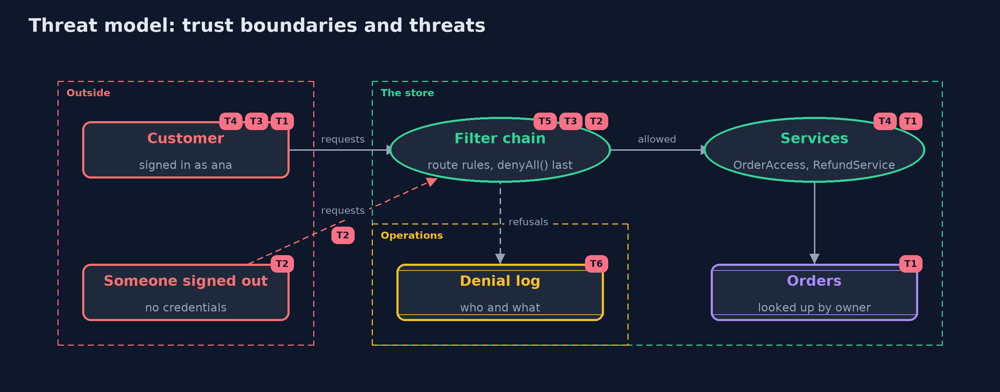

# Threat Model — Broken Access Control with Spring Security

A threat model answers four questions: what are we protecting, who or what could harm it, how, and what do we do about it. This one covers this project's own demo system, not a production deployment. Domain: an online store.

## Scope

Access control in an online store's Spring Boot API: the filter chain's route rules, the ownership checks on orders, method security on refunds, the denial log and the route inventory. It covers a signed-in customer reaching other customers'
data or staff functions, and someone signed out reaching any route. It does not cover authentication strength, CSRF, or the storage of orders.

## What we protect (assets)

- Customers' orders and delivery addresses.
- Staff functions: refunds, user management and the sales report.
- Customer accounts.
- The denial log.

## Who and what acts on the system

- Customers, who should reach only their own orders.
- Support staff and admins, with wider rights.
- Someone signed out.
- Developers adding routes later.

## Trust boundaries

A trust boundary is a line that data or a request crosses between parts that trust each other differently. Threats cluster where those lines are.

- Internet to the filter chain: every request crosses it.
- Controller to service: the method security boundary, which also guards callers with no URL.
- Service to the order store: where ownership is decided.

Each dashed box is a trust boundary. A rose tag such as T1 shows where the threat of that number, in the table below, applies.

## Threats, using STRIDE

STRIDE is a checklist of six kinds of threat: **Spoofing** (S), **Tampering** (T), **Repudiation** (R), **Information disclosure** (I), **Denial of service** (D), **Elevation of privilege** (E).

| Id | Kind | Threat | Where it shows up | Control in this project | What is left |
| --- | --- | --- | --- | --- | --- |
| T1 | Information disclosure | A customer reads or changes another customer's order by changing its number (IDOR, BOLA) | `OrderAccess`, `Orders` | The owner is part of the query (findByIdAndOwner), so someone else's order is not found | Every new lookup must use the owner too; a findById in a customer path brings the problem back |
| T2 | Elevation of privilege | A route nobody listed is reachable by anyone, through permitAll() at the end of the chain | `NaiveSecurity` | anyRequest().denyAll() is the last rule of the guarded chain | A rule that is too broad, such as permitAll on /**, still opens everything below it |
| T3 | Elevation of privilege | A pattern covers a path but not the paths below it, so DELETE /admin/users/ben is unchecked | `NaiveSecurity` | One rule per method and exact pattern, and deny by default for anything else | Pattern syntax must be read carefully in review; tests per route catch it |
| T4 | Elevation of privilege | A staff function is called from somewhere with no URL rule, such as a job or a new controller | `RefundService` | @PreAuthorize on the service method holds for every caller | Code that skips the Spring proxy, such as a call from inside the same class, is not checked |
| T5 | Elevation of privilege | A new route is added without a rule | `AccessRules`, `RouteInventory` | Denied by default at run time, and the route inventory test fails the build | Controllers outside the store's package are not inventoried |
| T6 | Repudiation | Attacks go unnoticed, or credentials end up in the logs | `DenialLog` | Every refusal is logged with who and what, from AuthorizationDeniedEvent and from the store; no credentials or headers are logged | Someone must read the log and alert on it: the detection module |

## Assumptions

- Authentication is sound: a signed-in name is the real person.
- Every controller is in the store's own package, so the inventory sees it.
- In the demo, every account has the demo password, and every attack targets only this project's own code.

## Out of scope

- Authentication: the identity modules.
- Cross-site request forgery: its own project.
- Database-level row security: the advanced track.

## How the tests check this

- `GuardedStoreTest` checks twenty requests' statuses, all nine attacks failing, six honest requests working, @PostAuthorize, the denial log and the route inventory.
- `NaiveAndLaterStoreTest` checks the three naive mistakes, and that a later route without a rule is reported and refused.
- `OrdersTest` checks that ownership is part of the lookup and that the rule list has no duplicates.
- `DemoRunsTest` compares the whole demo with the golden output.

## Where this model goes next

The next project in web-security, cross-site-scripting, moves from who may act to what the store sends back to the browser.
