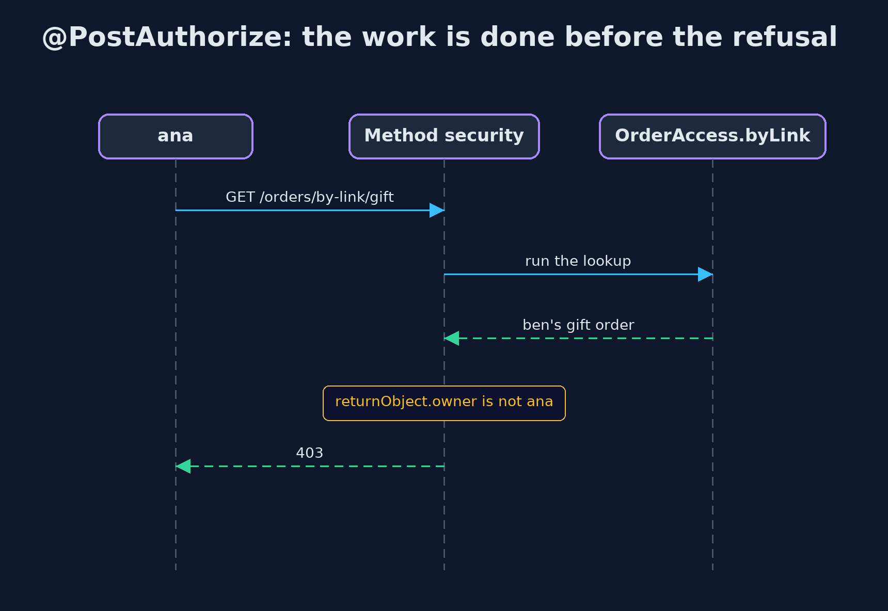
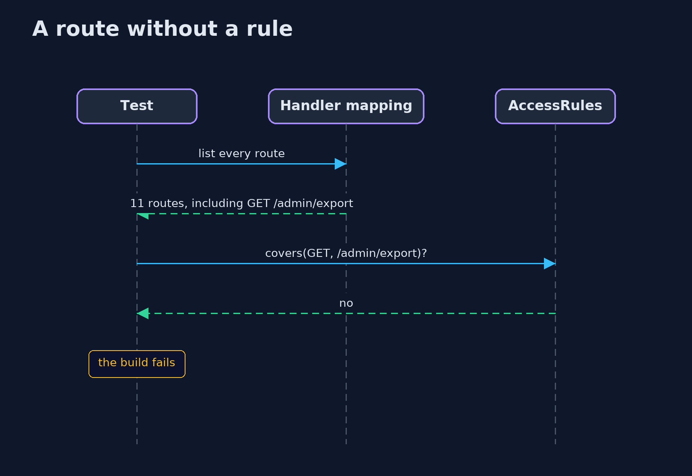

# Broken Access Control with Spring Security — UML Sequence Diagrams

## 1. @PostAuthorize: the work is done before the refusal

The lookup runs, then the rule reads the result and refuses with 403.

## 2. A route without a rule

The inventory test reads the handler mapping and fails; at run time the route is denied by default.

