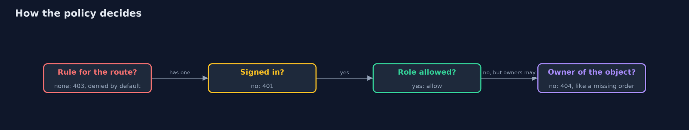
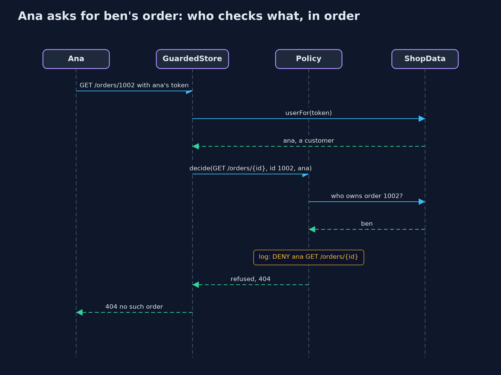

# Broken Access Control

```
src/main/java/com/jk/explore/security/accesscontrol/
├── AccessControlDemo.java  Runs the online store story in five numbered acts and prints exact, repeatable results
├── Attempts.java           The requests the demo sends: what an attacker tries, and what honest users do every day
├── Call.java               What a handler receives: who is asking (if anyone), the values from the path, the body, and the store's data
├── GuardedStore.java       The fixed store: the same handlers as the naive store, but with every check taken out of them and put in one policy that runs before any handler
├── Handler.java            The code behind one route
├── Handlers.java           The store's business logic, with no access checks at all
├── HttpFront.java          A store served over real HTTP on the loopback address, on a free port, and a client for it
├── NaiveStore.java         The first version of the store: every handler checks what its author remembered to check
├── Order.java              An order in the store
├── Policy.java             Every access rule of the store in one table, checked at one place before any handler runs
├── Reply.java              The store's answer: an HTTP status and a short body
├── Request.java            One request to the store: a method, a path, the bearer token (which may be missing), and a short body
├── Role.java               What a signed-in person is in the store
├── Route.java              A method and a path pattern such as /orders/{id}
├── RouteTable.java         The routes a store serves, in the order they were added, with the handler for each
├── ShopData.java           The store's users and orders, built fresh for every run so that no act changes another
├── Store.java              Anything that answers requests: the naive store and the guarded one
└── User.java               A signed-in person: a name, a role, and the bearer token their requests carry
```

**Most access-control bugs are not clever: an order anyone can read by changing a number, a route nobody linked to, a check in the page but not on the server, a DELETE that was copied without its check. The fix is one policy at one choke point, deny by default, with a test that fails when a route has no rule.**

**Access control** decides what a signed-in person may do. It is the top risk in the **OWASP Top 10 (2025), A01 Broken Access Control**, and the top two of the
**OWASP API Security Top 10 (2023)**: **API1, Broken Object Level Authorization**, and **API5, Broken Function Level Authorization**. The weaknesses have
names in the CWE list: **CWE-639**, authorization bypass through a user-controlled key, which is the classic **IDOR**; **CWE-862**, missing authorization;
and **CWE-285**, improper authorization. The **Authorization** chapter of **OWASP ASVS 5.0** lists what a verified application must do about them.

Two directions matter. **Horizontal** (sideways) escalation reaches another person's data with the same role, such as another customer's order. **Vertical**
(upwards) escalation reaches a higher role's functions, such as a refund that only staff may issue.

The demo breaks a small online store API in all of these ways, then fixes every one with a single policy that runs before any handler, refuses by default,
checks ownership of each object, logs each refusal, and is kept complete by a test.

## The idea in everyday terms

Think of a hotel where every key card opens every room, because the lock only checks that the card is a real card from this hotel. Being a guest
is authentication. Opening only your own room is authorization. A room number that is hard to guess does not help if someone reads it off your
key sleeve. And a staff door with no sign on it is still a door.

## The scenario

An online store has an API for orders, addresses, refunds, user management and a sales report. The first version checks access inside each
handler, wherever its author remembered to. The demo attacks it as a customer called ana, then replaces all those checks with one policy.

## Run

```bash
./gradlew run
```

The demo tells the story in 5 acts, each printing exact numbers that the tests check:

| Act | What it shows |
| --- | --- |
| 1. Walking order numbers | Signed in as ana, the numbers 1000 to 1010 return 4 orders, 2 of them other customers'; ben's gift order with an unguessable id opens too, because it was shared. |
| 2. Routes that nobody checks | The page hides the admin links, but ana's hand-made refund succeeds; a report nobody links to opens signed out; GET /admin/users is checked and DELETE is not. |
| 3. Sideways and upwards | Ana redirects ben's order to her address (sideways) and issues a refund (upwards); of nine attacks, 7 succeed through 5 of 9 routes; the one careful route refuses her. |
| 4. One choke point, deny by default | The same handlers behind one policy: 0 of 9 attacks succeed, 6 of 6 honest requests still work, someone else's order answers 404, and 9 refusals are logged with no token. |
| 5. Keeping it right, and the bill | A new route without a rule is caught by the route inventory test and refused even to the admin; the rules hold over real HTTP; the bill is one table to keep complete and an ownership lookup per request. |

## Test

```bash
./gradlew test
```

23 tests in `DemoRunsTest`, `GuardedStoreTest`, `HttpFrontTest`, `NaiveStoreTest`, `RouteInventoryTest`. The store, users, tokens and orders are fixed, so every status code is exact. The real HTTP check runs on a free loopback port and checks only status codes.

## What the simulation got right, and what it left out

The store runs in memory with fixed users, tokens and orders, so every answer is exact. Act five also serves the guarded store over real HTTP on the
loopback address, on a free port, and prints only the status codes. Every attack targets only this project's own code.

## Technologies and versions

Every version below is pinned in the project's build files and was the latest stable release when the project was built.

| Technology | Version | Used for |
| --- | --- | --- |
| Java | 25 | the language and runtime; a Gradle toolchain finds or downloads the JDK |
| Gradle | 9.8.1 (wrapper) | build and run; nothing to install, the wrapper downloads it |
| org.junit.jupiter:junit-jupiter | 6.1.3, set by junit-bom | JUnit 5: the tests (tests only) |
| org.junit.platform:junit-platform-launcher | 6.1.3, set by junit-bom | JUnit platform launcher, which Gradle needs to run the tests (tests only) |
| videokit | repository tool (`tools/videokit`) | the narrated video and animation: Piper `en_US-amy-medium`, speed 0.8, longer pauses (the amy-slow voice) |

## Learning Material

| Document | What it is for |
| --- | --- |
| [Problem statement](docs/problem-statement.md) | the situation and what the project must show |
| [Prerequisites](docs/prerequisites.md) | what you need to know first |
| [Broken Access Control, explained](docs/broken-access-control-explained.md) | the acts in prose |
| [Session guide](docs/session.md) | a one-hour lesson with exercises |
| [Animated walkthrough](docs/animation.html) | the acts step by step, narrated |
| [Threat model](docs/threat-model.md) | what is protected, who could harm it, and how, using STRIDE |
| [Spec](docs/spec.md) | what this project must be true of |
| [Expected output](docs/expected-output.txt) | the golden demo output every test and every port checks against |

### The idea in one picture

The naive store checks inside each handler; the guarded store checks once, before any handler, and refuses what it has no rule for.


### Where each piece sits

Both stores share the same handlers; only where the checks live differs.


### How the data moves

No rule means no; then signed in, then role, then ownership of the object in the path.



### Who calls whom, in order




### Video

`video/broken-access-control-explained.mp4` (with `.m4a` audio and `.srt` subtitles) is built by `video/build_video.sh`. Rendered media is not committed.

## What it costs

- **Ownership checks need data.** Every object-level decision looks up who owns the object, which is a database read on every request unless it is folded into the query.
- **One table must be kept complete.** A central policy only helps if every route has a rule, which is why a test reads the route list and fails when one is missing.
- **404 or 403 is a choice.** Answering 404 for someone else's order hides that it exists, but makes support harder: the log has to carry the real reason.
- **Refusals are log lines.** Logging every denial shows an attack in progress, and costs storage and attention; the log must never contain a token.

## When this is too much

A store with one page and no accounts needs none of this. As soon as there are two customers, or one customer and one member of staff, object-level checks and deny by default are the minimum,
because the attacks in this demo need nothing more than a browser's developer tools.

## Where you have already met this

- Bug bounty reports titled "IDOR in order endpoint" or "BOLA in /api/v1/users/{id}".
- Spring Security's `authorizeHttpRequests` with `anyRequest().denyAll()` at the end.
- The OWASP Top 10 and OWASP API Security Top 10, where this is first.
- Data breaches where records were downloaded by counting up an id in the address bar.

## Where this sits

This is the first project of the [intermediate track](../..), in [web-security](..). It builds on the beginner projects
[authentication-vs-authorization](../../../beginner/identity/authentication-vs-authorization) and [least-privilege](../../../beginner/safe-habits/least-privilege).
