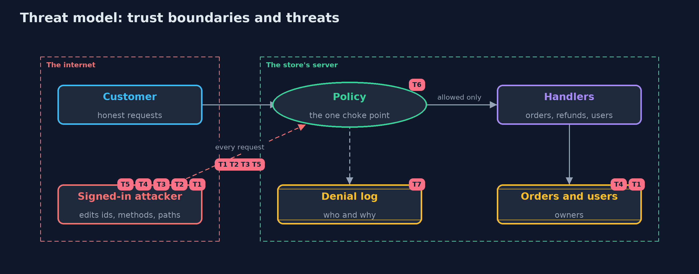

# Threat Model — Broken Access Control

A threat model answers four questions: what are we protecting, who or what could harm it, how, and what do we do about it. This one covers this project's own demo system, not a production deployment. Domain: an online store.

## Scope

The access control of an online store's API: reading and changing orders and addresses, refunds, user management and reports, by customers, support staff, admins and people who are signed out.
It covers a signed-in customer who edits ids, methods and paths. It does not cover authentication itself, stolen tokens, or injection.

## What we protect (assets)

- Every customer's orders and delivery addresses.
- Refunds, which move money.
- User accounts.
- The sales report, which lists every customer.

## Who and what acts on the system

- Customers, who may act only on their own orders.
- Support staff, who may read any order but not change one.
- Admins, who may refund, manage users and read reports.
- A signed-in customer who edits requests by hand.
- Someone who is not signed in.

## Trust boundaries

A trust boundary is a line that data or a request crosses between parts that trust each other differently. Threats cluster where those lines are.

- Internet to the store's API: every request crosses it, and every part of it can be edited by the sender.
- The page to the server: what the page shows or hides is not a control.

Each dashed box is a trust boundary. A rose tag such as T1 shows where the threat of that number, in the table below, applies.

## Threats, using STRIDE

STRIDE is a checklist of six kinds of threat: **Spoofing** (S), **Tampering** (T), **Repudiation** (R), **Information disclosure** (I), **Denial of service** (D), **Elevation of privilege** (E).

| Id | Kind | Threat | Where it shows up | Control in this project | What is left |
| --- | --- | --- | --- | --- | --- |
| T1 | Information disclosure | A customer reads another customer's order by changing the id in the path (IDOR, CWE-639, API1) | `GET /orders/{id}` | Object-level ownership check in the policy; someone else's order answers 404 | Every new object type needs its own ownership rule |
| T2 | Elevation of privilege | A route that nobody links to has no check, and is reached directly (CWE-862) | `GET /admin/reports` | Deny by default: a route with no rule is refused | None while the route inventory test runs in the build |
| T3 | Elevation of privilege | A function hidden in the page is called directly, because the role was checked only in the page (API5) | `POST /admin/refunds` | Role rules on the server, in the policy | None for this route; the page's menu is a convenience, not a control |
| T4 | Tampering | A customer changes or cancels another customer's order (horizontal escalation) | `POST /orders/{id}/address`, `DELETE /orders/{id}` | Ownership rules; support may read but not change | Business rules such as cut-off times are separate checks |
| T5 | Elevation of privilege | A method that was not checked, such as DELETE next to a checked GET, deletes an account (verb tampering, CWE-285) | `DELETE /admin/users/{name}` | Rules per method and path; unknown methods are not routed | A framework that maps methods loosely needs its own tests |
| T6 | Elevation of privilege | A new route is added without a rule and the policy is silently incomplete | `GuardedStore` route table | Deny by default at run time, and a route inventory test that fails the build | A rule that is present but too wide is still possible; rules need review |
| T7 | Repudiation | Attacks go unnoticed, or the log itself leaks tokens | `Policy` denial log | Every refusal is logged with who and why; tokens are never logged | Somebody has to read and alert on the log |

## Assumptions

- Tokens identify their users correctly; authentication is a separate concern.
- In the demo, tokens and data are fixed demo values, and attacks target only this project's own code.

## Out of scope

- Authentication and stolen tokens: the beginner identity module and the intermediate identity module.
- Injection: the next projects in web-security.
- Framework configuration: the Spring Security version of this project.

## How the tests check this

- `NaiveStoreTest` pins down each weakness of the first version, including that seven of the nine attacks succeed.
- `GuardedStoreTest` checks that every attack is refused, every honest request works, the statuses are right, and refusals are logged without tokens.
- `RouteInventoryTest` checks that every route has a rule, reports a forgotten one, and that routes match whole segments only.
- `HttpFrontTest` checks the same answers over real HTTP and that tokens must match exactly.
- `DemoRunsTest` compares the whole demo with the golden output.

## Where this model goes next

The next project, sql-injection, attacks the same store through its search box instead of its routes.
