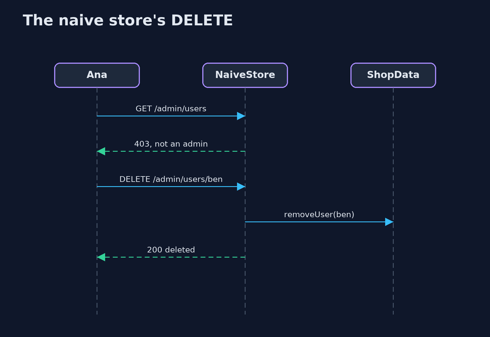
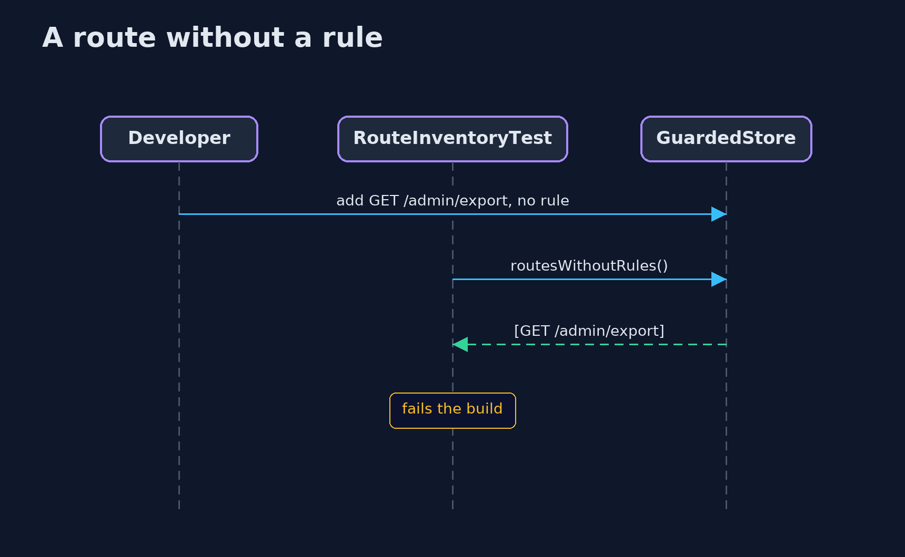

# Broken Access Control — UML Sequence Diagrams

## 1. The naive store's DELETE

GET was checked; DELETE, added later, was not.

## 2. A route without a rule

The inventory test fails the build, and the policy refuses it at run time.

