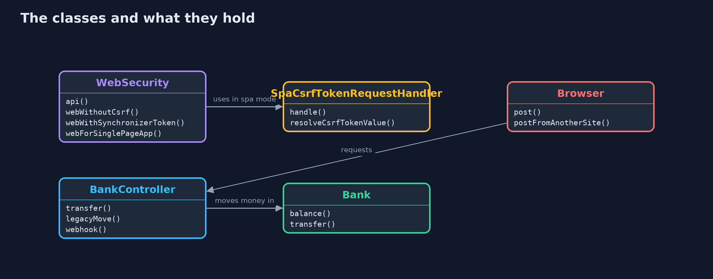

# Cross-Site Request Forgery with Spring Security

```
src/main/java/com/jk/explore/security/csrfspring/
├── Bank.java                        The bank's accounts
├── BankApp.java                     
├── BankController.java              The bank's pages and API: the routes that read, the routes that move money, and one that a mistake left on GET
├── Browser.java                     A customer's browser as far as this lesson needs one: it keeps cookies per site and attaches them to every request to that site, whichever page caused the request
├── CsrfSpringDemo.java              Runs the bank story in five numbered acts against real Spring Boot servers on the loopback interface
├── SpaCsrfTokenRequestHandler.java  For a single-page app that reads the token from a cookie and sends it back in a header
└── WebSecurity.java                 Two filter chains
```

**Spring Security protects every state-changing request of a session-cookie application with a token, which is why a forged post from another site is refused; the protection is undone by switching it off, by exempting a route, or by moving money on GET, and a single-page app needs the cookie mode, where the token is readable by the page's own script.**

The plain [cross-site-request-forgery](../cross-site-request-forgery) project builds the attack and the defences from scratch. This one uses what real Spring Boot banks use: **Spring Security 7** on **Spring Boot 4.1**, in real servers on the loopback address, with a browser stand-in that keeps cookies and attaches them to every request, which is the whole weakness.

What it shows:
- **Switching CSRF off** (a common tutorial step to make a `POST` work) lets a page on evil.example move Ana's money with her own cookie.
- **The default is a token tied to the session.** A forged post gets 403, so does one with a token from Mallory's session, the sign-in form and logout need tokens too, the token is renewed when Ana signs in, and it is masked with a new random value on each page.
- **A single-page app uses the cookie mode:** the token is in a cookie that the page's script reads and sends back in a header. It cannot be `HttpOnly`, so cross-site scripting would read it.
- **What the default does not cover:** a webhook exempted from tokens must check its own signature, `GET` is never checked, and one line that adds `/transfer` to the exemptions undoes the defence.
- **The bill:** the session cookie has no `SameSite` attribute by default, an API chain with credentials in a header can leave CSRF off, and a test should post to every route without a token.

**Maps to:** OWASP Top 10 (2025) A01 Broken Access Control · CWE-352 · OWASP ASVS 5.0 V3 (Web Frontend Security) · OWASP CSRF Prevention Cheat Sheet.

## The idea in everyday terms

A bank that accepts a signed cheque from anyone who walks in carrying your pen. The pen is your cookie, and the cheque is the forged request. A one-time number printed on the cheque book, which only your own cheque book shows, tells the bank the cheque came from the book on your desk.

## The scenario

An online bank on Spring Boot with a session-cookie login. The demo starts the real application five times, in different configurations, and sends forged requests the way a browser would from another site.

## Run

```bash
./gradlew run
```

The demo tells the story in 5 acts, each printing exact numbers that the tests check:

| Act | What it shows |
| --- | --- |
| 1. CSRF protection switched off | With http.csrf disabled, a forged post with Ana's cookie moves 500 to Mallory. |
| 2. Spring Security's default token | A forged post and a token from another session both get 403; the sign-in form, logout and every page need tokens, and the token is renewed and masked. |
| 3. A single-page app | The token lives in a cookie the page's script reads and sends in a header; a forged post gets 403, and the price is that the cookie cannot be HttpOnly. |
| 4. What the default does not cover | An exempt webhook needs its own signature, GET is never checked, and one extra exemption lets a forged transfer through. |
| 5. The bill | The session cookie has no SameSite attribute by default, an API chain with header credentials ignores cookies, and all 3 state-changing routes refuse a post with no token. |

## Test

```bash
./gradlew test
```

12 tests in `CsrfSpringTest`, `DemoRunsTest`. Each test starts a real server on a free loopback port and stops it. Nothing is printed that changes between runs.

## What the simulation got right, and what it left out

The servers are real Spring Boot applications on Tomcat and the filter chains are Spring Security 7. The browser stand-in is a few lines of Java that keep cookies and add an Origin header. Only statuses, booleans and balances are printed, never tokens, ports or time stamps, so the demo prints the same text on every run.

## Technologies and versions

Every version below is pinned in the project's build files and was the latest stable release when the project was built.

| Technology | Version | Used for |
| --- | --- | --- |
| Java | 25 | the language and runtime; a Gradle toolchain finds or downloads the JDK |
| Gradle | 9.8.1 (wrapper) | build and run; nothing to install, the wrapper downloads it |
| org.springframework.boot:spring-boot-starter-webmvc | 4.1.1, set by spring-boot-dependencies | library the code uses |
| org.springframework.boot:spring-boot-starter-security | 4.1.1, set by spring-boot-dependencies | library the code uses |
| org.springframework.boot:spring-boot-starter-webmvc-test | 4.1.1, set by spring-boot-dependencies | library the code uses (tests only) |
| org.springframework.boot:spring-boot-starter-security-test | 4.1.1, set by spring-boot-dependencies | library the code uses (tests only) |
| org.junit.jupiter:junit-jupiter | 6.1.3, set by junit-bom | JUnit 5: the tests (tests only) |
| org.junit.platform:junit-platform-launcher | 6.1.3, set by junit-bom | JUnit platform launcher, which Gradle needs to run the tests (tests only) |
| videokit | repository tool (`tools/videokit`) | the narrated video and animation: Piper `en_US-amy-medium`, speed 0.8, longer pauses (the amy-slow voice) |

## Learning Material

| Document | What it is for |
| --- | --- |
| [Problem statement](docs/problem-statement.md) | the situation and what the project must show |
| [Prerequisites](docs/prerequisites.md) | what you need to know first |
| [Cross-Site Request Forgery with Spring Security, explained](docs/cross-site-request-forgery-with-spring-security-explained.md) | the acts in prose |
| [Session guide](docs/session.md) | a one-hour lesson with exercises |
| [Animated walkthrough](docs/animation.html) | the acts step by step, narrated |
| [Threat model](docs/threat-model.md) | what is protected, who could harm it, and how, using STRIDE |
| [Spec](docs/spec.md) | what this project must be true of |
| [Expected output](docs/expected-output.txt) | the golden demo output every test and every port checks against |

### The idea in one picture

The web chain needs tokens because it trusts a cookie; the API chain trusts only a header.


### Where each piece sits

Security configuration chooses a mode by profile; the controller is the same in every mode.



### How the data moves

A state-changing request needs a token that matches the session; GET is not checked.


### Who calls whom, in order


### Video

`video/cross-site-request-forgery-with-spring-security-explained.mp4` (with `.m4a` audio and `.srt` subtitles) is built by `video/build_video.sh`. Rendered media is not committed.

## What it costs

- **Every form and every script call needs the token,** or the bank refuses its own customers.
- **Single-page apps need a readable cookie,** so cross-site scripting becomes the next problem to solve.
- **Exemptions are one line each,** and each one needs its own proof of origin, such as a signature.
- **GET is never checked,** so a route that changes state on GET cannot be protected by the filter.
- **Stateless APIs need none of this,** but only if they really have no session and no cookie authentication.

## When this is too much

Do not turn the protection off to fix a 403. Find the form or script that lacks the token. For APIs with header credentials and no session, use a separate filter chain without CSRF instead of weakening the web chain.

## Where you have already met this

- `http.csrf(csrf -> csrf.disable())` in a copied tutorial.
- `CookieCsrfTokenRepository.withHttpOnlyFalse()` in single-page app guides.
- `<input type="hidden" name="_csrf">` in Thymeleaf forms.
- A 403 Forbidden after a POST that worked in curl.

## Where this sits

This is the tools version of [cross-site-request-forgery](../cross-site-request-forgery), in the [web-security](..) module. It follows the same story with the same numbers, on Spring Security.
