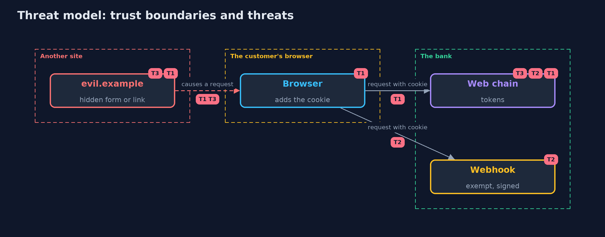

# Threat Model — Cross-Site Request Forgery with Spring Security

A threat model answers four questions: what are we protecting, who or what could harm it, how, and what do we do about it. This one covers this project's own demo system, not a production deployment. Domain: an online bank.

## Scope

A session-cookie web application on Spring Security 7 and the filter chains that protect it. It covers forged state-changing requests from other sites, exemptions and the API chain. It does not cover cross-site scripting or a compromised browser.

## What we protect (assets)

- The customer's money.
- The customer's session.

## Who and what acts on the system

- A customer logged in at the bank.
- An attacker who controls another site's page.
- A developer who changes the configuration.

## Trust boundaries

A trust boundary is a line that data or a request crosses between parts that trust each other differently. Threats cluster where those lines are.

- The browser to the bank: the cookie is attached to requests whatever site caused them.
- An exempt route: it has no token and needs its own proof of origin.

Each dashed box is a trust boundary. A rose tag such as T1 shows where the threat of that number, in the table below, applies.

## Threats, using STRIDE

STRIDE is a checklist of six kinds of threat: **Spoofing** (S), **Tampering** (T), **Repudiation** (R), **Information disclosure** (I), **Denial of service** (D), **Elevation of privilege** (E).

| Id | Kind | Threat | Where it shows up | Control in this project | What is left |
| --- | --- | --- | --- | --- | --- |
| T1 | Spoofing | A page on another site makes the customer's browser send a state-changing request with the session cookie | `WebSecurity` web chain | A token tied to the session, in a form field or a header, checked on every state-changing request | Cross-site scripting that reads the token |
| T2 | Spoofing | An exempt route accepts a forged request | `BankController.webhook`, the exemption list | A signature check on every exempt route and a review of the list | A new exemption added without review |
| T3 | Tampering | A route changes state on GET and so is never checked | `BankController.legacyMove` | State changes only on POST, PUT and DELETE | Old routes that nobody remembers |

## Assumptions

- No cross-site scripting hole exists in the bank's pages.
- The browser does not let one site read another site's cookies or pages.

## Out of scope

- Cross-site scripting and clickjacking.
- Attacks from the customer's own device.

## How the tests check this

- `CsrfSpringTest` starts a real server per mode and checks the forged post, a token from another session, sign-in and logout, masking and renewal, single-page mode, GET, the webhook, an extra exemption, the API chain and SameSite.
- `DemoRunsTest` compares the whole demo with the golden output.

## Where this model goes next

The next project in this module, server-side-request-forgery, moves from the browser to the server: a request the bank makes on an attacker's behalf.
