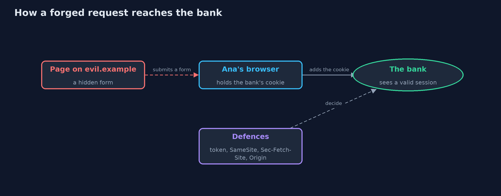
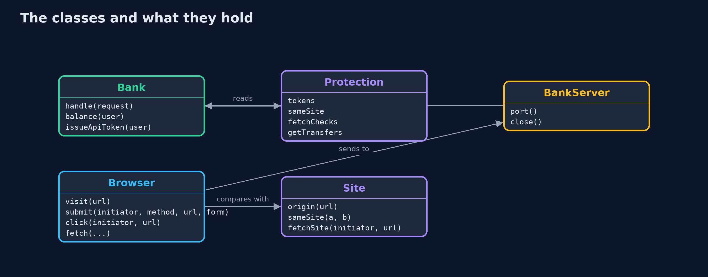
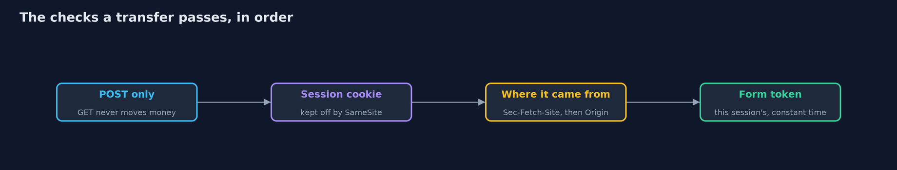
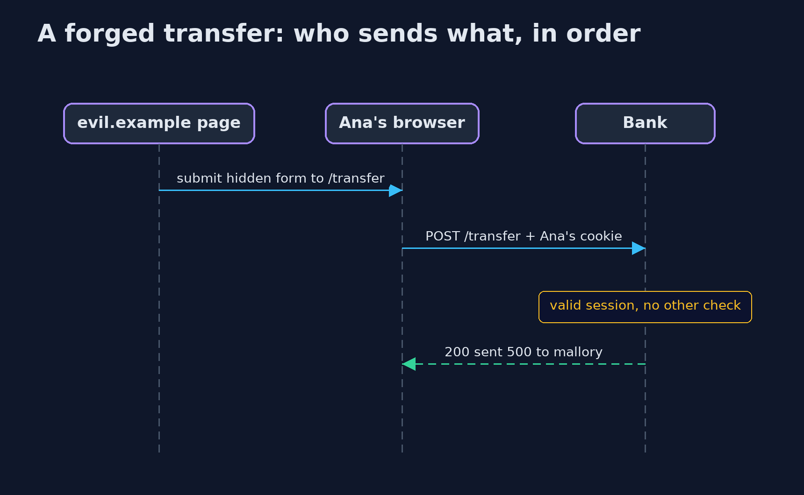

# Cross-Site Request Forgery (CSRF) and Its Defences

```
src/main/java/com/jk/explore/security/csrf/
├── Bank.java        An online bank with cookie sessions and a transfer form, and the CSRF defences that {@link Protection} switches on
├── BankServer.java  The bank on a real HTTP server, on the loopback address and a free port
├── Browser.java     A small browser that follows the rules a real one follows for cookies and request headers
├── CsrfDemo.java    Runs the online bank story in five numbered acts and prints exact, repeatable results
├── Protection.java  Which defences the bank switches on
├── Request.java     A request as the bank sees it: method, path, headers with lower-case names, and form or query fields
├── Response.java    A response: status, body, and headers such as Set-Cookie
└── Site.java        Origins and sites, as a browser compares them
```

**A browser attaches the bank's cookie to any request sent to the bank, even one started by another site, so a state-changing request needs proof that it came from the bank's own page: a per-session token, SameSite cookies, and a check of where the request came from.**

A logged-in user's browser holds a **session cookie**, and it attaches that cookie to every request sent to the site, whichever page started it.
So a page on another site can make the browser send a request to the bank (a hidden form that posts a transfer), and the bank sees a valid
session. That is **cross-site request forgery (CSRF)**: the cookie proves *who* is asking, not *what they meant*.

The defences, in the order this project shows them:
- A **synchronizer token** in every form, tied to the session and compared in constant time. Another site cannot read it.
- **SameSite cookies**, which a modern browser keeps off cross-site requests.
- **Fetch Metadata** (`Sec-Fetch-Site`) and **Origin** checks, which tell the server where a request came from.
- The rule that **GET never changes state**.

**Maps to:** OWASP Top 10 (2025) A01 Broken Access Control · CWE-352 · OWASP ASVS 5.0, the session management and
browser security chapters (CSRF protection for cookie-based sessions).

## The idea in everyday terms

Think of a bank that accepts any signed note brought to the counter, as long as the signature card matches. A stranger cannot sign as Ana, but
the stranger can slip a note into a pile that Ana signs without reading. The token is a serial number printed only on the bank's own forms:
a note without it, or with someone else's number, is refused. SameSite is Ana's pen refusing to sign papers handed to her by strangers.

## The scenario

An online bank has a transfer form. Ana is logged in, and in another tab she opens a page on another site. The demo runs the bank on a real local
server and a small Java browser that follows real browsers' cookie and header rules, and shows which forged requests get through under each defence.

## Run

```bash
./gradlew run
```

The demo tells the story in 5 acts, each printing exact numbers that the tests check:

| Act | What it shows |
| --- | --- |
| 1. A request Ana did not intend | While Ana is logged in, a hidden form on evil.example posts a transfer to the bank; her browser adds her cookie, and the bank sends 500 to mallory. |
| 2. A token in every form | The bank's form carries a token tied to the session; the forged form without it, or with Mallory's own token, is refused with 403. |
| 3. SameSite cookies | With Lax the forged post arrives without the cookie (401) while links and the bank's own form still work; Strict also drops links from other sites; no attribute means Lax in a modern browser. |
| 4. Where the request came from, and GET | Sec-Fetch-Site: cross-site is refused, an older browser is checked by Origin, and a bank that moves money on GET loses 100 to a link even with a Lax cookie. |
| 5. The bill | SameSite alone fails in an older browser and from a same-site subdomain; tokens stop both but must reach every form; a bearer-token API refuses the forged call with 401. |

## Test

```bash
./gradlew test
```

21 tests in `BankTest`, `BrowserTest`, `DemoRunsTest`, `SiteTest`. Session ids and tokens are random, so the demo prints only statuses, messages and balances. The bank's rules are tested directly with hand-made requests, and the browser's cookie rules against the real local server.

## What the simulation got right, and what it left out

The bank runs on a real HTTP server on the loopback address of this machine. The browser is a small Java model that follows modern browsers' rules
(SameSite enforcement with Lax as the default, Sec-Fetch-Site, Origin on POST) or a legacy browser's (SameSite ignored, no Fetch Metadata). Sites are
logical names such as bank.example and evil.example; every request really goes to the local server. Session ids and tokens are random and never printed.

## Technologies and versions

Every version below is pinned in the project's build files and was the latest stable release when the project was built.

| Technology | Version | Used for |
| --- | --- | --- |
| Java | 25 | the language and runtime; a Gradle toolchain finds or downloads the JDK |
| Gradle | 9.8.1 (wrapper) | build and run; nothing to install, the wrapper downloads it |
| org.junit.jupiter:junit-jupiter | 6.1.3, set by junit-bom | JUnit 5: the tests (tests only) |
| org.junit.platform:junit-platform-launcher | 6.1.3, set by junit-bom | JUnit platform launcher, which Gradle needs to run the tests (tests only) |
| videokit | repository tool (`tools/videokit`) | the narrated video and animation: Piper `en_US-amy-medium`, speed 0.8, longer pauses (the amy-slow voice) |

## Learning Material

| Document | What it is for |
| --- | --- |
| [Problem statement](docs/problem-statement.md) | the situation and what the project must show |
| [Prerequisites](docs/prerequisites.md) | what you need to know first |
| [Cross-Site Request Forgery (CSRF) and Its Defences, explained](docs/cross-site-request-forgery-explained.md) | the acts in prose |
| [Session guide](docs/session.md) | a one-hour lesson with exercises |
| [Animated walkthrough](docs/animation.html) | the acts step by step, narrated |
| [Threat model](docs/threat-model.md) | what is protected, who could harm it, and how, using STRIDE |
| [Spec](docs/spec.md) | what this project must be true of |
| [Expected output](docs/expected-output.txt) | the golden demo output every test and every port checks against |

### The idea in one picture

The page on another site never sees the cookie; it only makes Ana's browser send a request that carries it.



### Where each piece sits

Bank holds the rules; Browser holds the cookie rules; Protection says which defences are on.



### How the data moves

Each check refuses on its own; the token is the one that works for every client.



### Who calls whom, in order




### Video

`video/cross-site-request-forgery-explained.mp4` (with `.m4a` audio and `.srt` subtitles) is built by `video/build_video.sh`. Rendered media is not committed.

## What it costs

- **Tokens must reach every form and every client.** A page that forgets the token refuses the real customer, and JavaScript clients need the token too.
- **SameSite is not enough on its own.** Older browsers ignore it, and a page on another subdomain of the same site (such as user content on reviews.bank.example) is the same site, so the cookie is still sent.
- **Fetch Metadata and Origin are defence in depth.** Requests from tools and old browsers may carry neither, so the token is still needed.
- **Strict cookies hurt usability.** A customer arriving from a link on another site looks logged out, which is why Lax is the usual choice for a session.
- **A state-changing GET defeats Lax.** Lax cookies ride on top-level links, which is safe only because links never act.

## When this is too much

An API that authenticates with a bearer token in an Authorization header, and never with cookies, is not exposed to CSRF in the same way,
because a browser does not add that header by itself. Any site that uses cookies for login needs CSRF protection on every state-changing request.

## Where you have already met this

- Hidden `_csrf` or `authenticity_token` fields in the forms of almost every web framework.
- `Set-Cookie: ...; SameSite=Lax` on session cookies, the default in modern browsers.
- `Sec-Fetch-Site` headers in a browser's network panel.
- Breach reports where a router or bank changed settings after a visit to another page.

## Where this sits

This project is in [web-security](..) and builds on [http-basics-and-headers](../../../beginner/networking/http-basics-and-headers), which introduced cookie attributes,
and [authentication-vs-authorization](../../../beginner/identity/authentication-vs-authorization), which introduced sessions.
