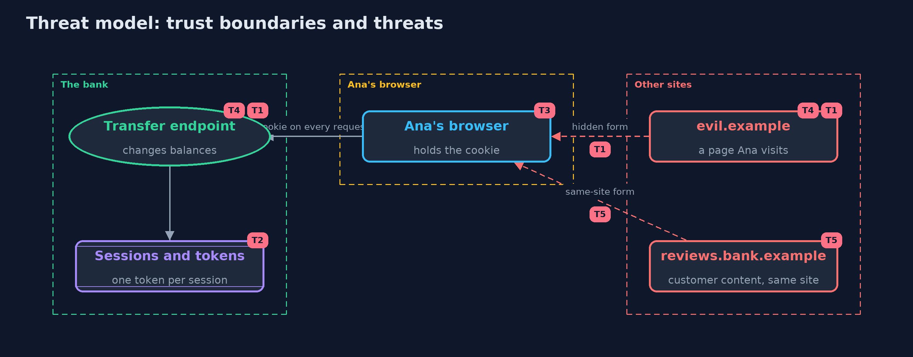

# Threat Model — Cross-Site Request Forgery (CSRF) and Its Defences

A threat model answers four questions: what are we protecting, who or what could harm it, how, and what do we do about it. This one covers this project's own demo system, not a production deployment. Domain: an online bank.

## Scope

An online bank's cookie-authenticated transfer form and API, used from a browser that also visits other sites. It covers pages on other sites and on same-site subdomains that make the browser send requests.
It does not cover cross-site scripting on the bank's own pages, stolen sessions, or the bank's server being compromised.

## What we protect (assets)

- Customers' balances and the transfer function.
- Session cookies, and the per-session form tokens.
- API tokens.

## Who and what acts on the system

- Ana, a logged-in customer.
- The owner of a page on another site that Ana visits.
- A customer who posts content on reviews.bank.example, a subdomain of the same site.

## Trust boundaries

A trust boundary is a line that data or a request crosses between parts that trust each other differently. Threats cluster where those lines are.

- Other sites to Ana's browser: they can make it send requests, not read the answers.
- Ana's browser to the bank: the cookie is attached to every request that goes there.

Each dashed box is a trust boundary. A rose tag such as T1 shows where the threat of that number, in the table below, applies.

## Threats, using STRIDE

STRIDE is a checklist of six kinds of threat: **Spoofing** (S), **Tampering** (T), **Repudiation** (R), **Information disclosure** (I), **Denial of service** (D), **Elevation of privilege** (E).

| Id | Kind | Threat | Where it shows up | Control in this project | What is left |
| --- | --- | --- | --- | --- | --- |
| T1 | Spoofing | A page on another site makes Ana's browser send a transfer with her cookie | `Bank.transfer` | A per-session form token, SameSite cookies, and Sec-Fetch-Site or Origin checks | A bank page with cross-site scripting can read the token and defeat all of these |
| T2 | Tampering | A token from another session, or a guessed token, is accepted | `Bank.transfer` token check | Tokens are random, tied to one session, and compared in constant time | A token leaked in a URL or a log can be replayed until the session ends |
| T3 | Elevation of privilege | An older browser ignores SameSite and sends the cookie on cross-site requests | `Browser` (legacy) | Tokens and Origin checks do not depend on the browser enforcing SameSite | Without the token, an old browser with no Origin header is unprotected |
| T4 | Tampering | A link moves money because the bank changes state on GET | `Bank.transfer` with GET | Transfers need POST; GET is refused with 405 | Any other endpoint that changes state on GET reopens the hole |
| T5 | Spoofing | A page on a same-site subdomain sends a request that SameSite allows | `Site.sameSite`, `Browser` | Tokens and a same-origin Sec-Fetch-Site rule refuse it | User content on subdomains of the bank's site should be avoided or isolated on another site |

## Assumptions

- The bank's pages have no cross-site scripting, which would let a script read the token.
- The browser enforces the same-origin policy and, when modern, SameSite and Fetch Metadata.
- In the demo, sites are logical names on one local server, and passwords are demo values.

## Out of scope

- Cross-site scripting: the cross-site-scripting project.
- Session theft and fixation: the session-management project.
- Login CSRF and clickjacking, which need their own controls.

## How the tests check this

- `BankTest` checks tokens, Fetch Metadata and Origin decisions, GET refusals, transfer validation and the API, with hand-made requests.
- `BrowserTest` checks the browser model's SameSite rules, legacy behaviour, headers and tokens against the real local server.
- `SiteTest` checks origins, sites and Sec-Fetch-Site values.
- `DemoRunsTest` compares the whole demo with the golden output.

## Where this model goes next

The next project, server-side-request-forgery, turns the direction around: instead of another site making the browser send requests, a customer makes the server send them.
