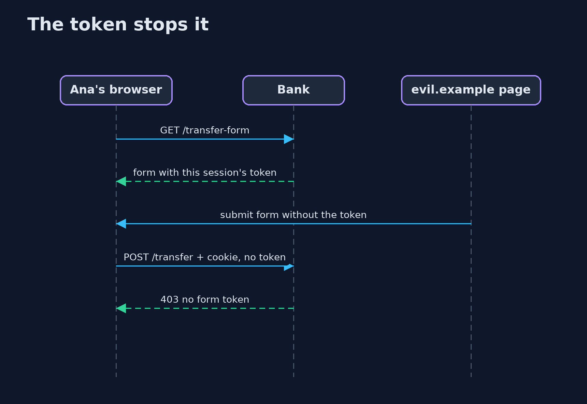
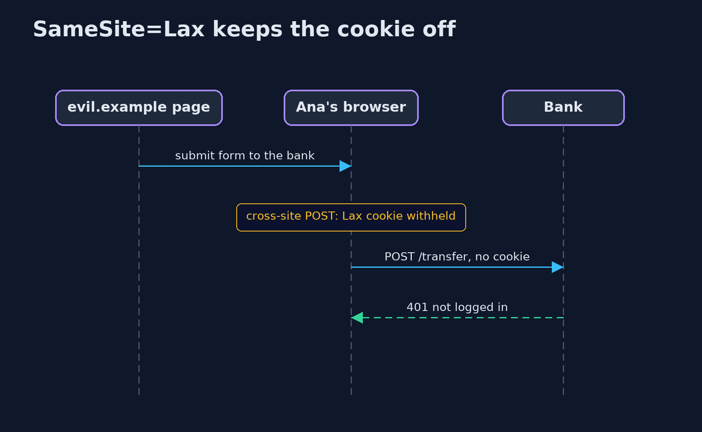

# Cross-Site Request Forgery (CSRF) and Its Defences — UML Sequence Diagrams

## 1. The token stops it

The other site can send the cookie, but cannot read the token from the bank's page.

## 2. SameSite=Lax keeps the cookie off

A cross-site POST arrives with no cookie, so there is no session to act for.

