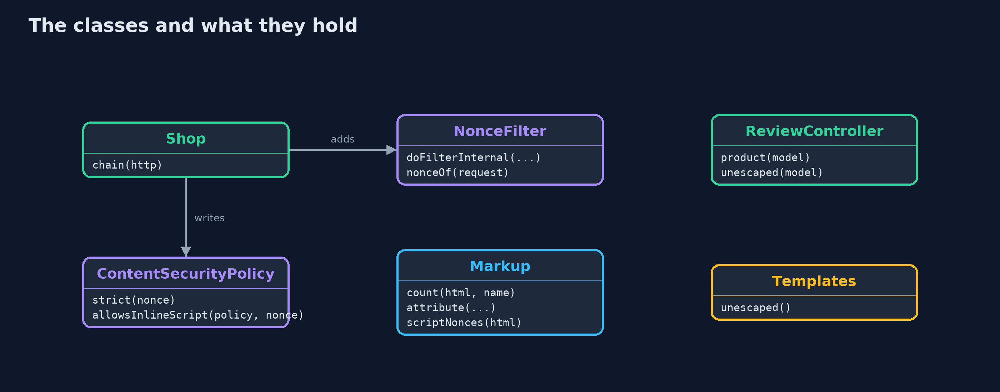
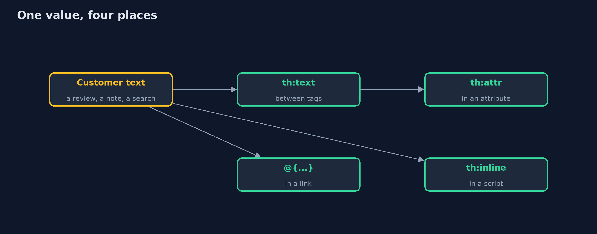
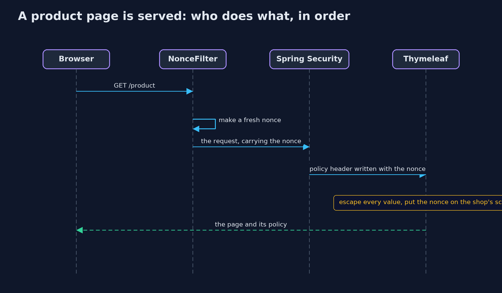

# Cross-Site Scripting with Spring Boot: Thymeleaf Escaping and a Nonce CSP

```
src/main/java/com/jk/explore/security/xssspring/
├── ContentSecurityPolicy.java  A strict Content-Security-Policy with a fresh nonce for every response, and an evaluator that answers what a browser would: may this inline script run?
├── Encode.java                 Reads an HTML-escaped value back as a browser would, so a test can check that a value survived the page whole
├── Markup.java                 A small model of how a browser would read a page: which elements it contains, and what an attribute's value is
├── NonceFilter.java            Gives every request a fresh nonce, before Spring Security writes its headers
├── ReviewController.java       The product page, written twice: the way Thymeleaf writes it by default, and with th:utext, the one switch that turns escaping off
├── Shop.java                   The store: Thymeleaf pages, and Spring Security writing a strict Content-Security-Policy with this request's nonce
├── Templates.java              The store's templates, read from the class path, so a test can list every place that turns escaping off
├── Wire.java                   Fetches a page from a running store over the loopback interface with the JDK's HTTP client
└── XssSpringDemo.java          Runs the online store story in five numbered acts against a real Spring Boot server on the loopback interface
```

**Thymeleaf escapes every value written with th:text, in the right way for an attribute, a link or a script; th:utext switches that off, and Spring Security can send a strict policy with a fresh nonce for every page once a small filter supplies the nonce.**

The plain version of this lesson wrote an encoder for each place a value can go. Real applications let a **template engine** do it. **Thymeleaf**, the engine that Spring Boot
uses for server-rendered pages, escapes every value written with `th:text`, and it escapes differently for an attribute, a link built with `@{...}` and a value inside a script
with `th:inline="javascript"`. The danger is the one switch that turns escaping off: **`th:utext`**, "unescaped text", which writes a value as markup.

The second line of defence is a strict **Content-Security-Policy** with a fresh **nonce** for every page. Spring Security writes security headers, but its policy is a fixed string, so
the store adds one small filter that makes a nonce for each request, gives it to the header and to the template, and puts it on the page's own script. It maps to **Injection (A05)** in the
OWASP Top 10 (2025), **CWE-79**, and the OWASP ASVS chapter on encoding and sanitization.

## The idea in everyday terms

Think of a shop that prints customers' reviews on its notice board through a printer that always prints in plain letters. Whatever a customer writes, it comes out as words. The
printer has one switch marked "print as the shop's own sign", and anyone who flips it for a customer's note lets that note pass as the shop. The policy is the board's rule that
only notices with today's stamp count.

## The scenario

An online store shows product reviews with Thymeleaf. The demo writes Ana's review with th:text and with th:utext, writes Ben's fit note, a search link and a value inside a script,
checks the page's policy and nonce on two requests, and reads the session cookie's flags.

## Run

```bash
./gradlew run
```

The demo tells the story in 5 acts, each printing exact numbers that the tests check:

| Act | What it shows |
| --- | --- |
| 1. Thymeleaf escapes by default | Ana's review, the text <b>Great boots</b>, written with th:text comes out as &lt;b&gt;Great boots&lt;/b&gt;: no bold element on the page, and nothing had to be remembered. |
| 2. th:utext, the one switch that turns escaping off | The same review written with th:utext becomes a bold element the shop never wrote; one of the two templates uses th:utext, and a test fails if another appears. |
| 3. The other places a value can go | Ben's fit note reads back whole from an attribute, the search text stays one link parameter, and a value inside a script is written as one JavaScript string. |
| 4. A strict Content-Security-Policy from Spring Security, with a fresh nonce for every page | Every page has a policy whose nonce matches the page's own script, the next page has a different nonce, and a script without the nonce may not run. |
| 5. The bill | The session cookie is HttpOnly and SameSite=Strict; escaping protects only what goes through it; some places need design rather than escaping; the nonce needs a small filter. |

## Test

```bash
./gradlew test
```

13 tests in `ContentSecurityPolicyTest`, `DemoRunsTest`, `ShopPagesTest`, `TemplatesTest`. The real server is tested for escaping in each place, the trap template, a fresh nonce on every page that matches the page's script, and the cookie flags. A guard test fails if any template other than the trap uses th:utext, or if an inline script lacks the nonce. Nonces and ports change on every run, so the demo prints only facts about them and the golden output is the same every time.

## What the simulation got right, and what it left out

The store is a real Spring Boot server on a free port of the loopback interface. Nonces are random, so the demo prints only facts about them: that the header and the script agree, that
the next page has a different one, and whether a script is allowed. The policy is evaluated in Java with the rules browsers apply, so no browser is needed. The problem is shown with a
harmless bold tag; the project contains no attack payloads.

## Technologies and versions

Every version below is pinned in the project's build files and was the latest stable release when the project was built.

| Technology | Version | Used for |
| --- | --- | --- |
| Java | 25 | the language and runtime; a Gradle toolchain finds or downloads the JDK |
| Gradle | 9.8.1 (wrapper) | build and run; nothing to install, the wrapper downloads it |
| org.springframework.boot:spring-boot-starter-webmvc | 4.1.1, set by spring-boot-dependencies | library the code uses |
| org.springframework.boot:spring-boot-starter-security | 4.1.1, set by spring-boot-dependencies | library the code uses |
| org.springframework.boot:spring-boot-starter-thymeleaf | 4.1.1, set by spring-boot-dependencies | library the code uses |
| org.springframework.boot:spring-boot-starter-webmvc-test | 4.1.1, set by spring-boot-dependencies | library the code uses (tests only) |
| org.springframework.boot:spring-boot-starter-security-test | 4.1.1, set by spring-boot-dependencies | library the code uses (tests only) |
| org.junit.jupiter:junit-jupiter | 6.1.3, set by junit-bom | JUnit 5: the tests (tests only) |
| org.junit.platform:junit-platform-launcher | 6.1.3, set by junit-bom | JUnit platform launcher, which Gradle needs to run the tests (tests only) |
| Thymeleaf | 3.1 (from the Spring Boot BOM) | the template engine that writes the store's pages and escapes values by default |
| videokit | repository tool (`tools/videokit`) | the narrated video and animation: Piper `en_US-amy-medium`, speed 0.8, longer pauses (the amy-slow voice) |

## Learning Material

| Document | What it is for |
| --- | --- |
| [Dependencies](docs/dependencies.md) | what the framework and infrastructure are, and why they are here |
| [Problem statement](docs/problem-statement.md) | the situation and what the project must show |
| [Prerequisites](docs/prerequisites.md) | what you need to know first |
| [Cross-Site Scripting with Spring Boot: Thymeleaf Escaping and a Nonce CSP, explained](docs/cross-site-scripting-with-spring-boot-explained.md) | the acts in prose |
| [Session guide](docs/session.md) | a one-hour lesson with exercises |
| [Animated walkthrough](docs/animation.html) | the acts step by step, narrated |
| [Threat model](docs/threat-model.md) | what is protected, who could harm it, and how, using STRIDE |
| [Spec](docs/spec.md) | what this project must be true of |
| [Expected output](docs/expected-output.txt) | the golden demo output every test and every port checks against |

### The idea in one picture

The filter makes the nonce, Spring Security writes it into the policy, and Thymeleaf writes it on the shop's script while escaping every value.


### Where each piece sits

Shop wires the filter and the header; the controller fills the model; the helpers read the page as a browser would.



### How the data moves

How the template writes a value decides how it is escaped.



### Who calls whom, in order




### Video

`video/cross-site-scripting-with-spring-boot-explained.mp4` (with `.m4a` audio and `.srt` subtitles) is built by `video/build_video.sh`. Rendered media is not committed.

## What it costs

- **Escaping protects only what goes through it.** th:utext, HTML assembled in Java code and values passed to a client-side framework's own raw-HTML feature all skip it.
- **Some places cannot be made safe by escaping.** An event handler attribute, a style, or a URL that starts with a scheme the customer chose need a different design: keep customer text out of them.
- **The nonce needs code.** Spring Security writes a fixed policy; a per-request nonce needs a filter and a template variable, and every inline script must carry it.
- **The policy needs care.** Every new script source must be added on purpose, and a policy with 'unsafe-inline' and no nonce protects nothing.

## When this is too much

For any page that shows text a customer wrote, escaping by default is the minimum and costs nothing. The nonce-based policy is worth it for any page behind a login. A test that
lists every use of th:utext costs a few lines and stops the trap from spreading.

## Where you have already met this

- `th:text` and `th:utext` in Thymeleaf templates.
- `Content-Security-Policy` response headers with `'nonce-...'` in browser developer tools.
- `server.servlet.session.cookie.http-only` and `same-site` in Spring Boot settings.
- Code reviews that ask "why is this th:utext?"

## Where this sits

This project follows [cross-site-scripting](../cross-site-scripting) in [web-security](..), the first module of the intermediate track. It uses the Spring Boot setup of
[http-basics-and-headers-with-spring-boot](../../../beginner/networking/http-basics-and-headers-with-spring-boot).
