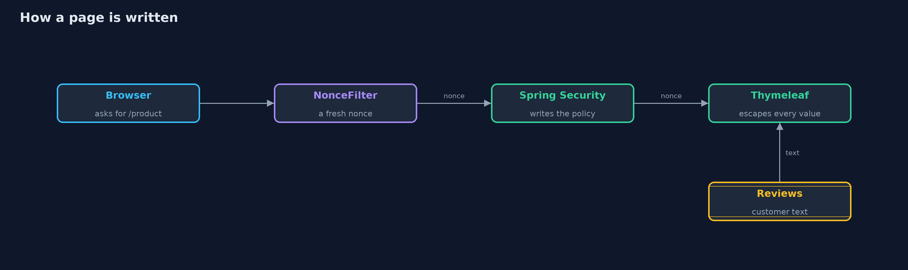

# Cross-Site Scripting with Spring Boot: Thymeleaf Escaping and a Nonce CSP — Architecture Diagram

The filter makes the nonce, Spring Security writes it into the policy, and Thymeleaf writes it on the shop's script while escaping every value.

