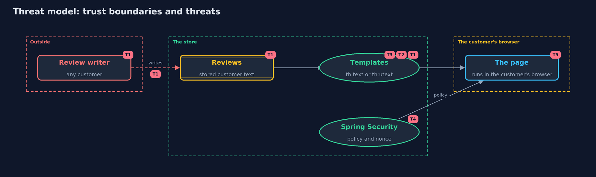

# Threat Model — Cross-Site Scripting with Spring Boot: Thymeleaf Escaping and a Nonce CSP

A threat model answers four questions: what are we protecting, who or what could harm it, how, and what do we do about it. This one covers this project's own demo system, not a production deployment. Domain: an online store.

## Scope

An online store's product pages rendered by Thymeleaf in Spring Boot, showing text written by customers, and the policy and cookies sent with them. It covers a customer who writes a
review or note, and the browsers of other customers who read it. It does not cover client-side frameworks, rich-text sanitizing or other injection types.

## What we protect (assets)

- The customer's session and what it can do.
- The content of the page as the shop meant it.
- The shop's own scripts and the nonce that lets them run.

## Who and what acts on the system

- A customer who writes reviews, notes and searches.
- Other customers whose browsers render the page.
- Developers who write templates.

## Trust boundaries

A trust boundary is a line that data or a request crosses between parts that trust each other differently. Threats cluster where those lines are.

- Customer text to the template: every value crosses it.
- The store to the browser: the page and its policy cross it.

Each dashed box is a trust boundary. A rose tag such as T1 shows where the threat of that number, in the table below, applies.

## Threats, using STRIDE

STRIDE is a checklist of six kinds of threat: **Spoofing** (S), **Tampering** (T), **Repudiation** (R), **Information disclosure** (I), **Denial of service** (D), **Elevation of privilege** (E).

| Id | Kind | Threat | Where it shows up | Control in this project | What is left |
| --- | --- | --- | --- | --- | --- |
| T1 | Tampering | Customer text is written as markup and changes the page | `templates/product-unescaped.html` (th:utext) | th:text everywhere, and a guard test that lists every th:utext | HTML built in Java code bypasses the template and needs the same review |
| T2 | Tampering | A value breaks out of an attribute or a link | `templates/product.html` | th:attr and @{...} escape for their place | Event handlers, styles and scheme-controlled URLs cannot be made safe by escaping |
| T3 | Elevation of privilege | A value inside a script ends the string and becomes code | the inline script | th:inline="javascript" writes one escaped string | Values in other script positions, such as building code from text, are never safe |
| T4 | Elevation of privilege | A script that slipped onto the page runs as the shop's own | `Shop`, `NonceFilter` | A strict policy with a fresh nonce for every page | A nonce reused across pages, or 'unsafe-inline' without a nonce, removes the protection |
| T5 | Information disclosure | A script reads the session cookie | the session cookie | HttpOnly and SameSite=Strict | A script can still act within the page without reading the cookie, so the first line of defence matters most |

## Assumptions

- Browsers enforce Content-Security-Policy.
- Templates are reviewed, and the guard test runs in the build.
- In the demo, reviews are fixed demo values and the problem is shown with a bold tag only.

## Out of scope

- Client-side rendering frameworks.
- Rich text that must keep formatting, which needs a sanitizer.
- SQL and other injection types.

## How the tests check this

- `ShopPagesTest` checks escaping in each place, the trap page, fresh matching nonces and the cookie flags on the real server.
- `TemplatesTest` fails if a template other than the trap uses th:utext, or if a script lacks the nonce.
- `ContentSecurityPolicyTest` checks the policy evaluator against browser rules.
- `DemoRunsTest` compares the whole demo with the golden output.

## Where this model goes next

The next project, cross-site-request-forgery, looks at a different way another site can act as the customer: by sending requests the customer did not mean.
