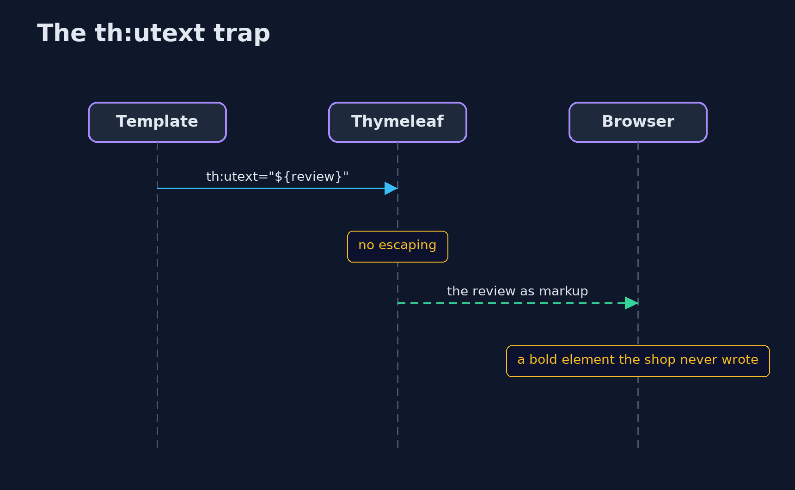
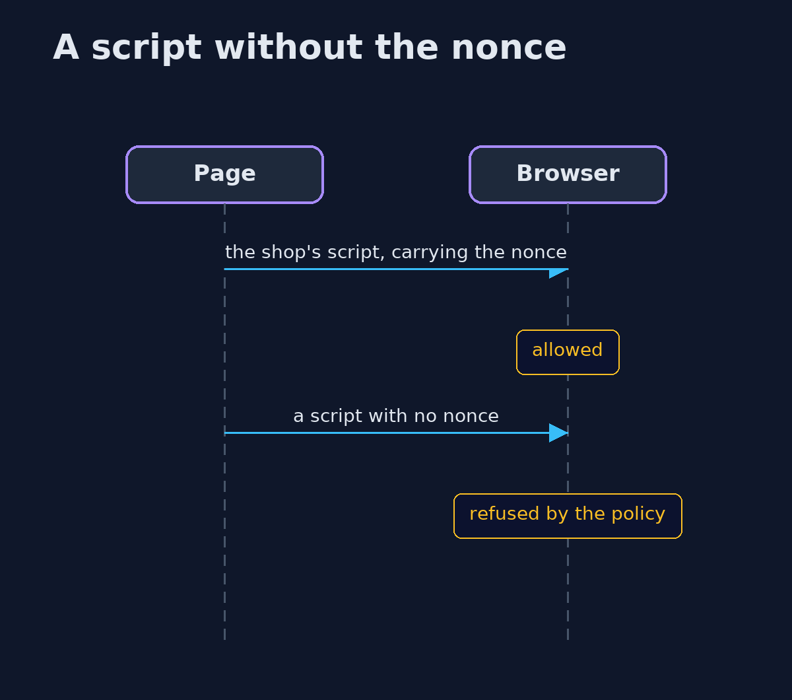

# Cross-Site Scripting with Spring Boot: Thymeleaf Escaping and a Nonce CSP — UML Sequence Diagrams

## 1. The th:utext trap

Unescaped text is written as markup.

## 2. A script without the nonce

The browser checks every inline script against the policy.

