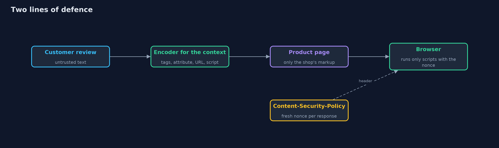
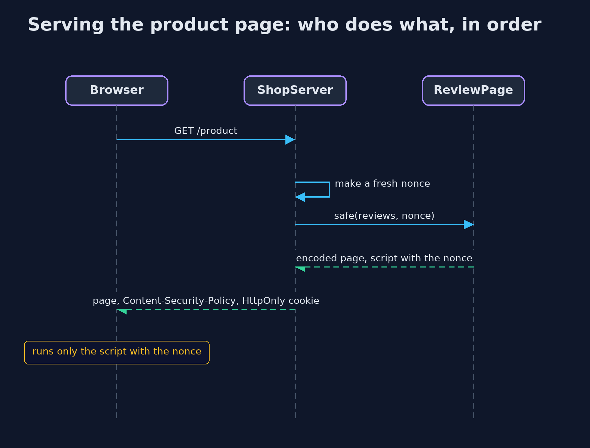

# Cross-Site Scripting: Output Encoding and CSP

```
src/main/java/com/jk/explore/security/xss/
├── ContentSecurityPolicy.java  A strict Content-Security-Policy with a fresh nonce for every response, and an evaluator that answers what a browser would: may this inline script run?
├── Encode.java                 Contextual output encoding: the same text needs a different encoding in each place it is written
├── Markup.java                 A small model of how a browser would read a page: which elements it contains, and what an attribute's value is
├── NaiveFilter.java            The tempting fix that is not one: cleaning input on the way in by deleting characters
├── Review.java                 A customer's review of a product: the author's name, a short note about fit, and the text
├── ReviewPage.java             The product page of the online store, with its reviews
├── ShopServer.java             The product page served for real on the loopback interface, with a fresh nonce, a strict policy and an HttpOnly session cookie per response
└── XssDemo.java                Runs the online store story in five numbered acts and prints exact, repeatable results
```

**Cross-site scripting happens when text from a user is read by the browser as part of the page; the fix is to encode every value for the place it is written, with a strict, nonce-based Content-Security-Policy as the second line of defence.**

**Cross-site scripting** (XSS) is what happens when text that came from a user is read by the browser as part of the page. A product review is meant to be shown as
words; if it is pasted into the HTML as it is, any markup in it becomes the shop's markup, and any script in it runs with the shop's authority, in the signed-in
customer's browser. It sits under **Injection (A05)** in the OWASP Top 10 (2025) and is **CWE-79**. The OWASP ASVS covers it in its chapter on encoding and sanitization.

The fix is not to clean the input. It is **contextual output encoding**: every value is encoded for the exact place it is written, which is different between tags, inside an
attribute, in a URL and inside a script. A strict **Content-Security-Policy** with a fresh random **nonce** for every response is the second line of defence: the browser runs only
the scripts that carry that response's nonce. The demo shows the problem once, then builds each defence and checks it.

## The idea in everyday terms

Think of a shop's notice board. Customers pin up notes, and the shop pins up its own signs. If a customer's note looks exactly like a shop sign, other customers will follow it.
Encoding is putting every customer note behind glass with a "customer note" label: it can say anything, and nobody will mistake it for the shop. The policy is the staff knowing
the shop's own stamp, so an unstamped sign is ignored even if it got onto the board.

## The scenario

An online store shows product reviews. Each review has an author, a short note about fit, and the text, and all three are untrusted. The demo writes them into the product
page unsafely, then encoded for each context, compares encoding with an input filter, and serves the page from a real local server with a strict policy and an HttpOnly cookie.

## Run

```bash
./gradlew run
```

The demo tells the story in 5 acts, each printing exact numbers that the tests check:

| Act | What it shows |
| --- | --- |
| 1. A review that changes the page | Ana's review, pasted into the page as it is, adds a bold element the shop never wrote: the review became part of the page. |
| 2. Encoding for the place the text goes | One encoder per context: between tags, in a quoted attribute, in a URL parameter and in a script string; the encoded page has no bold element and Ben's fit note reads back whole. |
| 3. Why filtering input is not the fix | A filter that deletes < and > changes an honest review and still lets a quote end Ben's attribute early; encoding shows the text exactly. |
| 4. A strict Content-Security-Policy, with a fresh nonce for every page | A real page carries a policy naming a 24-character random nonce that changes every response; the shop's script may run, a script without the nonce may not, and the session cookie is HttpOnly. |
| 5. The bill | Four kinds of output context each need their own encoder, the policy needs care, the nonce must be new every time, and a template engine that encodes by default is the practical answer. |

## Test

```bash
./gradlew test
```

17 tests in `ContentSecurityPolicyTest`, `DemoRunsTest`, `EncodeTest`, `PageAndFilterTest`. The encoders are tested per context, including round trips and a different locale. The policy evaluator is tested against the browser rules it models, including 'unsafe-inline' being ignored when a nonce is present. The real server is tested for a fresh nonce and an HttpOnly cookie on every response. Nonces are random, so the demo prints only facts about them and the golden output is the same on every run.

## What the simulation got right, and what it left out

The pages are built and read in memory by a small model of how a browser parses elements and attributes, and the one real page is served on the loopback interface of the machine
running the demo. Nonces are random, so the demo prints only facts about them: their length, that they change, and whether a script is allowed. The policy is evaluated in Java with
the rules browsers apply, so no browser is needed. The problem is shown with a harmless bold tag; the project contains no attack payloads.

## Technologies and versions

Every version below is pinned in the project's build files and was the latest stable release when the project was built.

| Technology | Version | Used for |
| --- | --- | --- |
| Java | 25 | the language and runtime; a Gradle toolchain finds or downloads the JDK |
| Gradle | 9.8.1 (wrapper) | build and run; nothing to install, the wrapper downloads it |
| org.junit.jupiter:junit-jupiter | 6.1.3, set by junit-bom | JUnit 5: the tests (tests only) |
| org.junit.platform:junit-platform-launcher | 6.1.3, set by junit-bom | JUnit platform launcher, which Gradle needs to run the tests (tests only) |
| videokit | repository tool (`tools/videokit`) | the narrated video and animation: Piper `en_US-amy-medium`, speed 0.8, longer pauses (the amy-slow voice) |

## Learning Material

| Document | What it is for |
| --- | --- |
| [Problem statement](docs/problem-statement.md) | the situation and what the project must show |
| [Prerequisites](docs/prerequisites.md) | what you need to know first |
| [Cross-Site Scripting: Output Encoding and CSP, explained](docs/cross-site-scripting-explained.md) | the acts in prose |
| [Session guide](docs/session.md) | a one-hour lesson with exercises |
| [Animated walkthrough](docs/animation.html) | the acts step by step, narrated |
| [Threat model](docs/threat-model.md) | what is protected, who could harm it, and how, using STRIDE |
| [Spec](docs/spec.md) | what this project must be true of |
| [Expected output](docs/expected-output.txt) | the golden demo output every test and every port checks against |

### The idea in one picture

Encoding keeps text as text; the policy stops any script that slips through anyway.



### Where each piece sits

ReviewPage uses Encode for every value; ShopServer adds the policy; Markup and the evaluator check the result.


### How the data moves

The same text needs a different encoding in each place it is written.


### Who calls whom, in order




### Video

`video/cross-site-scripting-explained.mp4` (with `.m4a` audio and `.srt` subtitles) is built by `video/build_video.sh`. Rendered media is not committed.

## What it costs

- **Every output context needs its encoder.** Between tags, inside an attribute, in a URL and in a script are four different encodings, and one forgotten place is enough.
- **A policy needs maintenance.** Every inline script must carry the nonce, and every new script source must be added on purpose; a policy loosened to `'unsafe-inline'` with no nonce protects nothing.
- **The nonce must be new for every response.** A cached or reused nonce gives an attacker the key.
- **Encoding by hand does not scale.** A template engine that escapes by default is the practical answer, with a reviewed escape hatch for the rare raw HTML; see the tools version.

## When this is too much

For a page that shows no user text, encoding has nothing to do, but a strict policy is still cheap insurance. For any page that shows text from users, partners or other systems,
both are the baseline. Rich text that must allow some HTML needs a dedicated, maintained sanitizer with an allow-list, which this project does not build.

## Where you have already met this

- `&lt;` and `&amp;` in a page's source, which are encoding at work.
- `Content-Security-Policy` headers in the browser's developer tools.
- `HttpOnly` on session cookies.
- Bug-bounty reports and advisories that say "stored XSS" or "reflected XSS".

## Where this sits

This project is in [web-security](..), the first module of the intermediate track. It builds on [http-basics-and-headers](../../../beginner/networking/http-basics-and-headers), which audited the
Content-Security-Policy header from outside; here the policy is generated and checked from inside the application.
