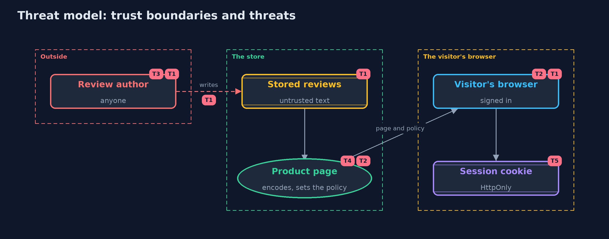

# Threat Model — Cross-Site Scripting: Output Encoding and CSP

A threat model answers four questions: what are we protecting, who or what could harm it, how, and what do we do about it. This one covers this project's own demo system, not a production deployment. Domain: an online store.

## Scope

How an online store's product page shows reviews written by customers: storing them, writing them into the page in four contexts, the policy that limits scripts, and the session cookie.
It covers anyone who can write a review, and signed-in visitors who read it. It does not cover rich-text sanitizing, front-end frameworks, or other injection kinds.

## What we protect (assets)

- Visitors' sessions and what they can do while signed in.
- The integrity of the product page.
- The trust customers place in what the page shows.

## Who and what acts on the system

- Customers who write reviews, any of whom may be hostile.
- Signed-in visitors who read the page.
- The store's developers, who add new places that show user text.

## Trust boundaries

A trust boundary is a line that data or a request crosses between parts that trust each other differently. Threats cluster where those lines are.

- Customer to stored review: anything can be written.
- Stored review to page: the point where text must be encoded for its context.
- Server to browser: the policy and cookie flags travel with the response.

Each dashed box is a trust boundary. A rose tag such as T1 shows where the threat of that number, in the table below, applies.

## Threats, using STRIDE

STRIDE is a checklist of six kinds of threat: **Spoofing** (S), **Tampering** (T), **Repudiation** (R), **Information disclosure** (I), **Denial of service** (D), **Elevation of privilege** (E).

| Id | Kind | Threat | Where it shows up | Control in this project | What is left |
| --- | --- | --- | --- | --- | --- |
| T1 | Tampering | A review's text is read as markup or script, changing the page or running in visitors' browsers | `ReviewPage.unsafe` | Contextual output encoding for every value | A place added later without its encoder; caught by the policy and by tests that look for unencoded output |
| T2 | Elevation of privilege | A script that slips through runs with the page's authority | the browser | A strict policy that allows only scripts carrying this response's nonce | Scripts the shop itself loads are trusted, so their sources must be controlled |
| T3 | Tampering | Input filtering changes honest reviews and misses contexts it was not designed for | `NaiveFilter` | Store text as written and encode on output | None, once the filter is removed |
| T4 | Information disclosure | A reused or predictable nonce lets injected content carry it | `ContentSecurityPolicy.newNonce` | 128 random bits from a secure source, new for every response | A shared cache that stores a page with its nonce, so such pages must not be cached publicly |
| T5 | Information disclosure | A script reads the session cookie and sends it away | the session cookie | HttpOnly, Secure and SameSite on the session cookie | A script can still act as the visitor while the page is open, which is why encoding comes first |

## Assumptions

- Every place that writes user text uses the encoder for its context.
- The nonce comes from a secure random source and is new for every response, and pages carrying it are not cached and shared.
- In the demo, the problem is shown with a harmless bold tag and the policy is evaluated in Java.

## Out of scope

- Rich text that must allow some HTML, which needs a maintained sanitizer.
- Front-end code that writes HTML in the browser.
- SQL and other injection: other projects in this module.

## How the tests check this

- `EncodeTest` checks each encoder, round trips, and that no value can end its context, in any locale.
- `PageAndFilterTest` checks the unsafe and safe pages and the filter's two failures.
- `ContentSecurityPolicyTest` checks the evaluator's rules, the nonces, and the real server's policy and cookie.
- `DemoRunsTest` compares the whole demo with the golden output.

## Where this model goes next

The tools version shows the same defences in Spring Boot, with a template engine that encodes by default and nonces from Spring Security. The next project in this module is cross-site-request-forgery.
