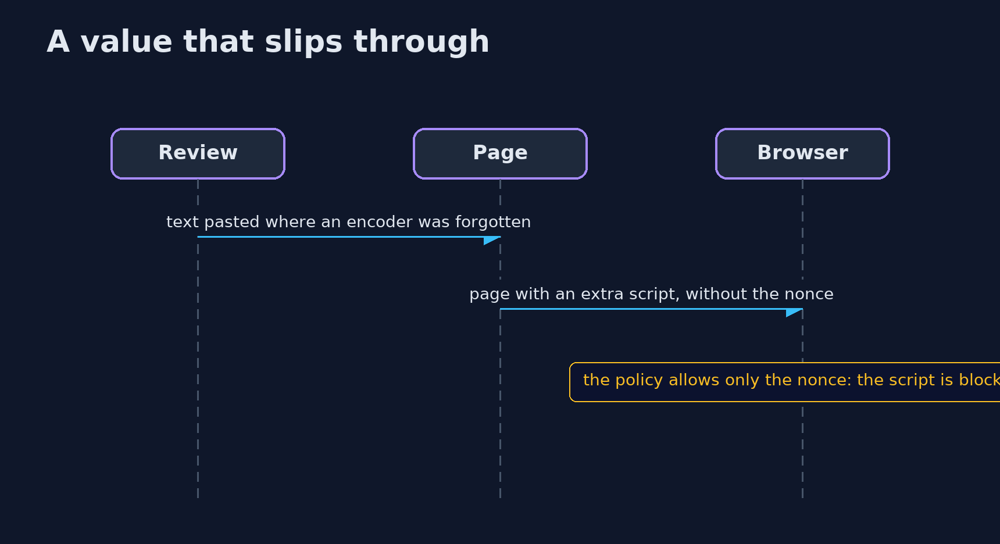
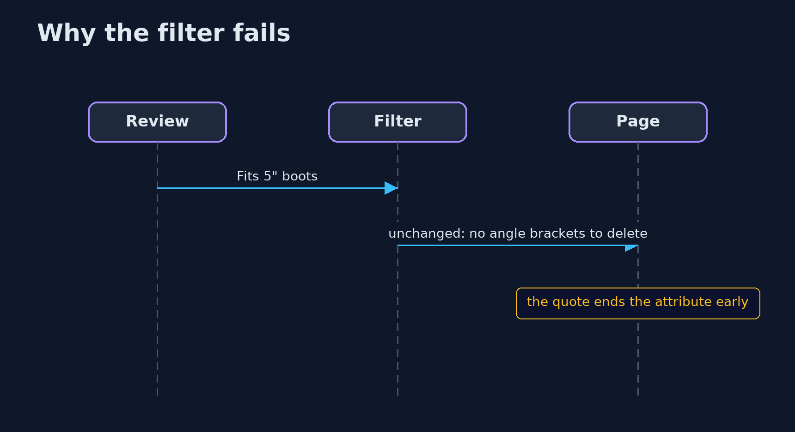

# Cross-Site Scripting: Output Encoding and CSP — UML Sequence Diagrams

## 1. A value that slips through

Even if one place was not encoded, a script without the nonce does not run.

## 2. Why the filter fails

The filter does not know where the text will be written.

