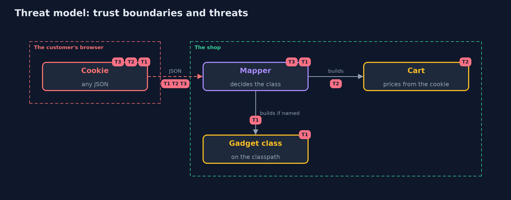

# Threat Model — Insecure Deserialization with Jackson

A threat model answers four questions: what are we protecting, who or what could harm it, how, and what do we do about it. This one covers this project's own demo system, not a production deployment. Domain: an online store's cart cookie.

## Scope

A JSON cart cookie read by Jackson 3 in an online store. It covers class selection by the data, prices in the data, and the size and depth of the data. It does not cover signing the cookie or the other uses of Jackson in the application.

## What we protect (assets)

- The shop's files and processes.
- The correctness of order totals.
- The server's memory and stack.

## Who and what acts on the system

- The customer, who controls the cookie.
- A developer who adds polymorphic fields or default typing.

## Trust boundaries

A trust boundary is a line that data or a request crosses between parts that trust each other differently. Threats cluster where those lines are.

- The cookie to the mapper: all of it is untrusted, including type ids and prices.

Each dashed box is a trust boundary. A rose tag such as T1 shows where the threat of that number, in the table below, applies.

## Threats, using STRIDE

STRIDE is a checklist of six kinds of threat: **Spoofing** (S), **Tampering** (T), **Repudiation** (R), **Information disclosure** (I), **Denial of service** (D), **Elevation of privilege** (E).

| Id | Kind | Threat | Where it shows up | Control in this project | What is left |
| --- | --- | --- | --- | --- | --- |
| T1 | Elevation of privilege | The data names a class and the mapper builds it | `Cart`, `Mappers.anyClassMayBeNamed` | Type ids by name from a list on the field, or a validator that lists classes | A future field with class-name typing |
| T2 | Tampering | A value such as a price is changed in the cookie | `Cart` | Data-only requests, priced by the shop from its own catalogue | Any other value the server trusts |
| T3 | Denial of service | Deeply nested or huge input exhausts memory or stack | `Mappers.strictRequest` | Stream limits for depth, text and number length | Many large requests together |

## Assumptions

- A class with a side effect in a setter or constructor is on the classpath.
- Jackson and its validator are current.

## Out of scope

- Real gadget chains in third-party libraries.
- Java's built-in serialization.

## How the tests check this

- `JacksonDeserializationTest` checks each configuration against the gadget, the forged price, the data-only request, the limits and bad input, with a marker file.
- `DemoRunsTest` compares the whole demo with the golden output.

## Where this model goes next

The next project in this module, path-traversal-and-file-upload, moves to file names that the customer supplies.
