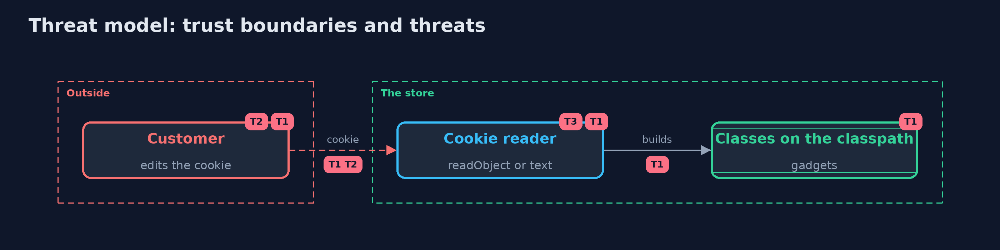

# Threat Model — Insecure Deserialization and Its Defences

A threat model answers four questions: what are we protecting, who or what could harm it, how, and what do we do about it. This one covers this project's own demo system, not a production deployment. Domain: an online store.

## Scope

An online store's shopping cart cookie and the code that reads it. It covers what the cookie can make the server build and what it can claim.
It does not cover stolen sessions, cross-site scripting that reads cookies, or other deserialization points such as message queues.

## What we protect (assets)

- The server's files and processes.
- The integrity of prices and carts.

## Who and what acts on the system

- A customer who edits the cookie.

## Trust boundaries

A trust boundary is a line that data or a request crosses between parts that trust each other differently. Threats cluster where those lines are.

- Customer to server: the cookie leaves the server and comes back changed.
- Cookie bytes to objects: the point where the bytes choose the classes.

Each dashed box is a trust boundary. A rose tag such as T1 shows where the threat of that number, in the table below, applies.

## Threats, using STRIDE

STRIDE is a checklist of six kinds of threat: **Spoofing** (S), **Tampering** (T), **Repudiation** (R), **Information disclosure** (I), **Denial of service** (D), **Elevation of privilege** (E).

| Id | Kind | Threat | Where it shows up | Control in this project | What is left |
| --- | --- | --- | --- | --- | --- |
| T1 | Elevation of privilege | The cookie names a class whose readObject runs code | `SerializedCartCookie.unfiltered` | An allow-list `ObjectInputFilter` set before reading, or no serialization at all | A class on the allow-list that is itself dangerous; keep the list to plain data classes |
| T2 | Tampering | The customer changes the price or quantity in the cookie | `Cart.Line` | Prices come from the server; the cookie is signed | A leaked signing key lets anyone sign |
| T3 | Denial of service | A deeply nested or huge object exhausts memory | `SerializedCartCookie.read` | Limits on depth, references, array size and bytes; a size limit on the signed cookie | Limits set too high |

## Assumptions

- At least one class with a dangerous `readObject` is on the classpath (here, `TempCleaner`).
- The signing key is secret and held only by the servers.

## Out of scope

- Jackson and JSON polymorphism: insecure-deserialization-with-jackson.
- Server-side session storage: session-management.

## How the tests check this

- `DeserializationTest` checks both readers with a gadget, a forged price, size limits, garbage and tampered signed cookies.
- `DemoRunsTest` compares the whole demo with the golden output.

## Where this model goes next

The next project, path-traversal-and-file-upload, moves to the names and contents of files that customers send.
