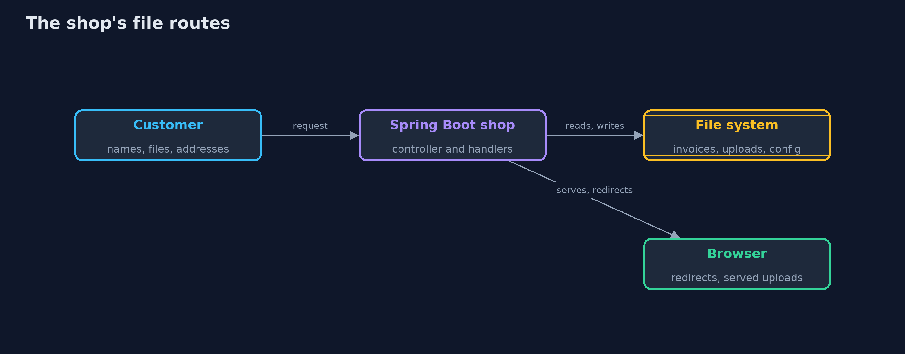
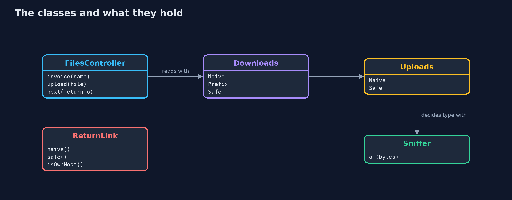
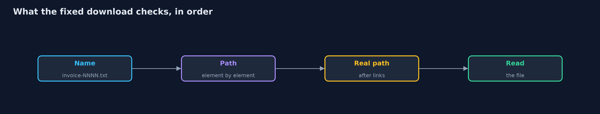
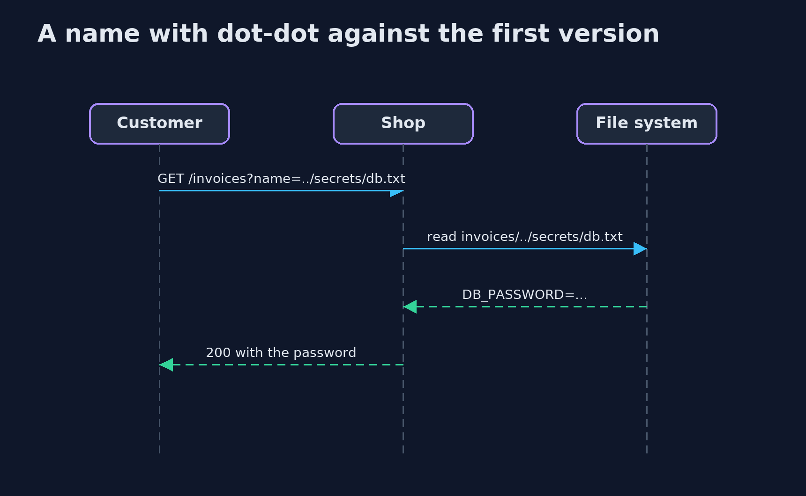

# Path Traversal and File Upload with Spring Boot

```
src/main/java/com/jk/explore/security/uploadspring/
├── Downloads.java        "Download invoice {name}": returns the text of the file
├── FilesController.java  The store's file routes: invoice downloads, photo uploads, the uploaded files, and the "return to" redirect
├── FilesSpringDemo.java  Runs the invoice download, photo upload and "return to" story in six numbered acts against real Spring Boot servers on loopback
├── Layout.java           The folders of the store's server, made in a temporary directory so the demo and the tests touch nothing else: <pre> invoices/ what customers may download invoices-private/ a sibling whose name starts the same way secrets/ the database settings config/ the application's settings webroot/ files the web server hands out as they are uploads-private/ where the fixed version keeps uploads, outside the web root </pre>
├── NaiveDownloads.java   The first version: the file is whatever the base folder plus the name says, {@code ..} included
├── NaiveUploads.java     The first version: the file is saved in the web root under the name the customer gave, whatever it contains
├── PrefixDownloads.java  The second version: it does check the resolved path, but compares <em>text</em>, so a sibling folder with the same beginning passes
├── Redirects.java        Where the customer is sent after an upload: the address in the "return to" parameter, judged or not
├── Refused.java          The request was refused
├── ReturnLink.java       The "return to" address after sign-in or upload: where the customer is sent next
├── SafeDownloads.java    The fixed version, in layers: the name must look like an invoice name, the path is resolved and compared as a <em>path</em> (element by element), and the real file, after symbolic links are followed, must still be inside the real folder
├── SafeUploads.java      The fixed version: size limit, the type decided from the bytes and not from the name, a name the <em>server</em> makes, storage outside the web root, and downloads that name the type, force a download and forbid the browser to guess
├── Served.java           What the web server sends back for a file: the type it claims, whether the browser must save instead of show, and the body
├── ShopApp.java          
├── Sniffer.java          Decides what a file is from its first bytes, the only part the customer cannot rename
├── StoreConfig.java      Which versions run is chosen by profile, so one controller serves all three
├── Uploads.java          "Upload a product photo": the customer sends a file name and bytes, and later fetches the photo
├── WebRoot.java          The web server's static files: whatever is in the folder is sent as it is, with a type chosen by the file name's extension
└── Wire.java             A tiny HTTP client for the demo: a plain GET, and a multipart upload with the file name exactly as given
```

**In a Spring Boot shop the customer's file name arrives untouched in a query parameter or in MultipartFile.getOriginalFilename, so a name with dot-dot leaves the folder, a text prefix check lets a sibling folder through, and an upload keeps the customer's name; Spring's static handler refuses dot-dot but follows a symbolic link, so the fix is a name pattern, a real-path check, server-made names, content checks, multipart limits and a return address that is only ever a path on the site.**

The plain [path-traversal-and-file-upload](../path-traversal-and-file-upload) project works on files directly. This one puts the same store behind **Spring Boot 4.1** and real HTTP, so the inputs arrive the way they do in production: a **query parameter**, a **multipart upload** and a **redirect parameter**, and the limits are Spring's own.

What it shows:
- **A file name in a query parameter** reaches the controller decoded once, exactly as typed, so `../secrets/db.txt` walks out of the invoice folder, and a check that compares *text* (`startsWith`) lets `invoices-private` through.
- **The fix is layered:** a name pattern, the path resolved and compared element by element, and the real path after symbolic links is still inside the folder.
- **Spring's static resource handler** refuses `..` and an encoded slash (400 or 404), which is good, but it **follows a symbolic link** inside the folder to a file outside it.
- **A multipart upload** gives the controller `getOriginalFilename()` as the client sent it, `../../config/app.properties` included. The naive shop keeps the name, serves a script inline, and overwrites the configuration. The fixed shop makes its own name, decides the type from the bytes, serves a download with `nosniff`, and Spring's `max-file-size` stops a large upload before the controller runs.
- **The "return to" address** becomes a redirect: a naive controller sends the customer anywhere; the fix accepts only a path on this site, and compares a host exactly when an absolute address is really needed.

**Maps to:** OWASP Top 10 (2025) A01 Broken Access Control · CWE-22 · CWE-434 · CWE-601 · OWASP ASVS 5.0 V5 (File Handling) · OWASP File Upload Cheat Sheet.

## The idea in everyday terms

A filing clerk who fetches "the folder the customer names". If the clerk walks wherever the written path says, "up two floors, then the safe" works. If the clerk only compares the start of the path, the sibling room with a similar name still works. If the clerk checks where they actually end up, a shortcut left in the corridor still needs to be checked too.

## The scenario

An online store lets customers download their invoices and staff upload product photos. The demo starts the real Spring Boot shop in three versions over a temporary folder layout, and sends it files, names and addresses over HTTP.

## Run

```bash
./gradlew run
```

The demo tells the story in 6 acts, each printing exact numbers that the tests check:

| Act | What it shows |
| --- | --- |
| 1. Downloading an invoice | An honest invoice name returns the invoice. |
| 2. A name with dot-dot leaves the folder | ../secrets/db.txt returns the database password and ../config/app.properties returns the settings. |
| 3. A text check on the path is not a path check | A startsWith on the path text refuses the secrets folder but lets the sibling folder invoices-private through. |
| 4. Names, paths and links, all checked | The fixed download checks the name, the path and the real path after links; Spring's static handler refuses dot-dot but follows a link out of the folder. |
| 5. Uploads | The naive shop keeps the customer's name, serves a script inline and overwrites the settings; the fixed shop makes its own name, checks the bytes, forces a download and limits the size. |
| 6. Where to send the customer next | A naive return address sends the customer anywhere; the fixed one accepts only a path on this site, and an absolute address only on an exact host match. |

## Test

```bash
./gradlew test
```

11 tests in `DemoRunsTest`, `FilesSpringTest`. Each test builds its own temporary layout, starts real servers over it and removes it.

## What the simulation got right, and what it left out

The shop is a real Spring Boot application; the file system is real, in a temporary folder that is removed at the end, and the symbolic link is a real link. Only the data is small. Ports and temporary paths are never printed.

## Technologies and versions

Every version below is pinned in the project's build files and was the latest stable release when the project was built.

| Technology | Version | Used for |
| --- | --- | --- |
| Java | 25 | the language and runtime; a Gradle toolchain finds or downloads the JDK |
| Gradle | 9.8.1 (wrapper) | build and run; nothing to install, the wrapper downloads it |
| org.springframework.boot:spring-boot-starter-webmvc | 4.1.1, set by spring-boot-dependencies | library the code uses |
| org.springframework.boot:spring-boot-starter-webmvc-test | 4.1.1, set by spring-boot-dependencies | library the code uses (tests only) |
| org.junit.jupiter:junit-jupiter | 6.1.3, set by junit-bom | JUnit 5: the tests (tests only) |
| org.junit.platform:junit-platform-launcher | 6.1.3, set by junit-bom | JUnit platform launcher, which Gradle needs to run the tests (tests only) |
| videokit | repository tool (`tools/videokit`) | the narrated video and animation: Piper `en_US-amy-medium`, speed 0.8, longer pauses (the amy-slow voice) |

## Learning Material

| Document | What it is for |
| --- | --- |
| [Problem statement](docs/problem-statement.md) | the situation and what the project must show |
| [Prerequisites](docs/prerequisites.md) | what you need to know first |
| [Path Traversal and File Upload with Spring Boot, explained](docs/path-traversal-and-file-upload-with-spring-boot-explained.md) | the acts in prose |
| [Session guide](docs/session.md) | a one-hour lesson with exercises |
| [Animated walkthrough](docs/animation.html) | the acts step by step, narrated |
| [Threat model](docs/threat-model.md) | what is protected, who could harm it, and how, using STRIDE |
| [Spec](docs/spec.md) | what this project must be true of |
| [Expected output](docs/expected-output.txt) | the golden demo output every test and every port checks against |

### The idea in one picture

The customer's words reach the file system and the browser through four routes.



### Where each piece sits

Three versions of each of downloads and uploads, chosen by profile.



### How the data moves

Each check closes a hole that the one before leaves open.



### Who calls whom, in order




### Video

`video/path-traversal-and-file-upload-with-spring-boot-explained.mp4` (with `.m4a` audio and `.srt` subtitles) is built by `video/build_video.sh`. Rendered media is not committed.

## What it costs

- **Name patterns break old names,** so know every invoice name the shop has ever made.
- **Real-path checks cost a file system call** on every download.
- **Content sniffing knows a few formats,** and each new format needs code.
- **Server-made names lose the original name,** which the shop must store separately if it matters.
- **Multipart limits protect the server, not the content,** and need the code check as a second layer.

## When this is too much

Where the files are few and fixed, serve them from object storage with signed addresses and let the shop never open a path. Where they are many, store them under server-made ids and keep names in the database.

## Where you have already met this

- `@RequestParam String file` passed to `Path.resolve`.
- `MultipartFile.getOriginalFilename()` used as a file name.
- `spring.servlet.multipart.max-file-size` in `application.properties`.
- `response.sendRedirect(request.getParameter("next"))` after a login.

## Where this sits

This is the tools version of [path-traversal-and-file-upload](../path-traversal-and-file-upload), in the [web-security](..) module. It keeps the same files, names and numbers, and adds what Spring and Tomcat do on the way.
